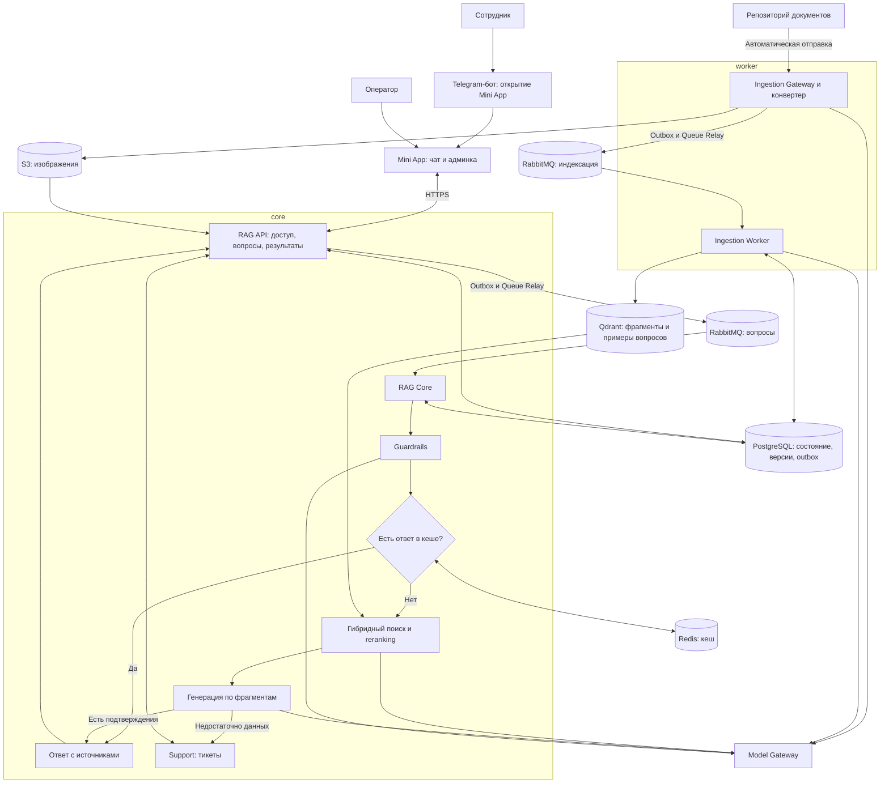

# docs-bots — корпоративный RAG-помощник команды 4-pm

**Хакатонный MVP: ответы по внутренней документации в Telegram Mini App с источниками и передачей сложных вопросов оператору.**

Сотруднику не нужно искать нужный раздел в нескольких инструкциях: он задаёт вопрос в чате, а система находит подходящие фрагменты документов и формирует ответ со ссылками. Если подтверждений недостаточно, вопрос передаётся в поддержку вместе с историей обращения.

## Какую задачу решаем

Внутренние регламенты и инструкции распределены по документам, а повторяющиеся вопросы попадают в поддержку. Помощник объединяет поиск по документации и обращение к оператору в одном интерфейсе. Цель — сократить время поиска ответа и нагрузку на поддержку; фактический эффект нужно измерять на вопросах сотрудников.

## Что входит в решение

| Возможность | Как это устроено |
| --- | --- |
| Чат в Telegram Mini App | Сотрудник открывает приложение из бота и задаёт текстовый вопрос. |
| Ответ с источниками | RAG находит фрагменты актуальных редакций документов и передаёт их модели для подготовки ответа. |
| Работа с документами | Загрузка PDF, DOCX и Markdown; OCR и описание изображений при подключённых модельных ролях. |
| Обновление базы знаний | Документы автоматически отправляются из отдельного репозитория; Ingestion готовит и публикует поисковую редакцию. |
| Поддержка | При нехватке данных создаётся тикет; после ответа сотрудник также может запросить помощь оператора. |
| Администрирование | Управление доступом сотрудников, работа с обращениями и просмотр истории. |
| Аналитика | Grafana показывает обращения, автоматические ответы, эскалации и время обработки; Loki и Alloy собирают технические логи. |

Входящие вопросы проходят проверку допуска, prompt injection и соответствия теме документации. Повторные вопросы могут обслуживаться из кеша, привязанного к версии корпуса.

## Репозитории проекта

| Репозиторий | Назначение |
| --- | --- |
| **Этот репозиторий — docs-bots** | RAG API, поиск и генерация ответов, загрузка и индексация документов, хранилища, очереди и серверное развёртывание. |
| [docks-for-docks-bot](https://github.com/randajam/docks-for-docks-bot) | Документы базы знаний. Отсюда документы автоматически отправляются в систему для обработки и индексации. |
| [docs-bots_TG_mini_app](https://github.com/lUniverseGameplay/docs-bots_TG_mini_app) | Платформа Telegram Mini App: пользовательский чат и административная панель. Frontend и backend разворачиваются рядом с RAG-сервисом. |

## Сценарий демонстрации

1. Администратор разрешает доступ сотруднику по Telegram username и проверяет, что документы проиндексированы.
2. Сотрудник открывает бота, переходит в Mini App и задаёт вопрос по загруженной инструкции.
3. Помощник возвращает ответ со ссылками на источники; сотрудник может проверить основание ответа.
4. Сотрудник задаёт вопрос, для которого в документах нет достаточных данных. Система создаёт обращение в поддержку.
5. Оператор открывает обращение в админке, видит исходный вопрос и отвечает сотруднику.
6. В Grafana можно показать число запросов, время обработки и долю обращений, переданных оператору.

Для показа подходят вопросы по документам демонстрационного корпуса: например, «Какой статус по умолчанию у мебели при добавлении в реестр?» или «Сколько записей можно создать за одно массовое добавление?». Ожидаемые ответы нужно сверить с опубликованной редакцией документа до демонстрации.

## Архитектура

Поиск сочетает dense-векторы и BM25, объединяет результаты через RRF и при включённом reranker уточняет порядок фрагментов. Генератор проверяет структуру ответа и ссылки на переданные источники. Эти проверки не заменяют оценку фактической корректности ответа.

`core` обрабатывает вопросы, доступ и поддержку; `worker` принимает и индексирует документы. PostgreSQL хранит состояние, версии и outbox, RabbitMQ передаёт задания, Qdrant хранит поисковые данные, Redis — кеш ответов, S3 — изображения. Вызовы моделей проходят через единый Model Gateway. На схеме показан основной сценарий Mini App; подробности повторов, восстановления и доставки — в [архитектуре MVP](docs/documents/architecture/index.md).

## Технологии

| Слой | Стек |
| --- | --- |
| Приложение | Python 3.12, FastAPI, Pydantic v2, SQLAlchemy, Alembic |
| Поиск | Qdrant, BGE-M3, BM25, RRF, BGE Reranker |
| Модели | Ollama: Qwen для ответов и Qwen VL для изображений; PaddleOCR; отдельный ONNX-сервис детектора инъекций |
| Состояние и доставка | PostgreSQL, RabbitMQ, Redis, S3-совместимое хранилище RustFS |
| Развёртывание и наблюдение | Docker Compose, nginx, HTTPS, Grafana, Loki, Alloy |
| Документация и проверки | Docusaurus, unittest, GitHub Actions |

Серверный набор моделей закреплён в [deploy/model-profile.json](deploy/model-profile.json).

## Запуск демо

Серверный профиль рассчитан на **Ubuntu 24.04, 32 CPU и 64 GiB RAM**. Нужны Docker Engine, Compose plugin 2.24+, публичный IPv4 или домен, открытые порты 80/443 и доступ к Telegram и реестрам моделей. Первый запуск скачивает веса; скорость на CPU зависит от выбранного профиля.

## Статус и ограничения MVP

В репозитории реализованы основные обработчики RAG, адаптеры хранилищ, загрузка и индексация, доступ и поддержка, серверная композиция и мониторинг. Готовность конкретного стенда зависит от настроенного модельного профиля, опубликованных документов и сквозной проверки.

- Mini App принимает текстовые вопросы; Изображения внутри документов обрабатывает отдельный конвейер OCR/VLM.
- Каждый вопрос самостоятельный: предыдущая переписка не используется как контекст для следующего RAG-ответа. У сотрудника может быть один активный вопрос.
- Документация общая для допущенных сотрудников; разграничение документов по отделам не входит в MVP.
- Публичные ссылки на тикеты дают доступ посетителю ссылки. Административные операции требуют авторизации.
- Качество поиска и ответов, задержки и бизнес-эффект требуют измерения на корпусе кейса. Успешные тесты и health checks сами по себе их не подтверждают.

