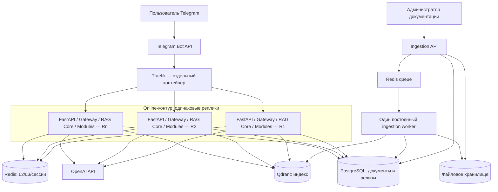
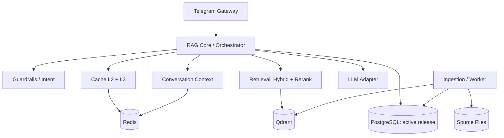
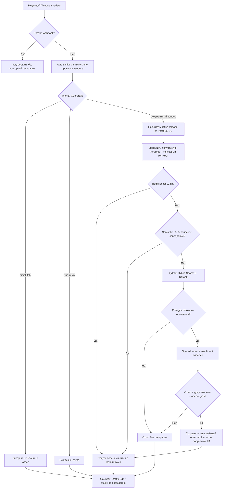
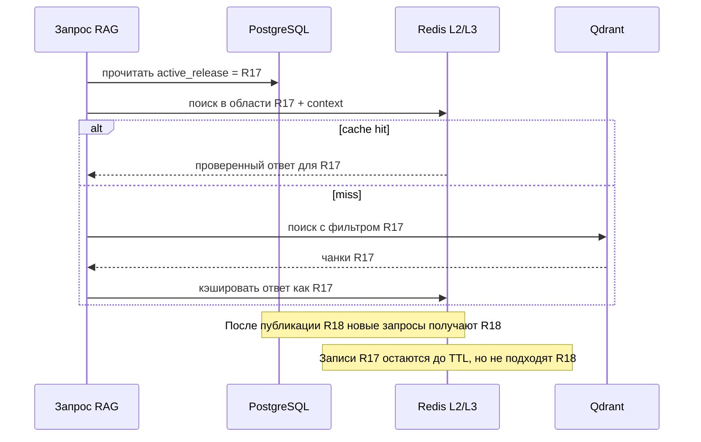
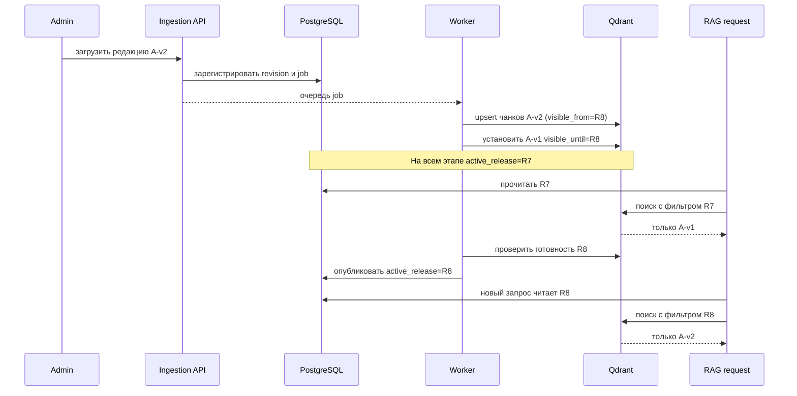
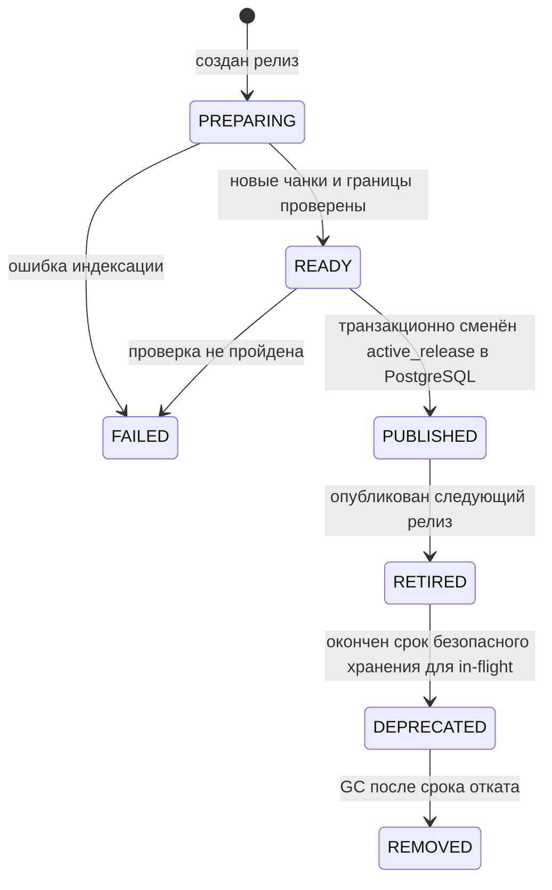
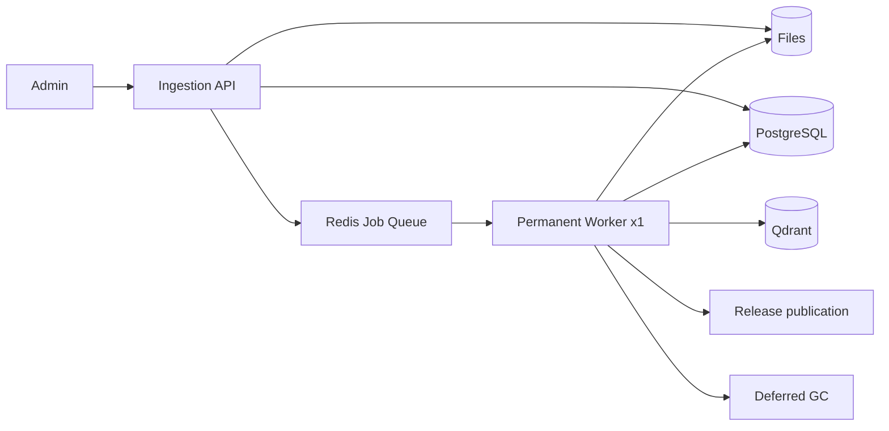
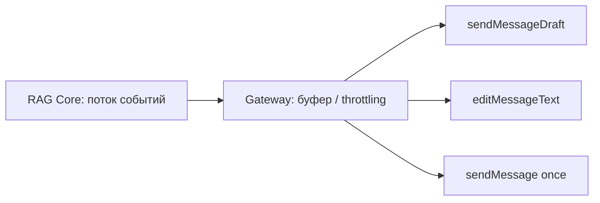

# Candidate Architecture v1 — корпоративный Telegram-бот с High-Speed RAG

**Архитектурный исследовательский отчёт / вариант для сравнения с альтернативой техлида**  
**Дата фиксации:** 2 ноября 2026 г.  
**Статус:** `CANDIDATE / NOT APPROVED` — это не утверждённая архитектура команды и не техническое задание на реализацию.  
**Основа:** презентация `брифинг_v1.0.pdf` (11 страниц) и последовательное обсуждение архитектурных решений.  
**Предмет:** корпоративный Telegram-ассистент АО «БАРС Груп», отвечающий на вопросы по актуальной документации с обязательными источниками.

> **Принцип чтения отчёта.** Мы намеренно различаем: **[БРИФ]** — исходное требование или гипотеза презентации; **[РЕШЕНИЕ]** — принято в рамках *нашего кандидата*, но ещё не согласовано с техлидом; **[КАНДИДАТ]** — предпочитаемая техническая схема, требующая проверки; **[ИССЛЕДОВАТЬ]** — вопрос передан на эксперимент или поздний этап; **[ОТЛОЖЕНО]** — сознательно не фиксируем до получения условий задания/сравнения архитектур. Все цифры производительности без пометки «измерено» — цели или примеры, не фактические показатели системы.

---

## Содержание

1. [Краткое резюме](#1-краткое-резюме)
2. [Исходная задача и ограничения](#2-исходная-задача-и-ограничения)
3. [Принципы принятия архитектурных решений](#3-принципы-принятия-архитектурных-решений)
4. [Сравнение рассмотренных архитектур](#4-сравнение-рассмотренных-архитектур)
5. [Целевая физическая топология](#5-целевая-физическая-топология)
6. [Логические модули, границы и ответственность](#6-логические-модули-границы-и-ответственность)
7. [Сценарий обработки пользовательского запроса](#7-сценарий-обработки-пользовательского-запроса)
8. [Кэширование L2 и L3](#8-кэширование-l2-и-l3)
9. [Документы, PostgreSQL и файловое хранилище](#9-документы-postgresql-и-файловое-хранилище)
10. [Инкрементальная индексация Qdrant и релизы](#10-инкрементальная-индексация-qdrant-и-релизы)
11. [Публикация релиза и согласованность хранилищ](#11-публикация-релиза-и-согласованность-хранилищ)
12. [Отложенная очистка, откат и восстановление](#12-отложенная-очистка-откат-и-восстановление)
13. [Ingestion API, очередь и постоянный worker](#13-ingestion-api-очередь-и-постоянный-worker)
14. [Контекст диалога и поиск](#14-контекст-диалога-и-поиск)
15. [«No Source → No Claim»: доказательства и отказ](#15-no-source--no-claim-доказательства-и-отказ)
16. [Telegram Gateway, streaming и результаты эксперимента](#16-telegram-gateway-streaming-и-результаты-эксперимента)
17. [Балансировка, нагрузка, ресурсы и отказоустойчивость](#17-балансировка-нагрузка-ресурсы-и-отказоустойчивость)
18. [Командная разработка и будущие контракты](#18-командная-разработка-и-будущие-контракты)
19. [Риски и нерешённые вопросы](#19-риски-и-нерешённые-вопросы)
20. [Матрица решений и альтернатив](#20-матрица-решений-и-альтернатив)
21. [Критерии сравнения с версией техлида](#21-критерии-сравнения-с-версией-техлида)
22. [План проверки гипотез и следующее действие](#22-план-проверки-гипотез-и-следующее-действие)
23. [Приложения и источники](#23-приложения-и-источники)

---

## 1. Краткое резюме

### 1.1. Предлагаемый результат

**[РЕШЕНИЕ]** В качестве нашей архитектурной альтернативы предлагается **одна модульная Python-кодовая база с раздельными контурами исполнения**:

- **Online RAG:** несколько идентичных stateless-реплик FastAPI, принимающих пользовательские запросы через отдельный Traefik. Внутри каждой реплики находятся Telegram Gateway, RAG Core и необходимые модули запросного конвейера; *RAG Core является Python-модулем, а не отдельным HTTP-сервисом*.
- **Ingestion:** отдельный административный API, очередь заданий на Redis и **один постоянный worker**, выполняющий подготовку документов, инкрементальную индексацию, публикацию и очистку старых версий.
- **Постоянные данные:** исходные PDF/DOCX в файловом хранилище; PostgreSQL как авторитетный реестр документов, редакций, релизов и активного релиза; Qdrant как производный индекс для Dense + BM25; Redis для общего кэша, сессий и очереди (с логическим разделением задач).
- **Кэш:** **L2 Redis Exact + L3 Semantic**, без обязательного L1 в памяти реплик. Кэш привязан к релизу и контексту запроса.
- **Обновление знаний:** новые редакции добавляются **инкрементально** в Qdrant, но не становятся видимы до безопасного переключения единого `release_id`. Вместо многократного пересоздания коллекций исследуется **интервальная видимость чанков**.
- **Ответ:** Retrieval даёт проверяемые идентификаторы источников, LLM получает только отобранные фрагменты, может ответить `insufficient_evidence`, а приложение само разрешает ссылки по метаданным. Предполагается потоковая выдача; базовый Telegram-механизм — `sendMessageDraft`, резервный — `editMessageText` / обычный ответ.

Это **не чистый one-process монолит** и **не сеть мелких микросервисов**. Наиболее точное описание: *модульная кодовая база + независимо исполняемые online и ingestion-контуры + обособленный worker*. Некоторые назовут её «гибридным модульным монолитом», другие — «двухконтурной сервисной архитектурой»; название не важнее фактических границ исполнения.

### 1.2. Что мы НЕ утверждаем

1. Наша архитектура ещё **не согласована с техлидом**. Его независимый вариант должен быть рассмотрен на равных.
2. Никакие «150 RPS», «1000 RPS», «300 мс до первого токена», `faithfulness ≥ 0,95` пока **не доказаны** для всей системы.
3. Интервальная видимость в Qdrant — **основной кандидат**, а не результат пройденного end-to-end эксперимента.
4. Семантический кэш L3 **не гарантирует** правильность ответа по одной cosine similarity.
5. Потоковый `sendMessageDraft` **проверен на тестовом боте**, но не доказана его устойчивость на целевой массовой нагрузке.
6. Python DTO, сигнатуры Protocol, конкретные таблицы и классы **намеренно не проектировались** до выбора общей архитектуры.

### 1.3. Центральное обоснование

Для этой задачи важна прежде всего **независимость ресурсоёмкого ingestion от низколатентного online RAG**, а не сетевое разделение каждого шага поиска, кэша и генерации. Две независимые группы процессов обеспечивают требуемую ресурсную границу. Дополнительные HTTP-переходы между мелкими сервисами в основном запросном pipeline пока не дают доказанной пользы, зато добавляют точки отказа и интеграционную работу.

---

## 2. Исходная задача и ограничения

### 2.1. Продукт

**[БРИФ, стр. 1–2]** Пользователь обращается к корпоративному Telegram-боту на естественном языке. Бот быстро отвечает по **актуальной документации** и указывает источники. Если документация не подтверждает ответ, система должна отказаться от утверждения: **`NO SOURCE → NO CLAIM`**.

Три заявленных бизнес-критерия:

| Направление | Что означает на практике |
|---|---|
| Скорость | короткий путь по кэшу для повторов; минимизация задержки первого содержательного ответа; потоковый UX |
| Достоверность | фрагменты только из допустимой документации; ссылки на реальный источник; отказ при недостатке оснований |
| Актуальность и нагрузка | обновления документов без остановки ответов, согласованные версии, работа при параллельных запросах |

### 2.2. Ограничения стека

**[БРИФ]** Фиксированы Python, FastAPI, OpenAI API, Qdrant и Redis. В презентации также предполагаются Docker Compose, aiogram 3.x, Flashrank, Dense + BM25, обработка PDF/DOCX, Ragas и Locust. В нашей версии **добавлен PostgreSQL** для реестра документов и публикаций; это **архитектурная гипотеза поверх исходного брифа**, а не первоначально зафиксированный стек заказчика.

| Пункт | Статус |
|---|---|
| Python + FastAPI | задано брифом |
| OpenAI API | задано брифом |
| Qdrant | задано брифом |
| Redis | задано брифом |
| PostgreSQL | предложено в обсуждении с техлидом; включено в наш кандидат |
| Traefik | выбран как внешний балансировщик для Docker-реплик |
| Один постоянный ingestion worker | выбран вместо запуска одноразовых job-контейнеров |
| Точная библиотека очереди | пока не выбрана |

### 2.3. Первичные KPI из брифинга — только ориентиры

- **150+ RPS** — целевой ориентир, требующий нагрузочного тестирования.
- **50+ одновременно активных пользователей** без ожидаемых необработанных 500 — цель тестирования.
- **~300 мс до первого токена**, **1,2–1,8 с на полный RAG** — предварительный latency budget, не измеренный SLO.
- **Exact cache < 5 мс**, `Faithfulness ≥ 0,95`, точный чанк в top-3 — критерии, для которых ещё нужны тестовые данные и методика измерения.
- **1000 RPS** обсуждалось как **возможная будущая нагрузка/стресс-сценарий**, а не как обязательное подтверждённое требование.

Нельзя использовать эти значения как доказательство выбора топологии: без доли cache hit, числа LLM-генераций, CPU/RAM, лимитов провайдера и Telegram неизвестно, что будет реальным bottleneck.

### 2.4. Имеющиеся зоны команды в презентации

| Направление в брифинге | Обозначенная ответственность |
|---|---|
| Архитектор / QA | общие принципы, интеграция, тесты, защита |
| High-Load / Cache | FastAPI, Redis, rate limiting, нагрузка, инфраструктура |
| Bot Gateway / UX | aiogram, webhook, доставка/обновление сообщений, интерфейс |
| Retrieval / Vector Search | Qdrant, Dense + BM25, Flashrank, поиск, первоначально Query Rewriter |
| Guardrails / Ingestion | PDF/DOCX, чанкинг, классификация и фильтрация входа |

**[РЕШЕНИЕ]** Эти роли — отправная точка, **не строгая разметка модулей и не окончательное назначение владельцев**. В частности, назначение владельца `RAG Core` решим позже. Число модулей не обязано равняться числу разработчиков.

---

## 3. Принципы принятия архитектурных решений

1. **Архитектура раньше сигнатур.** До сравнения с альтернативой техлида определяем границы, потоки, ответственность и компромиссы, но не конкретные DTO/Protocol.
2. **Изоляция по объективной потребности.** Разделяем процессы там, где нужны разные жизненные циклы, CPU/RAM-профили или политики отказов. Не создаём HTTP-сервис только потому, что есть отдельный разработчик.
3. **Скорость не ценой недостоверности.** При конфликте между сомнительным cache hit и проверенным RAG приоритет отдаётся источнику и честному отказу.
4. **Один авторитетный статус публикации.** PostgreSQL определяет опубликованный релиз; другие хранилища — производные или оперативные.
5. **Новая версия подготавливается до включения.** Во время индексации запросы читают прежний согласованный релиз.
6. **Стриминг — транспортное свойство, не бизнес-логика RAG Core.** Gateway свободно переключает способы доставки, не меняя поиск или генерацию.
7. **Инструменты измеряем, а не фетишизируем.** Добавляем L3, реплики и новые модели по метрикам полезности; не считаем число компонентов признаком качества.
8. **Каждое решение обратимо там, где это разумно.** В частности, нужен путь от L2 к L2+L3, от обычного ответа к streaming, от одного worker к нескольким при необходимости.

---

## 4. Сравнение рассмотренных архитектур

### 4.1. Альтернативы

| Обозначение | Архитектура | Смысл |
|---|---|---|
| A | Простой монолит | Все операции в одном приложении, границы в основном по соглашению |
| B | Слоистый монолит | Разделение по `routers/services/repositories`, но функциональные границы могут пересекаться |
| C | Модульный монолит | Публичные интерфейсы функциональных модулей, совместное выполнение в API-процессах |
| D | Модульная кодовая база + отдельный постоянный ingestion worker | Изоляция online от тяжёлой индексации, одинаковый Python-код и внутренние контракты |
| E | Набор микросервисов | Gateway, Retrieval, Ingestion, RAG и другие как независимые сетевые сервисы |

### 4.2. Сравнение по проверяемым механизмам

| Критерий | A/B | C | D — выбранный кандидат | E |
|---|---|---|---|---|
| Сетевые переходы между шагами RAG | Необязательны | Необязательны | **Необязательны** | Обычно появляются |
| Изоляция ingestion от процесса API | Не по умолчанию | Не по умолчанию | **Да** | Да |
| Независимые лимиты CPU/RAM для ingestion | Требуют отдельного исполнения | Требуют отдельного исполнения | **Да** | Да |
| Изменение функциональных границ в одном репозитории | Легко, но риск связанности | Контролируемо | **Контролируемо** | Более дорого из-за сетевых контрактов |
| Независимый релиз отдельных online-частей | Нет | Нет | Нет (RAG-реплики одинаковы) | Да |
| Операционная сложность | Низкая | Низкая | **Средняя** | Выше |
| Параллельная работа команды | Зависит от дисциплины | Лучше при явных границах | **Хорошо при согласованных границах** | Формальная, но требует больше интеграции |

**Почему не A/B:** быстрый старт, но не обеспечивает автоматически контролируемых функциональных контрактов. Пять разработчиков могут начать импортировать внутренности соседних зон.

**Почему не C в одном online runtime:** обработка документов и индексация способны конкурировать с запросами за CPU/RAM и могут создавать дополнительный риск остановки процесса при падении тяжёлой задачи. Это не неизбежность для любого C: можно добавить process pool; но тогда он фактически движется к требуемому разделению выполнения.

**Почему не E:** на момент проектирования нет подтверждённой потребности независимо деплоить маленькие компоненты внутри RAG pipeline. Сетевые вызовы, таймауты, трассировка, совместимость схем и частичные отказы добавляются сразу. Зато физическое разделение ingestion и online действительно полезно — его обеспечивает D.

**Почему D:** получает самый нужный эффект изоляции без обязательного сетевого взаимодействия между Guardrails, Retrieval, RAG Core и Gateway. Один репозиторий остаётся удобным для короткого хакатона.

> Это **логический вывод по свойствам архитектур**, не итог синтетических измерений. Если тест покажет, что ingestion не конкурирует за ресурсы, или выявит другое узкое место, архитектуру допустимо упростить/пересмотреть.

### 4.3. Как появилась итоговая форма D

Сначала обсуждался worker как обычный постоянный процесс. Затем рассматривался более сложный вариант: `Ingestion API` создаёт **отдельный Docker-контейнер под каждое задание**. От него **отказались** из-за необходимости контроллера создания контейнеров, их жизненного цикла, авторизации управления Docker, повторного выполнения и обработки сбоев. Вместо этого выбрали **один постоянный worker с очередью Redis**. Он получает задачи последовательно и не требует создавать/удалять контейнеры при каждом запросе.

---

## 5. Целевая физическая топология

### 5.1. Контейнеры и процессы



**Пояснение:** стрелки означают логически разрешённый доступ, а не обязательно отдельный HTTP-вызов. `RAG Core` внутри каждого online-контейнера — Python-модуль. Redis может быть одним развернутым сервисом, но кэш и очередь должны иметь раздельные пространства ключей, разумные политики памяти и надёжности. Отдельно показанный `Ingestion API` не предполагает автоматический публичный доступ без авторизации.

### 5.2. Почему это масштабируется

- **Traefik** обнаруживает реплики RAG API через Docker и распределяет входящие запросы; писать балансировщик самим не требуется.
- Реплики не должны зависеть от собственной локальной памяти для критичных сессий/версий. Их можно добавлять/удалять без переноса пользовательского состояния.
- Worker имеет отдельный лимит ресурсов и может быть выполнен на другой машине, если потребуется; **один worker не подразумевает распределённое масштабирование самой индексации**.
- Qdrant, PostgreSQL, Redis и внешний LLM остаются общими узкими местами. Увеличение числа API-реплик само по себе не обеспечивает 1000 end-to-end ответов в секунду.
- Docker Compose объединяет развёртывание, но несколько контейнеров на одном физическом хосте **продолжают конкурировать за общий CPU/RAM/диск**.

### 5.3. Терминологические границы

| Термин | Что имеется в виду |
|---|---|
| `FastAPI worker` (Uvicorn) | процесс, обслуживающий HTTP-запросы |
| `Ingestion worker` | отдельный длительно живущий исполнитель фоновых заданий |
| `RAG API replica` | копия всего online-приложения со встроенным RAG Core |
| `RAG Core` | логический оркестратор внутри реплики; **не отдельный контейнер** |
| `Traefik` | отдельный контейнер reverse proxy / load balancer |

---

## 6. Логические модули, границы и ответственность

### 6.1. Предварительная карта функциональности

| Модуль / зона | Что делает | Чего делать не должен | Статус |
|---|---|---|---|
| **Telegram Gateway** | webhook, дедупликация Telegram updates, доставка, streaming, formatting, fallback | самостоятельно искать в Qdrant или управлять текстом источников | [РЕШЕНИЕ] |
| **RAG Core / Orchestrator** | маршрут запроса, вызов других модулей, выбор завершения, общая обработка ошибок, сбор результата | собственная ML-классификация, эмбеддинги, rerank, прямое управление файлами | [РЕШЕНИЕ] |
| **Guardrails / Intent** | различение small talk / документного запроса / вне темы, входные проверки | гарантировать абсолютную защиту от prompt injection | [БРИФ + КАНДИДАТ] |
| **Retrieval** | поиск по индексу, гибридный Dense + BM25, rerank, работа с поисковым контекстом | изменять авторитетные сведения о документах | [РЕШЕНИЕ] |
| **Cache** | L2 exact, L3 semantic, version/context scoping, метрики cache hit/miss | генерировать ответы или объявлять схожие вопросы заведомо эквивалентными | [РЕШЕНИЕ] |
| **Conversation Context** | история, контекстный отпечаток, связи с прежними чанками | превращать предыдущий ответ LLM в авторитетный источник | [КАНДИДАТ] |
| **LLM Adapter / Generation** | обращение к OpenAI, поток событий, режим отказа, формирование текста | открывать URL в документах или самостоятельно определять актуальную версию | [РЕШЕНИЕ] |
| **Knowledge / Ingestion** | загрузка, парсинг, чанкинг, постановка заданий, индексация, публикация, GC | выполнять тяжелую подготовку в online API-процессе | [РЕШЕНИЕ] |
| **Shared infrastructure / bootstrap** | конфигурация клиентов/логов, DI, подключение хранилищ, наблюдаемость | превращаться в общий мешок бизнес-логики | [ПРИНЦИП] |

Это **не утверждённый список Python-пакетов**, а карта зон ответственности для будущего согласования с альтернативной архитектурой. При реализации несколько небольших зон можно объединить, не меняя принципов.

### 6.2. Основная логическая диаграмма



Координатор знает **возможности**, а не внутренние SQL-запросы и модели соседних модулей. Обязательных сетевых переходов между его стадиями нет: это вызовы в пределах Python-приложения.

### 6.3. Почему ядро выделено отдельно

Без RAG Core порядок `Guardrails → Context → Cache → Retrieval → LLM` быстро расползётся по Gateway, кэшу и сервису поиска. Тогда любое изменение порядка стадий вынудит несколько участников менять код друг друга. Ядро решает *когда и кого вызвать*, но не *как выполняется поиск*. Владелец модуля будет назначен позднее; в этой версии фиксируется сама обязанность.

---
## 7. Сценарий обработки пользовательского запроса

### 7.1. Целевая логика



**Важно:** это **логическая диаграмма**, а не уже утверждённый порядок каждой строки кода. В особенности: загрузка версии, Guardrails, context-aware подготовка вопроса и использование L3 должны быть оптимизированы без нарушения правил безопасности/кэша. Часть стадий (например, простые ответы) заканчивается досрочно.

### 7.2. Сквозные инварианты

1. В начале обработки каждого документного запроса фиксируется один `release_id`; дальнейший поиск, генерация и кэш используют его.
2. Нельзя отдать L2/L3-ответ с несовместимым релизом, областью доступа или контекстом.
3. История диалога — контекст, но не источник истины; источники берутся из актуальной документации.
4. В результате поиска должны остаться идентификаторы конкретных чанков/документов, пригодные для восстановления ссылок.
5. При отсутствии материалов **не вызывать LLM без необходимости** — вернуть управляемый отказ.
6. Ошибка отправки промежуточного Draft не должна сама по себе сбивать генерацию; Gateway переключает транспортную стратегию.
7. Корректность результата нельзя свести к наличию ссылки: нужна проверка содержания/тестовый набор.

### 7.3. События и метрики запроса

Для будущих контрактов предполагаются (без фиксации сигнатур): идентификатор запроса, chat/user identity, `release_id`, режим контекста, решения Guardrails, попадание L2/L3, версия модели/поискового конвейера, найденные источники, причина отказа, длительности стадий, факт отправки/отмены ответа. Логи не должны сохранять секреты и лишние персональные данные.

---

## 8. Кэширование L2 и L3

### 8.1. От исходного L1+L2+L3 к L2+L3

**[БРИФ, стр. 4]** Предлагалось три ступени: L1 In-Memory LRU (~0,1 мс), L2 Redis Exact (~2 мс), L3 Semantic (~30 мс), а дальше — полный RAG (~1,5–3 с). Эти задержки были **предположениями брифа**.

**[РЕШЕНИЕ]** Для Candidate v1 оставлены **два уровня**:

| Уровень | Механика | Для чего нужен | Важное ограничение |
|---|---|---|---|
| **L2: Redis Exact** | ключ по нормализованному запросу и связанным условиям → готовый проверенный ответ | экономит полноценный поиск и генерацию при точных повторах, общ для всех RAG-реплик | повтор вопроса с другим контекстом может требовать другого ответа |
| **L3: Semantic Cache** | поиск ранее проверенного ответа для смыслово схожего вопроса | дополнительно экономит LLM-вызовы на перефразированиях | similarity не гарантирует эквивалентность и фактическую правильность |

**Почему отказались от обязательного L1:** локальная RAM-копия в первую очередь экономит несколько миллисекунд запроса к Redis, но **не дополнительные LLM-вызовы** по сравнению с L2; появляется кэш в каждой реплике, усложняющий наблюдение и инвалидацию. Если Redis latency или нагрузка впоследствии станут реальным узким местом, L1 можно добавить без изменения основной предметной архитектуры.

**Почему не отказались от L3:** при условии высокой точности он способен ловить новые типы повторов (перефразирования) и экономить дорогостоящие генерации. **Но эффективность и безопасность L3 не подтверждены**. Его надо запускать под feature flag и считать ложные совпадения, а не только hit rate.

### 8.2. Что образует контекст ключа

Семантически одинаковый запрос может требовать разных ответов при другой документации, истории или области доступа. Концептуально кэш должен зависеть от:

- `release_id` опубликованной базы знаний;
- нормализованного текста вопроса;
- **контекстного отпечатка** диалога / выбранной поисковой темы;
- области доступа (если заказчик введёт разграничение прав);
- совместимой версии генерационного/ответного протокола и модели, если изменения влияют на содержание;
- при необходимости — языка ответа и настроек.

Это **не конкретный формат Redis-ключа**. Важно зафиксировать зависимые от корректности измерения. Для L3 область поиска должна быть ограничена этими же условиями, иначе можно безопасно обработать exact hit и ошибочно выдать семантически похожий, но неэквивалентный ответ.

### 8.3. Инвалидация при публикации релиза

Наша основная стратегия — **version-keyed cache**:



**Почему не «очистить всё»:** при нескольких репликах, L3 и возможных незавершённых запросах мгновенная очистка всех старых данных хрупка. Изоляция по релизу даёт корректность новых запросов без массового удаления кэша.

**Политика на границе публикации:** запрос, уже начавшийся на R17, может закончиться после активации R18; это *последовательная согласованность на уровне одного запроса*, а не запрет на всякий ответ R17 после времени публикации. Более строгая семантика потребует проверки перед финальной выдачей и возможной отмены streaming — отдельно не выбрана.

### 8.4. Context fingerprint вместо обязательного переписывания местоимений

Идея пользователя: хранить несколько последних пар «вопрос — ответ», сведения о релевантных чанках и учитывать их в контекстном отпечатке. Это позволяет L2 отличать одинаковую фразу «А где это настроить?» в разных диалогах и не вызывать Query Rewriter **только ради корректности ключа**.

Однако **контекстный хеш не решает задачу поиска сам по себе**. Retrieval всё ещё нужно получить пригодную поисковую формулировку или кандидатов из предыдущего контекста (см. раздел 14). Поэтому ответственность перенесена не из L1 в L2, а частично из обязательного Query Rewriter в подсистему контекстного поиска.

### 8.5. Неочевидные риски и меры

| Риск | Архитектурная защита |
|---|---|
| Cache stampede: 100 одинаковых misses вызывают 100 генераций | Single-flight/контролируемая дедупликация in-flight ключей — желательная оптимизация |
| Старый ответ после обновления документа | обязательный `release_id` в области кэша |
| Семантически похожий, но другой вопрос | критерии эквивалентности, контекст, тесты негативных пар, fallback на RAG |
| Кэш пересекает права доступа | access scope включается в область кэша; конкретные роли пока не утверждены |
| Загрязнение кэша частичным/неверным ответом | записывать только завершённые ответы, прошедшие согласованные проверки |
| Потеря Redis | controlled cache miss и обычный RAG, если система сохраняет необходимые контракты и данные; очередь/сессии требуют отдельного плана восстановления |

### 8.6. Числовая иллюстрация, не бенчмарк

При условных 1500 мс полного RAG и 2 мс Redis Exact Cache, 20% точных попаданий дают среднее сокращение задержки около `0,2 × (1500 − 2) ≈ 300 мс` на запрос в такой упрощённой модели и уменьшают количество полных RAG-вызовов примерно на 20%.

L1 при 10% собственных hits и разнице 2 мс против 0,1 мс сэкономил бы только около 0,19 мс среднего времени на запрос **по этим допущениям**. L3 при стоимости поиска 40 мс и полном RAG 1500 мс имеет положительный эффект на среднюю latency только при достаточной доле **корректных** попаданий (упрощённая безубыточность около 2,7% среди L2-miss). Цена ошибок здесь важнее расчёта latency.

---

## 9. Документы, PostgreSQL и файловое хранилище

### 9.1. Зачем добавлен PostgreSQL

**[РЕШЕНИЕ]** Предложение техлида хранить сведения о версиях документов в PostgreSQL дополнено идеей хранить оригинальные файлы отдельно, а БД использовать как авторитетный реестр. Это отвечает сразу на несколько вопросов: где лежит оригинал, какую редакцию считать текущей, что произошло при обновлении, какой состав индекса опубликован и с чего восстанавливать Qdrant.

Qdrant — **индекс**, а не единственный незаменимый архив исходных PDF. Redis — **оперативное хранилище**, а не авторитетный документный реестр.

### 9.2. Логическая модель, НЕ SQL-схема

| Сущность | Смысл | Статус |
|---|---|---|
| `documents` | постоянная идентичность логического документа | [КАНДИДАТ] |
| `document_revisions` | отдельные редакции файла, путь к оригиналу, hash, время поступления | [КАНДИДАТ] |
| `current_documents` или эквивалентное представление | какая исходная редакция утверждена для следующей публикации | [КАНДИДАТ] |
| `knowledge_releases` | выпущенный согласованный номер релиза, состояние подготовки/публикации | [РЕШЕНИЕ о понятии; схема открыта] |
| `release_documents` или эквивалентный состав | какие именно редакции вошли в опубликованный релиз | [КАНДИДАТ] |
| `ingestion_jobs` | жизненный цикл фоновой индексации и ошибки | [КАНДИДАТ] |

Два понятия нельзя смешивать:

- **«Последняя загруженная/утверждённая редакция документа»** может ещё не пройти индексацию.
- **«Активный опубликованный релиз»** — согласованный набор редакций, уже доступный online RAG.

Пример: в PostgreSQL у документа A уже есть `revision=2`, но в активном релизе поиска остаётся `revision=1`, пока worker не закончит подготовку и проверку.

### 9.3. Где физически лежат файлы

**[РЕШЕНИЕ]** Исходные PDF/DOCX сохраняются в постоянном файловом хранилище (например, volume или объектное хранилище); PostgreSQL хранит идентификатор, путь/URI, версию и метаданные. Не допускается единственная копия файла внутри эфемерного контейнера.

Открытые технические параметры: формат ключа файла, хеширование, политика удаления оригиналов, резервные копии, объём хранилища, проверка целостности и полномочия на загрузку. Это не меняет принципа разделения исходников и поискового индекса.

### 9.4. Почему не хранить все исходные PDF непосредственно в Qdrant

Потому что Qdrant оптимизирован для поисковых векторов и payload, а задачи архивирования оригиналов, проверки версий, восстановления и аудита лучше разделять. **Мы не утверждаем, что технически невозможно вложить туда большой payload; мы выбираем разделение ответственности для восстановления и сопровождения.**

---

## 10. Инкрементальная индексация Qdrant и релизы

### 10.1. Почему отказались от обязательных полных снимков

Изначально обсуждались полные коллекции `knowledge_v1`, `knowledge_v2` с атомарным переключением alias или указателя. Они концептуально просты и удобны для отката, но при частых маленьких обновлениях имеют недостатки:

- повторное создание большого индекса ради одного изменённого документа;
- повышенное место при одновременном хранении нескольких снимков;
- дорогое повторное вычисление эмбеддингов (если нет повторного использования).

**Факт о Qdrant:** он поддерживает `upsert` новых точек, обновление payload, удаление по ID/фильтру и фильтры во время поиска; **полное пересоздание коллекции при каждом документе не требуется**. См. официальные разделы [Points](https://qdrant.tech/documentation/manage-data/points/), [Payload Filtering](https://qdrant.tech/course/beginners/module-2/payload-filtering/).

**[КАНДИДАТ]** Поэтому вместо Blue-Green на каждое изменение выбран вариант одной основной коллекции с инкрементальной загрузкой изменённых документов и согласованными глобальными релизами.

### 10.2. Почему недостаточно просто менять `is_active`

Если старый документ разбит на 100 чанков, новый — на 120, установка `is_active` на 220 точках выполняется не как единый SQL-commit всего массива. Поисковый запрос может увидеть смесь старой и новой редакций, если переключение реализовано как постепенное изменение флагов.

**Пользовательское требование:** *ни один запрос не должен получать одновременно старые и новые чанки одной редакции документа*.

### 10.3. Предпочитаемый механизм: интервалы видимости

Для каждого индексируемого чанка существуют логические границы доступности:

- `visible_from` — первый релиз, где чанк разрешён;
- `visible_until` — первый релиз, где чанк уже запрещён (исключительная граница; при отсутствии верхней границы — видим дальше);
- `document_id`, `revision_id`, `chunk_id`, метаданные раздела и ссылки на оригинал.

Для запроса, закреплённого за релизом `R`, применяется логический фильтр:

```text
visible_from <= R AND (visible_until IS NULL OR R < visible_until)
```

**Пример** (не конкретная схема Qdrant-запроса):

| Чанк | `visible_from` | `visible_until` | Читается в R7 | Читается в R8 |
|---|---:|---:|---:|---:|
| `A-v1/*` | 1 | 8 | да | нет |
| `A-v2/*` | 8 | ∞ | нет | да |
| `B-v3/*` | 4 | ∞ | да | да |

### 10.4. Как обновляется один документ



**Почему это может быть безопаснее массовой смены флагов:** подготовка изменений завершается при **ещё старом** активном `R7`; после подтверждённой готовности всех новых чанков единственный указатель переключается на `R8`. В результате поиск по одному закреплённому релизу должен видеть только одну редакцию документа.

### 10.5. Что нужно обязательно проверить на прототипе

- Корректность range-фильтра по числовым payload полям для **Dense + BM25 / hybrid**.
- Результаты при частичной загрузке, повторном запуске и обновлении `visible_until`.
- Влияние фильтра на recall/top-3, p95 latency и потребление памяти.
- Правильность предварительного создания payload indexes: Qdrant рекомендует индексировать поля, по которым идёт фильтрация, поскольку они влияют на планирование и эффективность поиска; [Qdrant Indexing](https://qdrant.tech/documentation/manage-data/indexing/).
- Необходимость сохранения старых редакций на время in-flight-запросов, периода отката и GC.

**Ограничение выбранного механизма:** если несколько обновлений одновременно изменяют один и тот же документ или кто-то публикует релиз вне единственного worker, потребуется дополнительная синхронизация; один последовательный worker облегчает ситуацию, но не заменяет контроль `release_id` и идемпотентность.

---

## 11. Публикация релиза и согласованность хранилищ

### 11.1. Где источник истины

**[РЕШЕНИЕ]** PostgreSQL — **единственная авторитетная запись** об активном опубликованном релизе. В Qdrant физически лежат точки и интервалы; Redis хранит ответы/контекст, но не должен определять независимо, какую версию считать активной.

При обычном запросе RAG API **один раз читает active_release из PostgreSQL**, затем закрепляет его за всем pipeline. Это пока предпочтительнее кэшировать этот единственный указатель в Redis, потому что TTL/несогласованная инвалидация могут ненадолго вернуть устаревший `release_id`.

Плюсы: простая семантика и отсутствие распределённой транзакции для публикации между Redis и PostgreSQL. Минусы: один короткий SQL-read на документный запрос и дополнительная зависимость online RAG от доступности PostgreSQL. Последний пункт — честный trade-off и предмет нагрузочной проверки.

### 11.2. Двухэтапная публикация (prepare → commit)



**Критический момент публикации:** смена активного `release_id` в PostgreSQL после успешной подготовки Qdrant. SQL-операция над авторитетным указателем атомарна **внутри PostgreSQL**, но не делает PostgreSQL и Qdrant одной распределённой транзакцией.

### 11.3. Результаты частичных отказов

| Момент сбоя | Ожидаемое безопасное поведение |
|---|---|
| Worker упал до загрузки чанков | старый релиз активен; job можно повторить |
| Worker упал посередине upsert | старый релиз активен; новые точки ещё невидимы для него; job возобновить/перезагрузить идемпотентно |
| Worker изменил часть `visible_until`, но ещё не опубликовал | старый релиз продолжает соответствовать фильтру, если значения изменены корректно |
| Qdrant не подтвердил готовность всех изменений | **запретить публикацию** |
| PostgreSQL не выполнил commit активного релиза | старый релиз остаётся активным; подготовленные векторы не активируются |
| После commit worker упал | опубликованный релиз обязан быть готов; job должен восстановить запись финального статуса без повторной нежелательной публикации |
| Redis недоступен | не заменять активный релиз случайной старой версией; cache miss/контролируемая деградация по принятой политике |

Для повышения корректности будущая реализация должна предусмотреть **идемпотентные задания, предикаты публикации и уникальные номера релизов**. Сложную распределённую сагу и Transactional Outbox не следует вводить заранее без доказанной необходимости: при одном worker и PostgreSQL-публикации протокол может быть существенно проще.

### 11.4. Почему не Redis как единственный active pointer

Это был ранний вариант. Если Redis хранит `active_release` одновременно с таблицей активных редакций PostgreSQL, появляются **два источника истины**. Их нельзя атомарно изменить одной обычной транзакцией. Поэтому выбор сместился в пользу одного PostgreSQL-указателя. Redis-инвалидация останется вопросом оптимизации после доказанного bottleneck; для L2/L3 уже работает version scoping.

### 11.5. Семантика актуальности

**Гарантия нашего кандидата:** *любой новый запрос, который закрепил актуальный опубликованный релиз, не смешивает старую и новую редакции одного документа; кэш и Retrieval используют тот же релиз*.

**Не обещаем без дополнительного протокола:** отсутствие **всех** ответов старого релиза после момента публикации. In-flight RAG может продолжить отвечать по старому `release_id`. Это нужно явно объяснить жюри как согласованную обработку уже начавшегося запроса, а не выдавать за «моментальную глобальную отмену».

---

## 12. Отложенная очистка, откат и восстановление

### 12.1. Version Garbage Collector

Пользователь предложил наблюдатель, который видит прекращение запросов к старым чанкам и по таймеру удаляет их либо переносит в deprecated. Идея очистки одобрена, но **отсутствие свежих обращений — недостаточное доказательство безопасности удаления**: старый in-flight-запрос ещё существует, а откат может потребовать прошлые данные.

**[РЕШЕНИЕ]** GC является **фоновой обязанностью существующего worker**, а не отдельным контейнером и тем более не частью критического online-пути.

Для удаления требуются согласованные условия:

1. Релиз больше не выбирается новыми запросами.
2. Прекратились in-flight-запросы релиза **или** истёк строго ограниченный максимальный срок их исполнения плюс запас (выбранная гарантия нуждается в тесте).
3. Окончился срок удержания для отката.
4. Текущий активный релиз опубликован и проверен.
5. Нет ещё не обработанных заданий, использующих удаляемую редакцию как необходимый вход.

Метрика «сколько запросов ещё обращаются к старым чанкам» полезна для диагностики, но не служит единственным разрешающим условием. Реальная очистка — `delete` по выбранным points/фильтрам с контролем завершения. GC запускается с низким приоритетом и ограничениями ресурсов; он не должен задерживать HTTP/LLM-поток, хотя общий Qdrant-ресурс всё равно может испытывать I/O-конкуренцию.

### 12.2. Откат

Пока предыдущие редакции и интервалы сохранены, возврат к предыдущему `release_id` **может** быть реализован сменой авторитетного указателя. Однако это нельзя делать, если данные уже удалены GC или если номера/состояния публикаций нарушают инварианты. Альтернатива — создать **новый** релиз, который возвращает состав предыдущего (с восстановлением из оригиналов), не уменьшая монотонный номер релиза.

**[ИССЛЕДОВАТЬ]** Выбрать политику отката до реализации публикации: прямое временное возвращение на удерживаемый предыдущий релиз либо новый монотонный «rollback release». Это влияет на интерпретацию интервалов и историю, поэтому не объявляется автоматически решённым.

### 12.3. Восстановление после аварии

- PostgreSQL: восстановить авторитетный реестр и состояние активной публикации.
- Файловое хранилище: иметь доступ к исходным редакциям для полного rebuild.
- Qdrant: проверка совместимости активного релиза с реальным индексом; при потере — фоновая реконструкция из источников.
- Redis: восстановить необходимые сессии/очередь в зависимости от выбранной политики persistence; кэш готовых ответов может быть пересоздан.
- Если активный индекс не соответствует подтверждённому релизу, online RAG **не должен выдавать произвольный старый ответ**; нужна безопасная деградация с явным состоянием готовности.

Заявленное в брифе восстановление за 2–3 минуты — **пока цель**, зависящая от размеров исходников, моделей и скорости индексации.

---

## 13. Ingestion API, очередь и постоянный worker

### 13.1. Граница процессов

`Ingestion API` принимает административное действие, сохраняет оригинал, регистрирует задание и возвращает идентификатор/статус. `Ingestion worker` обрабатывает задание независимо от времени жизни HTTP-запроса. Такое разделение важно при больших PDF и при обновлении документации без остановки бота.



### 13.2. Почему один статичный worker

| Вариант | Причина рассматривался | Итог |
|---|---|---|
| Индексация в API-процессе | проще запуск | отвергнута как основная: CPU/память/длительность могут вредить online |
| Один постоянный worker + Redis queue | изоляция без сложного оркестратора | **выбран** |
| Отдельный Docker-контейнер на каждое задание | отличный жизненный цикл задачи, демонстрация масштабирования | отложен как неоправданное усложнение хакатона |
| Несколько workers и распределённая очередь | ускорение массового параллельного ingestion | не требуется без фактической очереди заданий и решения публикационных конфликтов |
| Kubernetes Jobs | готовая платформа одноразовых работ | не нужен в рамках текущего хакатона |

Worker может выполнять задачи последовательно, что особенно упрощает назначение глобальных номеров релизов. Но его код должен быть **идемпотентным**: повтор одной задачи не должен создавать два конфликтующих опубликованных релиза.

### 13.3. Ресурсы и нагрузка

**[РЕШЕНИЕ]** Основная часть вычислительной мощности по возможности резервируется под online RAG; ingestion worker получает управляемые CPU/RAM-лимиты. **Точные доли заранее не фиксируем:** объём PDF, модель эмбеддингов, Qdrant и параллелизм ещё неизвестны. На одном хосте процессная изоляция не означает нулевую конкуренцию за ресурсы. Лимиты и момент запуска тяжёлых GC/индексации надо валидировать одновременным нагрузочным тестом.

### 13.4. Надёжность очереди

Функционально требуются статусы `queued / running / completed / failed`, повтор с безопасным результатом, диагностика, отсутствие бесконтрольной параллельной публикации. Технологию (`RQ`, Celery или более простой подход) **не закрепляем на архитектурном уровне**. Важно не спутать обычный Redis-кэш с долговременной гарантированной очередью: политики eviction/persistence и восстановления заданий должны быть совместимы с требованиями к данным.

---
## 14. Контекст диалога и поиск

### 14.1. Исходное предложение брифа

На слайде про anaphora предполагался **Query Rewriter**, который превращает зависимый вопрос («А где у него сертификат?») в самостоятельный поисковый запрос с учётом 2–3 сообщений истории. Недостатки обязательного rewrite для нашей цели — дополнительная стадия, потенциальный внешний вызов LLM и вклад в время до первого содержательного ответа.

### 14.2. Новое предложение

**[РЕШЕНИЕ]** Хранить ограниченный контекст диалога: предыдущие сообщения пользователя, ответы ассистента, идентификаторы/метаданные ранее найденных чанков, а также отпечаток контекста для кэширования. **Обязательный Query Rewriter убираем из MVP**, оставляя возможность добавить его, если поиск не справится с зависимыми вопросами.

**При этом важно:**

- Для L2 контекстный отпечаток защищает от совпадения двух одинаковых по строке, но разных по смыслу уточняющих вопросов.
- Для генерации история позволяет дать связный ответ.
- Для **Retrieval история должна реально влиять на поиск**. Нельзя ограничиться передачей предыдущих сообщений только генератору, поскольку он получает чанки уже **после** Qdrant.

### 14.3. Направления исследования Retrieval

**[ИССЛЕДОВАТЬ]** Мини-задача для разработчика поискового/классификационного направления (владелец позже): выяснить на маленьком наборе диалогов, когда новый вопрос зависим от контекста и как сохранить retrieval quality без постоянного LLM-rewrite.

| Кандидат | Суть | Риск |
|---|---|---|
| Эвристики | местоимения, указательные слова, короткие уточнения | не обнаруживают все зависимости |
| Контекстное расширение поискового представления | новое сообщение + сущности/тема предыдущего вопроса | может привнести ненужные понятия |
| Лёгкая ML-классификация | определяет зависимость от истории | потребует размеченных примеров и измерений |
| Query Rewriter как fallback | исправляет сложные случаи | добавляет задержку/затраты и может менять смысл |

На архитектурном уровне фиксируем **возможность получать поисковый контекст и выбирать стратегию**, а не конкретный классификатор. Простой признак наличия местоимения недостаточен: фраза «А настройка сертификатов?» также может продолжать прошлую тему.

### 14.4. Границы доверия

Предыдущий ответ бота — **история беседы, не доказательство**. Старые `chunk_id` нужно перепроверять относительно `release_id`: после обновления исходного документа прежний фрагмент может быть недопустимым. История должна быть ограничена по размеру/времени и сохраняться в общей для реплик системе; точный TTL и окно определятся после получения условий задачи.

---

## 15. «No Source → No Claim»: доказательства и отказ

### 15.1. Что мы можем доказать до LLM

Retrieval выдаёт не просто текст, а идентифицируемые источники: документ, редакция, чанк, местоположение в исходнике, score/ранг. При отсутствии достаточных кандидатов можно **сразу отказать без вызова OpenAI**. Однако высокий поисковый score означает *релевантность*, а не гарантию, что в найденном тексте есть ответ на точный вопрос.

В брифе упоминается `score < 0,60 → fallback`, но порог **пока не проверен**; для hybrid dense/BM25/rerank численные оценки имеют разные интерпретации. Порог выбирается на реальном тестовом наборе и должен учитывать режим поиска, а не просто копироваться из презентации.

### 15.2. Что отдавать генератору

**[РЕШЕНИЕ]** LLM получает вопрос и *только выбранные* Retrieval-фрагменты с **внутренними `evidence_id`**, например:

```text
[SOURCE_01] ...текст проверенного чанка...
[SOURCE_02] ...текст проверенного чанка...
```

У LLM **не должно быть необходимости самой открывать PDF или придумывать URL**. Приложение хранит соответствие `evidence_id → document/revision/chunk/source_location` и формирует настоящие ссылки само.

### 15.3. Структурированный результат — полезен, но не абсолютная гарантия

Обсуждалась структура в духе:

```json
{
  "status": "answered",
  "answer": "Текст ответа на основе источников",
  "evidence_ids": ["SOURCE_01", "SOURCE_02"],
  "self_confidence": 0.92
}
```

**Это иллюстрация семантики, не уже согласованный контракт.** Проверки разной силы:

| Проверка | На что способна | Чего НЕ доказывает |
|---|---|---|
| JSON соответствует схеме | структура полей, допустимые типы и состояния | фактическая истинность текста |
| Все `evidence_ids` известны | ссылки на реально переданные фрагменты | что текст опирается на эти фрагменты |
| `status=insufficient_evidence` | модель умеет честно отказаться | что модель всегда верно оценивает нехватку фактов |
| Числовая самооценка модели | дополнительный диагностический сигнал | калиброванную вероятность достоверности (0,92 ≠ 92% гарантии) |
| Отдельная проверка faithfulness | эмпирическое качество на выбранных вопросах | абсолютную гарантию на любом новом вопросе |

**[РЕШЕНИЕ]** Числовая самооценка LLM **не используется как самостоятельный допуск к публикации**. Возможно логирование для исследований, но нельзя утверждать, что самопроверка модели решает проблему галлюцинаций.

### 15.4. Два независимых основания для отказа

1. **До генерации:** недостаточно релевантных/допустимых фрагментов → отказ и экономия токенов.
2. **Во время генерации:** материалы по теме имеются, но сведений для конкретного ответа недостаточно → `insufficient_evidence` и отказ.

После генерации проверяются допустимость `evidence_ids`, полнота финального результата и правила кэширования. В L2/L3 не должен попадать неполный текст или ответ без требуемых подтверждений.

### 15.5. Важный компромисс со streaming

Чтобы **полностью** проверить финальный JSON, нужно дождаться окончания генерации, что конфликтует с показом текста по мере появления. Передать `status/evidence_ids` перед `answer` полезно, но не доказывает корректность ещё не сформированных предложений.

**[РЕШЕНИЕ об архитектуре, не о строгой политике]** RAG Core должен допускать поток событий; Gateway может использовать их для Draft или дождаться полного ответа. Уровень предварительной проверки перед реальным показом текста пока **не утверждён** и будет зависеть от требований заказчика/жюри и экспериментов. Это **не блокирует** модульную архитектуру.

### 15.6. Prompt injection и права доступа

Guardrails из брифа — фильтр для подозрительных/внепредметных запросов, **не математическая гарантия безопасности**. Извлечённые документы также являются недоверенными данными, и инструкции внутри них не должны считаться системными. Конкретная модель прав доступа к документам будет согласована **после получения окончательного задания**. Архитектура не должна исключать учёт доступа при поиске и кэшировании.

---

## 16. Telegram Gateway, streaming и результаты эксперимента

### 16.1. Варианты, которые были реально проверены

Разработан автономный Python-скрипт с симуляцией постепенной генерации текста без вызова OpenAI. Две команды тестового Telegram-бота:

- `/draft` — `sendMessageDraft` в **личном чате**, затем `sendMessage` для постоянного финального ответа;
- `/edit` — `sendMessage`-заглушка, затем `editMessageText` при поступлении накопленных частей текста.

**Пользовательский тестовый супергрупповой чат — только среда для первоначального эксперимента; итоговый продукт предполагает личную переписку с ботом.** Поэтому ограничение Draft личными чатами не является препятствием для основной модели взаимодействия.

### 16.2. Реальные результаты первого теста

Одинаковый симулированный текст: **127 псевдотокенов**, **1062 символа**. Задана скорость генератора **15 псевдотокенов/с**, буферизация обновления **1,2 с**. Результаты получены пользователем на реальном Telegram-боте:

| Метрика | Draft (`/draft`) | Edit (`/edit`) |
|---|---:|---:|
| Индикатор/начальная реакция | 0,346 с | 0,628 с |
| Время до первого фрагмента | 1,377 с | 1,420 с |
| Общая длительность | 11,519 с | 11,749 с |
| Фактическая скорость скрипта | 11,0 псевдоток./с | 10,8 псевдоток./с |
| HTTP-попыток / успешных | 11 / 11 | 10 / 10 |
| Неуспешные попытки | 0 | 0 |
| HTTP 429 | 0 | 0 |
| HTTP RTT mean | 142,1 мс | 184,7 мс |
| HTTP RTT p95 | 343,7 мс | 627,8 мс |
| Состав запросов | 10 `sendMessageDraft` + 1 `sendMessage` | 9 `editMessageText` + 1 `sendMessage` |

**Визуальная оценка пользователя:** Draft «гораздо приятнее, как в чате с нейросетью». После **уменьшения интервала обновлений** анимация стала заметно плавнее; точный интервал второго прогона **не был сообщён как измеренный параметр**, поэтому в отчёте не придумывается новое численное значение.

### 16.3. Как правильно интерпретировать результаты

1. Тест подтверждает **работоспособность двух методов и субъективное преимущество Draft** в данном клиенте/условиях.
2. Разница 11,519 vs 11,749 с, p95 343,7 vs 627,8 мс — **не статистически значимое сравнение**: по одному короткому прогону и нескольким HTTP-вызовам нельзя сделать вывод о глобальном преимуществе по скорости.
3. Измеренный «первый текст» — момент подтверждения HTTP-вызова со стороны скрипта, **не точное отображение в Telegram-клиенте**.
4. Реализованный симулятор ждал Telegram API внутри цикла генерации. Из-за этого целевые 15 псевдоток./с превратились в ~11; при реальном LLM-потоке лучше **развязать приём токенов и отправку накопленного текста** отдельными асинхронными задачами.
5. Отсутствие 429 на одном тесте не означает отсутствие rate limiting на массовой нагрузке.

### 16.4. Выбранная политика доставки

**[РЕШЕНИЕ] Draft-first streaming**:

- В личном чате Gateway сначала использует `sendMessageDraft` для анимированного временного предпросмотра.
- При завершении выполняет обычный `sendMessage` с полным результатом, чтобы ответ остался в истории.
- Частота отправки обновлений **настраиваемая**, с защитой от Telegram 429, накоплением фрагментов и снижением частоты при необходимости.
- Резервные режимы: `editMessageText` или один итоговый `sendMessage`.
- Отказ промежуточного Draft не должен обрывать выполняемую генерацию.
- Gateway может обрабатывать пользовательскую остановку потока, если соответствующая возможность Telegram будет задействована.

Документация Telegram подтверждает назначение [sendMessageDraft](https://core.telegram.org/bots/api#sendmessagedraft): это **временный предварительный просмотр для private chat**, с анимацией обновлений по одному `draft_id`, и он требует **финального `sendMessage`**. Это важнее гипотез о визуальном клиентском времени.

### 16.5. Почему выбор метода не заставляет переписывать RAG



Для RAG Core нет разницы, создаёт Gateway черновик, редактирует сообщение или ждёт финального результата. Это **транспортное решение**. Пока конкретная форма потокового события не закрепляется — её определят после сравнительного архитектурного обсуждения.

---

## 17. Балансировка, нагрузка, ресурсы и отказоустойчивость

### 17.1. Почему Traefik

**[РЕШЕНИЕ]** Выбран готовый контейнер **Traefik**: автоматическое обнаружение Docker-реплик и маршрутизация через настройки Compose. Альтернатива — **Nginx**, который тоже решает задачу; Traefik предпочтён из-за удобства динамически меняемого числа контейнеров. Писать собственный балансировщик нет оснований. Официально: [Traefik Docker Provider](https://doc.traefik.io/traefik/providers/docker/).

Нужно помнить: Traefik **распределяет**, но не обязательно **автоматически создаёт** новые RAG-контейнеры на пороге RPS. Число реплик в базовом Compose изменяется отдельно. Безопасность Docker API/socket в конфигурации Traefik — инфраструктурный риск, не причина делать свой балансировщик.

### 17.2. Stateless RAG-реплики

Критичные состояния должны быть общими: беседы/сессии и дедупликация updates — в выбранном общем хранилище; опубликованный релиз — в PostgreSQL; кэш — Redis; индекс — Qdrant. Тогда Traefik может выбирать любую здоровую реплику без обязательной sticky session.

Требуются health/readiness, корректное завершение обработок при остановке реплик, connection pooling и ограничения параллельной работы CPU-интенсивных компонент. Локальные классификаторы и Flashrank при каждом Uvicorn-процессе могут дублировать модель в RAM — **4 Uvicorn workers не всегда выгоднее одного процесса на контейнер**. Количество процессов выбирается измерениями.

### 17.3. Почему 1000 RPS нельзя обещать количеством реплик

Пусть приходит 1000 пользовательских запросов/с. Доля, доходящая до LLM, зависит от точности кэша:

| Cache bypass / LLM generation rate | Генераций/с |
|---:|---:|
| 1% | 10 |
| 10% | 100 |
| 50% | 500 |
| 100% | 1000 |

Это лишь арифметика нагрузки: OpenAI API имеет тарифы/лимиты, Telegram — свои ограничения доставки и редактирования, Qdrant и Redis — общую пропускную способность. **1000 FastAPI HTTP RPS ≠ 1000 завершённых ответов Telegram/с**. Для оценки нужны отдельно: webhook throughput, cache hit, retrieval throughput, LLM concurrency, throughput отправки Telegram и end-to-end latency.

### 17.4. Rate limiting и backpressure

В брифе упоминается Token Bucket rate limiter и повторные попытки с exponential backoff. В нашей архитектуре это остаётся полезным, но параметры не фиксируются до нагрузки:

- ограничение запросов пользователя/чата и общего числа параллельных генераций;
- bounded queues / контролируемая перегрузка вместо неконтролируемого роста RAM;
- `429` и `retry_after` для Telegram и внешних провайдеров;
- таймауты и circuit-breaker-подобное поведение там, где повтор опасен по задержке/стоимости;
- не пытаться скрывать ожидаемые сбои провайдера бесконечными ретраями.

### 17.5. Observability и QA

Обязательные для исследования метрики:

| Контур | Метрики |
|---|---|
| Gateway | количество входящих updates, дубли, успешные сообщения, Telegram 429, частота Draft/Edit, отмены, задержка первого отображаемого фрагмента |
| RAG Core | latency на каждом этапе, total p50/p95/p99, количество отказов и причины, версия релиза |
| L2/L3 | hit/miss, доля **корректных** совпадений, стоимость поиска, затраты LLM с/без кэша, конфликты контекста |
| Retrieval | recall@k / попадание эталонного чанка в top-3, latency, влияние фильтра релиза, качество rerank |
| Ingestion | длительность парсинга, embedding и upsert, число неуспешных заданий, время публикации, доля времени блокировки ресурсов |
| Хранилища | доступность, использование CPU/RAM/disk, время чтения active_release, нагрузка Qdrant во время ingestion |
| Качество ответа | faithfulness на подготовленном наборе, доля правильных отказов, нарушения привязки источников |

Исходный план QA из брифа включает Locust и Ragas. Их использование оправдано, но **качество измерения зависит от фиксированного набора реальных вопросов с ожидаемыми источниками и эталонными отказами**. Выставить `faithfulness ≥ 0,95` без методики недостаточно.

### 17.6. Проверка graceful degradation

- Qdrant недоступен → контролируемая ошибка или допустимый только проверенный кэш актуального релиза, если безопасность и актуальность можно гарантировать.
- PostgreSQL недоступен → невозможно достоверно прочитать активный релиз; запрещено молча подменять его устаревшим.
- Redis недоступен → L2/L3 пропадают, queue/sessions могут деградировать отдельно; политика должна быть определена для каждого назначения Redis.
- OpenAI API недоступен → управляемый отказ, отсутствие утечки сырого исключения пользователю.
- Worker упал → online RAG продолжает пользоваться опубликованным релизом, а очередь/состояние заданий восстанавливается.
- Traefik / одна RAG-реплика упала → исключить недоступную реплику из маршрутизации, но тестировать фактическое поведение.

---

## 18. Командная разработка и будущие контракты

### 18.1. Почему контрактный подход остаётся важен

Даже если все online-модули выполняются в одном процессе, без ограничений разработчик может импортировать внутренний код соседнего модуля, напрямую читать таблицы и обходить оркестратор. Это нарушает независимость разработки и делает интеграцию хаотичной.

**[ПРИНЦИП, реализация позже]** Для Python рассматривались:

| Механизм | Предполагаемая роль | Статус |
|---|---|---|
| `public.py` в модуле | единая разрешённая точка программного взаимодействия | принцип принят, конкретные интерфейсы позже |
| DTO | перенос типизированных данных через границы | позже |
| `dataclass(frozen=True)` | простые неизменяемые внутренние DTO и события | рекомендуемая техника, не догма |
| Pydantic | вход/выход HTTP и другие внешние границы с валидацией | рекомендуемая техника |
| `typing.Protocol` | интерфейс без привязки к конкретным классам | позже |
| Dependency Injection | раздельная реализация контрактов | позже |
| `bootstrap.py` | Composition Root: сборка зависимостей | позже |
| Import Linter | автоматический запрет неразрешённых импортов | после утверждения модулей |
| Pyright / Ruff / pytest | типизация, стиль, тестирование | после каркаса |
| CI + защищённая main | непрерывная интеграция небольших PR | принцип из брифа, актуален |

**Не следует делать `public.py` и десятки Protocol до сравнения архитектур**: при изменении границ большая часть этой работы окажется лишней. На текущем этапе нужны схемы зависимостей и владельцы областей данных.

### 18.2. Организация работы

В брифе: Kanban `Backlog → Ready for Dev → In Progress → Code Review → Done/Released`, одна активная задача на человека, защищённая `main`, PR, фиксация статуса, эскалация блокера через 30 минут. Эти правила **совместимы** с выбранным вариантом.

Рекомендации для параллельной разработки после архитектурного согласования:

1. Сначала согласовать **граф модулей, смысл операций, права владения данными**.
2. Затем реализовать публичные контракты и запускаемый минимальный каркас с заглушками.
3. Только потом выдавать независимые функциональные задачи.
4. Интегрировать **часто**, а не соединять пять больших веток в конце.
5. Изменения публичных контрактов обсуждать со смежными владельцами и проверять контрактными тестами.

### 18.3. Предварительные наиболее чувствительные стыки

| Стык | Основной риск |
|---|---|
| Ingestion ↔ Retrieval | формат чанков, векторов, метаданных, фильтра релизов и ссылок |
| RAG Core ↔ Cache | порядок использования L2/L3, версия, контекст и безопасность hit |
| RAG Core ↔ Gateway | поток/финализация/отмена/ошибки/источники |
| RAG Core ↔ PostgreSQL | выбор актуального релиза, согласованность между инстансами |
| Ingestion ↔ PostgreSQL ↔ Qdrant | безопасная публикация и сбой посередине подготовки |
| Context ↔ Retrieval | корректность зависимых уточняющих вопросов |

Назначение владельца RAG Core, форматов `SearchResult`, `IndexedChunk`, `AnswerEvent` и других DTO — **отложено** до сравнения Candidate v1 с вариантом техлида.

---
## 19. Риски и нерешённые вопросы

### 19.1. Критические для последующего согласования архитектуры

| ID | Вопрос / риск | Почему важен | Текущее состояние / план |
|---|---|---|---|
| R-01 | **Интервальный фильтр в Qdrant** | может влиять на качество гибридного поиска и память | [КАНДИДАТ] мини-прототип до окончательного утверждения |
| R-02 | **Согласованность публикации** | нельзя показывать полузагруженный релиз | [РЕШЕНИЕ о протоколе] Qdrant prepare/verify → PostgreSQL commit; проверить с имитацией отказов |
| R-03 | **Откат после GC** | удалённый релиз нельзя вернуть простым указателем | [ИССЛЕДОВАТЬ] retention и способ создания rollback release |
| R-04 | **L3 false positives** | похожий вопрос может требовать другого ответа | [КАНДИДАТ] feature flag, оценка качества на негативных парах |
| R-05 | **Context-Aware Retrieval** | без него история в LLM не помогает подобрать чанки | [ИССЛЕДОВАТЬ] сравнение эвристик/ML/fallback rewrite |
| R-06 | **Source-grounded generation** | корректные ссылки не гарантируют корректность утверждений | [ПРИНЦИП] формальная привязка evidence; контрольный бенчмарк |
| R-07 | **Стриминг vs полная проверка до выдачи** | нельзя проверить весь текст до генерации и одновременно немедленно его стримить | [ОТЛОЖЕНО] Gateway допускает оба режима; политика по требованиям |
| R-08 | **Доступ к документам** | влияет на retrieval-фильтры и ключи кэша | [ОТЛОЖЕНО] уточнить после задания |
| R-09 | **Конкуренция Qdrant между ingestion и RAG** | worker отделён процессно, но разделяет индекс/диск | [ИССЛЕДОВАТЬ] параллельный нагрузочный тест с лимитами |
| R-10 | **PostgreSQL-read на каждый запрос** | может стать задержкой/точкой отказа при высокой нагрузке | [КАНДИДАТ] выбрать корректность, измерить и только затем оптимизировать |
| R-11 | **Сохранность очереди Redis** | cache eviction и недолговременное хранение нельзя переносить на jobs | [ОТЛОЖЕНО] выбрать библиотеку/политику persistence при реализации |
| R-12 | **Ресурсы локальных моделей** | Flashrank и классификаторы могут дублироваться на репликах | [ИССЛЕДОВАТЬ] измерить память и CPU на целевом сервере |
| R-13 | **Дубли Telegram Webhook** | повтор update не должен породить два платных LLM-вызова | [ПРИНЦИП] общая дедупликация, тесты race conditions |
| R-14 | **Нужен ли отдельный веб-интерфейс администрирования** | зависит от точного задания | [ОТЛОЖЕНО] сохраняем административный API, UI не придумываем |

### 19.2. Решения, сознательно НЕ принимаемые сейчас

- конечный список Python-файлов, типы DTO, формат JSON-ответа LLM, сигнатуры Protocol;
- конкретный алгоритм определения местоименной/контекстной зависимости;
- модель эмбеддингов, sparse-часть BM25, точные размеры чанков;
- пороги rerank и semantic hit (включая `0,60` и `0,96` из первоначального брифа);
- точный способ persistence Redis queue и библиотека задач;
- число Uvicorn-процессов, реплик и CPU/RAM worker;
- конкретные права доступа к корпоративной документации;
- конкретный порог для оценки `self_confidence` модели: по нашей логике он **не является механизмом гарантии**;
- политика полной предварительной проверки перед отображением стрима;
- ответственность конкретных участников за модуль RAG Core.

### 19.3. Различать проблему архитектуры и проблему алгоритма

При сравнении с техлидом полезно не объявлять отсутствие готового алгоритма недостатком самой топологии, если архитектура предусматривает соответствующую точку расширения. Например: контекстный поиск нужно **измерить и исследовать** в любом из вариантов; эта задача не решается автоматически ни микросервисами, ни PostgreSQL. Напротив, наличие/отсутствие изоляции CPU ingestion — именно архитектурная характеристика.

---

## 20. Матрица решений и альтернатив

Краткий Decision Log — центральная часть отчёта для последующего спора двух архитектурных предложений. **Формулировка «отказались» означает решение внутри *нашего кандидата*, а не запрет на рассмотрение альтернативы техлида.**

| № | Вопрос | Выбрано для Candidate v1 | Рассмотренная альтернатива | Почему выбран текущий вариант | Уверенность |
|---:|---|---|---|---|---|
| 01 | Организация системы | модульная Python-кодовая база с online/ingestion контурами | простой монолит / микросервисы | изоляция тяжёлой работы без сетевого дробления RAG | высокая по логике; производительность не проверена |
| 02 | Online RAG | N stateless FastAPI-реплик | один процесс / отдельный сервис на каждый модуль | реплики удобно масштабировать без сетевой оркестрации pipeline | высокая |
| 03 | Балансировка | Traefik в отдельном контейнере | написать своё / Nginx | готовое Docker discovery, не писать собственный LB | высокая; Nginx тоже приемлем |
| 04 | Индексация | один постоянный worker с Redis queue | в API / job-container на запрос / Kubernetes Jobs | предсказуемый жизненный цикл, меньшая инфраструктурная сложность | высокая |
| 05 | Координация RAG | отдельный логический RAG Core | распылить логику по Gateway/Cache/Retrieval | единый владелец порядка вызовов и fallback | высокая |
| 06 | Источник истины | PostgreSQL для документов/публикаций | Redis pointer или Qdrant как единственная база | согласованная авторитетная публикация и восстановление | высокая по идее; SQL-схема позже |
| 07 | Исходные файлы | постоянное файловое хранилище, метаданные в PG | оригиналы внутри worker/только Qdrant | сохраняем файлы для rebuild и истории | высокая |
| 08 | Индексация Qdrant | инкрементальная | полная коллекция на каждый релиз | мелкие обновления не должны пересобирать всю базу | высокая (возможность), средняя (производительность) |
| 09 | Видимость редакций | интервалы релизов, закреплённый `release_id` | массовое переключение `is_active` | избегаем смешанных редакций в одном поисковом запросе | средняя: нужен прототип |
| 10 | Активная версия | авторитетный `release_id` в PostgreSQL | независимый Redis active pointer / Qdrant alias + Redis | один источник истины | высокая по корректности; latency проверить |
| 11 | Старые чанки | deferred GC после in-flight/rollback retention | немедленное удаление | безопасность запросов и возможность отката | высокая |
| 12 | Кэш | L2 Redis Exact + L3 Semantic | обязательный L1+L2+L3 / только exact | L1 мало экономит, L3 потенциально сокращает LLM-вызовы на перефразированиях | L2 высокая, L3 условная |
| 13 | История диалога | контекст + fingerprint + поисковый контекст | обязательный Query Rewriter на каждый запрос | убрать постоянную дорогую стадию и сохранить корректность ключа | средняя: нужен набор диалогов |
| 14 | No Source No Claim | Retrieval gate + ссылки на evidence + возможность отказа | верить наличию цитаты / полагаться на self-confidence | ссылки доказывают происхождение, но не истинность; отказ обязателен | высокая по принципу |
| 15 | Telegram streaming | Draft-first, Edit/обычный fallback | только editMessageText / только полный ответ | проверенная приятная анимация в личном чате | высокая для UX; нагрузка не измерена |
| 16 | Способ доставки | Gateway буферизует/форматирует; RAG Core отдаёт поток | Telegram-специфика в ядре | независимость модели и транспорта | высокая |
| 17 | Архитектурные контракты | спроектировать после сравнения вариантов | заранее написать `public.py`, DTO, Protocol | избежать преждевременной фиксации неверных границ | высокая |
| 18 | Контроль качества | нагрузочные и retrieval/faithfulness тесты | принять ориентиры слайдов как гарантии | объективно сравнить реальные свойства | высокая |

---

## 21. Критерии сравнения с версией техлида

### 21.1. Принцип сравнения

Сравниваем **свойства и последствия**, а не названия архитектур. Альтернатива техлида ещё не интегрирована в этот документ и не должна быть воображаемо описана за него. Сначала получить его самостоятельную диаграмму и допущения, затем заполнить матрицу.

### 21.2. Рекомендуемый шаблон парного сравнения

| Измерение | Наша Candidate v1 | Версия техлида | Способ проверки |
|---|---|---|---|
| Независимость online от ingestion | отдельные процессы, worker с лимитами | *заполнить* | нагрузка в момент индексации |
| Актуальность при частичном обновлении | PG release + Qdrant intervals | *заполнить* | чтение при аварии перед commit и после него |
| Сложность публикации версий | средняя: подготовка, интервалы, commit, GC | *заполнить* | сценарии ошибок/отката |
| Стоимость маленького обновления | индексируется изменённый документ | *заполнить* | нагрузка/диск/CPU при 1 из N документов |
| Возможность отката | retention + политика rollback | *заполнить* | аварийный rollback test |
| Безопасность кэшей | exact + semantic, release/context scoped | *заполнить* | старый ответ после обновления; ложные L3 hits |
| Качество поиска | Dense + BM25 + rerank с версионным фильтром | *заполнить* | recall@k / top-3 / p95 |
| Дополнительные сетевые вызовы в RAG | отсутствуют между локальными Python-модулями | *заполнить* | трассировка запроса |
| Командная автономия | логические границы, контракты после выбора | *заполнить* | смежные правки и PR conflicts |
| Стоимость поддержки | Compose, несколько процессов, PG+Qdrant+Redis | *заполнить* | число обязательных компонентов, сценарии отказа |
| Streaming UX | проверенный Draft-first | *заполнить* | визуальная демонстрация, Telegram errors |
| Время до первого ответа | не измерено для RAG | *заполнить* | одинаковые тестовые вопросы и окружение |
| 150/1000 RPS | не доказано | *заполнить* | единый load profile с разной долей cache hits |
| Восстановление | источник файлов + реестр + перестраиваемый индекс | *заполнить* | имитация порчи индекса / Redis |

### 21.3. Как не исказить результаты

- Одинаковый объём исходной документации, размер вопросов, доля cache hit, версия OpenAI API и тестовый сервер.
- Для реального Telegram отдельно учитывать лимиты Bot API; не подменять end-to-end throughput синтетическим throughput FastAPI.
- Показатели p95 считать по достаточному числу запросов, а не по нескольким API-вызовам.
- Сравнивать не только latency, но и неверные ответы, неподтверждённые источники и случаи устаревшей информации.
- Подсчитывать стоимость разработки критического пути на коротком хакатоне и зависимость команды от общей инфраструктуры.

### 21.4. Вопросы, которые стоит задать при защите альтернатив

1. Какая операция в предложенной архитектуре гарантирует, что новый пользовательский запрос увидит только одну редакцию документа?
2. Что произойдёт после падения ingestion на 70% индексации?
3. Можно ли восстановить весь индекс после потери Qdrant, имея только PostgreSQL и исходные файлы?
4. Сколько полных повторных embedding потребуется при обновлении одного из тысячи документов?
5. Как cache key отличает старый релиз, другой диалог и, при необходимости, другую область доступа?
6. Сколько сетевых переходов лежит на пути cache miss до первого LLM-токена?
7. Могут ли одновременно и безопасно выполняться индексирование и RAG-ответы?
8. Каким образом нейросеть возвращает ссылки на источники, к которым у неё нет прямого доступа?
9. Где заканчивается ответственность Telegram Gateway и начинается RAG Core?
10. Как измеряется выигрыш архитектуры на реальном воспроизводимом тесте, а не только по диаграмме?

---

## 22. План проверки гипотез и следующее действие

### 22.1. Что уже проверено экспериментально

- Telegram `sendMessageDraft` и `editMessageText` реально сработали на тестовом боте.
- Сняты метрики одного прогона для обоих методов.
- Пользователь визуально выбрал Draft, а уменьшение интервала сделало анимацию приятнее.

**Другие решения пока не подтверждены интеграционными измерениями.**

### 22.2. Минимальные эксперименты после архитектурного согласования

| Приоритет | Эксперимент | Условие успеха |
|---|---|---|
| P0 | Qdrant: A-v1/A-v2 + интервальный фильтр + гибридный поиск | нет смеси редакций при переключении, воспроизводимый поиск |
| P0 | Падение worker перед/после публикации PG | активный релиз остаётся целым, нет ложной готовности |
| P0 | Кэш v1/v2 + одинаковый вопрос | после публикации новый запрос не использует старый кэш |
| P0 | Пробный RAG с evidence IDs | ссылки восстанавливаются только из действительных чанков, отсутствие источника ведёт к отказу |
| P1 | Контекстные диалоги с местоимениями | измеримый recall у зависимых вопросов без обязательного rewrite |
| P1 | L3 на синонимах и «опасно похожих» вопросах | низкая доля ложных попаданий при приемлемой экономии LLM-вызовов |
| P1 | Online load вместе с ingestion | p95 онлайн-запросов остаётся в согласованном бюджете при ограниченном worker |
| P1 | Redis/PG/Qdrant fault injection | понятная деградация и восстановление вместо молчаливой устаревшей информации |
| P1 | Telegram Draft со сниженным интервалом и отключением сети | стабильный fallback без потери финального ответа |

### 22.3. Порядок дальнейшей работы

1. **Считать Candidate v1 завершённой для сравнения**, не смешивая её с будущим техническим заданием.
2. Получить независимый архитектурный вариант техлида **как отдельную спецификацию**, не корректируя его задним числом под наш вариант.
3. Сопоставить схемы, инфраструктурные обязательства, протокол обновления базы, кэш и критические запросы по таблице раздела 21.
4. Согласовать единый архитектурный вариант команды и список открытых гипотез.
5. Только затем зафиксировать реальные Python-пакеты, `public.py`, DTO/Protocol, контракты входа/выхода, связи между модулями, ownership и порядок разработки.
6. При наличии времени до хакатона подготовить запускаемый каркас с заглушками и CI; в противном случае начать с него в первые часы хакатона.
7. Раздать независимые задачи по согласованному графу зависимостей; интегрировать небольшими PR, а не в конце.

---

## 23. Приложения и источники

### 23.1. Карта перехода от первоначального брифа к Candidate v1

| Тема | В `брифинг_v1.0.pdf` | В Candidate Architecture v1 |
|---|---|---|
| Архитектура | one repo / one deploy, модульный монолит | один репозиторий, **раздельные процессы** Online, Ingestion API, worker; Traefik |
| Кэш | L1 RAM + L2 Redis + L3 Semantic | **L2 + L3**, без обязательного L1 |
| Документы | Smart Ingestion, soft-delete `is_active` | PostgreSQL versions + file originals + инкрементальные Qdrant-публикации |
| Публикация | включить v2, выключить v1 | подготовить интервалы видимости и **единожды сменить `release_id` в PG** |
| История | Redis 2–3 сообщения, Query Rewriter | история+context fingerprint; **rewriter необязателен**, Context-Aware Retrieval исследуется |
| Telegram | buffered editing, throttling ~1,2 с | **Draft-first** в private chat + fallback Edit / full response |
| Масштабирование | Uvicorn workers, возможность Nginx/Ingress | N одинаковых RAG-реплик за Traefik; worker отдельно |
| Достоверность | `No Source → No Claim`, faithfulness | Retrieval gate + IDs источников + отказ + отдельное тестирование семантического соответствия |
| Общие контракты | единый `schemas.py` | публичные границы нужны, **спецификацию DTO откладываем** до выбора архитектуры |

### 23.2. Страницы исходного PDF, релевантные решениям

- **Стр. 1:** задача, стек, три критерия результата.
- **Стр. 2:** первоначальная архитектурная идея High-Speed RAG и one-repo modular monolith.
- **Стр. 3:** пять направлений команды.
- **Стр. 4:** трёхуровневый кэш и `is_active` soft-delete.
- **Стр. 5:** Query Rewriter, история, ML Guardrails.
- **Стр. 6:** High-Load, отказоустойчивость, резервирование и горизонтальное масштабирование.
- **Стр. 7:** первоначальная C2 Component Diagram.
- **Стр. 8–9:** первоначальный Activity/Sequence Flow и условный latency budget.
- **Стр. 10:** Definition of Done и целевые метрики.
- **Стр. 11:** Kanban, PR, защищённая main и командные правила.

### 23.3. Официальная документация, используемая как проверка возможностей, не как доказательство производительности проекта

- [Qdrant — Points, upsert, update, delete](https://qdrant.tech/documentation/manage-data/points/).
- [Qdrant — Payload, update payload](https://qdrant.tech/documentation/manage-data/payload/).
- [Qdrant — Payload filtering](https://qdrant.tech/course/beginners/module-2/payload-filtering/).
- [Qdrant — Payload/Vector Indexing](https://qdrant.tech/documentation/manage-data/indexing/).
- [Traefik — Docker Provider](https://doc.traefik.io/traefik/providers/docker/).
- [Telegram — Bot API / sendMessageDraft](https://core.telegram.org/bots/api#sendmessagedraft).
- [Telegram — Bot API / editMessageText](https://core.telegram.org/bots/api#editmessagetext).
- [FastAPI — Background Tasks](https://fastapi.tiangolo.com/tutorial/background-tasks/).
- [FastAPI — Deployment / Workers](https://fastapi.tiangolo.com/deployment/server-workers/).
- [PostgreSQL — Transactions](https://www.postgresql.org/docs/current/tutorial-transactions.html).

Документация подтверждает **наличие операций и свойства интерфейсов**, но не реальные latency, RPS, стоимость или гарантированное качество нашего приложения. Числа в данном отчёте либо перенесены из исходного брифа с пометкой «цель», либо представлены как иллюстративные расчёты, либо взяты из пользовательских тестовых логов Telegram.

### 23.4. Глоссарий

| Термин | Определение в отчёте |
|---|---|
| RAG | генерация ответа на основе найденных фрагментов документации |
| RAG Core | Python-оркестратор запроса внутри online-приложения |
| Gateway | адаптер к Telegram update/send/edit/draft API |
| Ingestion | приём, подготовка и индексация документов |
| Worker | постоянно работающий независимый исполнитель заданий ingestion |
| L2 | Redis-кэш точных ответов по версии/контексту |
| L3 | кэш семантически близких запросов с дополнительной проверкой |
| `document revision` | конкретная редакция одного исходного файла |
| `knowledge release` | согласованный опубликованный набор редакций для всех поисковых запросов |
| `active_release` | авторитетный глобальный номер опубликованного релиза в PostgreSQL |
| `visible_from / visible_until` | интервал релизов, в котором чанк допустим к поиску |
| GC | фоновая отложенная очистка устаревших поисковых записей |
| In-flight request | запрос, начавшийся до публикации и ещё не закончившийся |
| Evidence ID | внутренний идентификатор фрагмента, предъявленного генератору |
| Context fingerprint | отпечаток состояния диалога, влияющего на смысл вопроса и ключ кэша |
| p95 latency | 95-й процентиль задержки на воспроизводимой выборке |

---

## Заключение

**Candidate Architecture v1 можно считать завершённым архитектурным предложением для дальнейшего сравнения.** Она не является готовым ТЗ, а её нетривиальные механизмы — интервальные релизы Qdrant, L3 Semantic Cache и контекстный поиск без обязательного Query Rewriter — требуют прототипов и измерений.

Выбор обоснован тем, что мы хотим совместить **быструю выдачу, доказуемую актуальность источников и автономную работу небольшой команды** без необоснованного дробления на микросервисы. Основная эксплуатационная граница проходит между online-ответами и тяжёлой индексацией. Архитектура допускает масштабирование первого контура отдельно от второго, но не обещает производительность, которую ещё никто не проверил.

**Следующее действие: сравнить эту версию с независимой архитектурой техлида, сохранить сильные решения обеих сторон и только после этого закреплять программные контракты и декомпозицию задач.**
