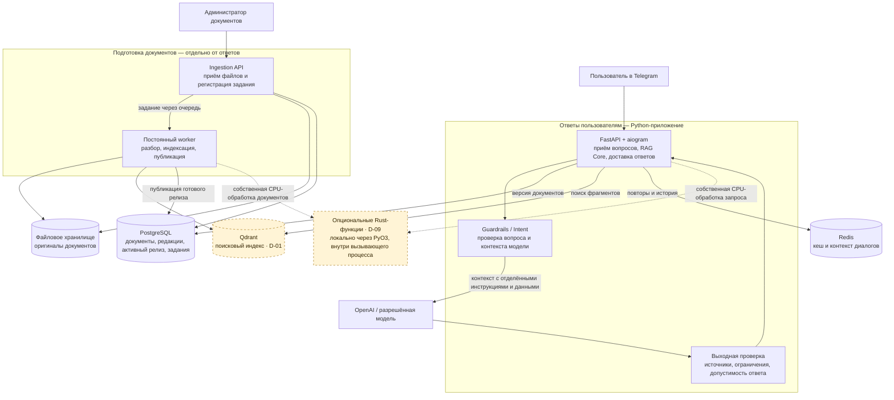
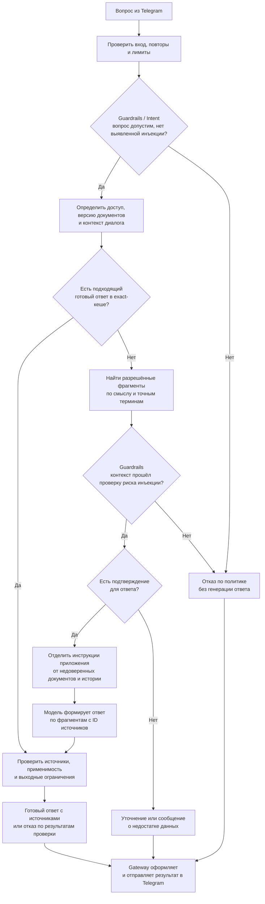
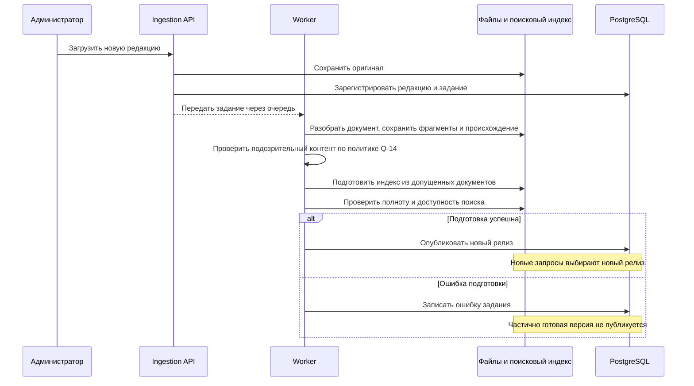

# Архитектура RAG-бота: схема и вопросы для команды

Бот отвечает на вопросы в Telegram по актуальной документации и показывает источники. Если в документах нет достаточного подтверждения, он просит уточнение или сообщает, что ответа не нашёл.

Ниже — общий каркас из черновиков и вопросы, которые ещё нужно решить. **Столбец «Итог» оставлен пустым для заполнения на синке.** Номера D и Q помогают ссылаться на конкретную строку.

## Как устроена система

### 1. Приложение, обработка документов и хранилища

**Что здесь уже вырисовывается:**

- Одна модульная Python-кодовая база. Подготовка документов выполняется отдельным процессом, чтобы тяжёлая обработка не задерживала ответы.
- PostgreSQL определяет, какая версия базы знаний опубликована. Исходные файлы сохраняются отдельно; поисковый индекс можно восстановить.
- Redis ускоряет повторы и хранит выбранное состояние диалога. Он не определяет активный релиз документов.
- Guardrails проверяет пользовательский ввод и контекст, который получит модель; выходная проверка применяется и к новым ответам, и к кешу. Это логические модули внутри приложения.
- Qdrant показан как исходный кандидат из Candidate v1 и исследования №1. Альтернатива — поиск внутри PostgreSQL; это вопрос D-01. Технология очереди и число процессов — D-07.
- Rust может заменить отдельные CPU-функции внутри API или worker. Это возможная оптимизация, показанная пунктиром; основной конвейер остаётся на Python.

`RAG Core` — координатор внутри приложения: он вызывает нужные модули, а не становится отдельным сетевым сервисом. Несколько копий приложения и Traefik можно добавить при необходимости; начальное количество обсуждаем в D-07.

### 2. Как бот отвечает на вопрос

Exact-кеш возвращает ответ на тот же вопрос при совместимых версии документов, правах и контексте. История помогает понять вопрос, но не заменяет документальное подтверждение. Поиск сочетает смысловую близость и точные слова: например, коды ошибок, команды и номера версий.

На схеме показан общий путь. **Когда повторно проверять актуальность и можно ли показывать ещё не проверенный текст — отдельные решения D-02 и D-05.** Проверка существования ссылки сама по себе не доказывает правильность каждого утверждения.

**Защита от prompt injection:** попытка заставить бота сменить правила может прийти и в вопросе, и внутри найденного документа. Поэтому одного входного фильтра недостаточно. Документы и история передаются как недоверенные данные; права на источники и передачу данных проверяются сервером, модель не может их расширить. Ссылки строит приложение по проверенным ID, а не по придуманному моделью URL. В этом RAG-пути модель не выполняет команды из документов и не получает произвольных инструментов.

Guardrails/Intent из [Candidate v1, §6 и §15.6](./candidate_architecture_v1_rag_bot.md) и [корпоративного приложения, §8.3](./candidate_architecture_v1_appendix_corporate_context_scope.md) — часть этой защиты. Классификатор «по теме / не по теме» сам по себе не является детектором инъекций. Отрицательный результат фильтра тоже не гарантирует отсутствия атаки: остаются серверные ограничения, выходная проверка и тесты атак через вопросы и документы. Выбор детектора и реакция на срабатывание — **Q-13 и Q-14**. Эти границы соответствуют [рекомендациям OWASP](https://genai.owasp.org/llmrisk/llm01-prompt-injection/).

### 3. Как обновляются документы

**Редакция** — версия одного документа. **Релиз** — согласованный набор редакций всей базы знаний. Загрузка файла и публикация релиза — разные действия.

Как физически хранить версии индекса — D-03. Можно ли отвечать по прежним документам во время обновления — D-02. Как восстанавливать потерянные задания — D-07 и Q-03.

## Что нужно решить

### Расхождения в черновиках

В позициях указаны документы, где они описаны. Никита добавил Candidate v1 и приложения; Эмиль — оба исследования. У Эмиля исследования тоже различаются между собой, поэтому сравниваем предложения, а не делим команду на два лагеря. Автор коммита не обязательно является первоначальным автором каждой идеи.

| Вопрос                                                                                           | Позиция 1                                                                                                                                                                                                                                                                                                    | Позиция 2                                                                                                                                                                                                                                                                                                                               | Пояснения к сравнению                                                                                                                                                                                                                                                                                                                                                                                                                                                                                                                                                          | Итог                                                                                                                                                                                                                                                                                                                                                                                                                                                                                                                                                                                                                                                                      |
| ------------------------------------------------------------------------------------------------------ | ------------------------------------------------------------------------------------------------------------------------------------------------------------------------------------------------------------------------------------------------------------------------------------------------------------------- | ---------------------------------------------------------------------------------------------------------------------------------------------------------------------------------------------------------------------------------------------------------------------------------------------------------------------------------------------- | ------------------------------------------------------------------------------------------------------------------------------------------------------------------------------------------------------------------------------------------------------------------------------------------------------------------------------------------------------------------------------------------------------------------------------------------------------------------------------------------------------------------------------------------------------------------------------------------------- | ----------------------------------------------------------------------------------------------------------------------------------------------------------------------------------------------------------------------------------------------------------------------------------------------------------------------------------------------------------------------------------------------------------------------------------------------------------------------------------------------------------------------------------------------------------------------------------------------------------------------------------------------------------------------------- |
| **D-01. Где выполнять поиск?**                                                        | **Qdrant + PostgreSQL.** Поиск в Qdrant, версии и публикации в PG. Candidate v1 Никиты и исследование №1 Эмиля.                                                                                                                                                    | **PostgreSQL + pgvector + FTS.** Поиск и версии в одной БД. Исследование №2 Эмиля.                                                                                                                                                                                                                       | Qdrant соответствует перечисленному стеку кейса и даёт готовые средства гибридного поиска, но требует согласования индекса с PG. PG-only уменьшает число сервисов, но качество и скорость поиска нужно проверить. Сначала уточняем обязательность стека; затем выбираем один вариант.                                                                                | Qdrant хранит вектора и версии документов + ссылки (все обновляется только транзакционно через версионирование и встроенные транзации). PostgreSQL через ORM нужен для хранения актуальных версий документов (именно версии), пользователей (доступы, рейтинг пользователя)                                                                                                                                                                                   |
| **D-02. Когда ответ считается актуальным?**                               | **Версия фиксируется в начале обработки.** Уже начатый ответ может завершиться по старому релизу. Candidate v1 и исследование №1; последнее предусматривает маркировку версии. | **Повторная проверка перед отправкой.** При изменении версии — повтор или временный отказ; известная правка может блокировать старую редакцию ещё до публикации новой. Исследование №2. | Первый вариант проще и даёт меньше отказов, но старый факт может прийти после обновления. Второй уменьшает такие случаи ценой повторов и задержек. Отдельно решаем обычные правки и экстренное удаление/отзыв прав. Проверка перед отправкой не гарантирует актуальность в момент отображения Telegram.                                         | Версия фиксируется в начале обработки                                                                                                                                                                                                                                                                                                                                                                                                                                                                                                                                                                                                        |
| **D-03. Как обновлять индекс?**                                                      | **Инкрементально, в одной коллекции.** Менять только нужные документы и задавать диапазон релизов, где виден каждый фрагмент. Candidate v1.                                                                   | **Отдельный снимок на релиз.** Подготовить новую коллекцию и переключить указатель в PG. Исследование №1.                                                                                                                                                    | Инкрементальный путь экономит перенос данных при небольших правках, но усложняет отмену, откат и очистку. Снимки проще изолировать, но дороже по диску и времени сборки. Для обоих можно переиспользовать готовые embeddings. Перед выбором интервалов обязательно закрыть Q-01 и Q-02.                                                                                  | Инкрементально, в одной коллекции                                                                                                                                                                                                                                                                                                                                                                                                                                                                                                                                                                                                                |
| **D-04. Нужен ли семантический кеш готовых ответов?**             | **Exact + Semantic.** Переиспользовать ответы и на близкие по смыслу вопросы; L3 вводить экспериментально. Candidate v1.                                                                                                                      | **Только Exact в основном пути.** Семантическое переиспользование ответов по умолчанию выключено. Оба исследования.                                                                                                                                 | Semantic экономит вызовы модели на перефразированиях, но похожие вопросы с другим отрицанием, продуктом или версией могут требовать другого ответа. Предложение для старта: exact; L3 сначала только наблюдает совпадения и проходит проверку ложных попаданий.                                                                                                                         | L1 и L2 кеш объединяется в один - точные совпадения фраз после нормализации (после попадания в кеш проверить актуальность версии и если утстарела то запись очищаем и идем полным путем запроса). p.s. L3 кеш возможно как-то можно надресировать на сокращение времени работы rerancing модели в quadrant (самая долгая операци в quadrant, ее имеет смысл разгрузить если возможно). |
| **D-05. Показывать текст во время генерации?**                          | **Draft-first.** Показывать временный текст, затем отправлять постоянный итог. UX-выбор Candidate v1; строгость проверки до показа оставлена открытой.                                                          | **Сначала проверить ответ, затем показать.** Совместимо со строгой проверкой перед выдачей из исследования №2.                                                                                                                                        | Поток приятнее воспринимается, но пользователь уже видит непроверенные факты. Поздний отказ не отменяет прочитанное. Итог после проверки проще согласовать с достоверностью и отзывом доступа. Можно заранее показывать только статус работы. Решаем вместе с D-02.                                                                                                       | отправляем полностью готовый текст без трансляции (опционально если будет время или условие кейса воодить трансляцию или новую фичу с html ответами)                                                                                                                                                                                                                                                                                                                                                                                                |
| **D-06. Как понимать уточнения вроде «А где это включить?»** | **Переписывать зависимый вопрос в самостоятельный поисковый запрос.** Исходный бриф в пересказе Candidate.                                                                                                                          | **Использовать историю и контекстный поиск; rewrite — при необходимости.** Candidate v1 убирает обязательный rewriter.                                                                                                                                                 | Rewrite добавляет задержку и может изменить смысл. Контекстный поиск дешевле, но его нужно проверить на диалогах; при неоднозначности просить уточнение. Хеш истории защищает кеш, однако сам по себе не помогает найти нужный документ.                                                                                                                                                               | изначально планируем без контекста (одно сообщение = один ответ) . если кейс потребует историю (полноценный чат) то лучше переиспользовать прошлые ответы с новыми запросами (возможно поможет kv cache)                                                                                                                                                                                                                                                                                                   |
| **D-07. Сколько процессов и какая очередь на старте?**            | **Несколько online-реплик за Traefik, отдельные Ingestion API и worker, очередь Redis.** Candidate v1.                                                                                                                                                                            | **Начать с одной online-реплики и отдельного worker; долговременные задания в PG.** Более простой старт, допускаемый исследованиями.                                                                                                             | Реплики помогают при нагрузке, но требуют общего состояния, дедупликации и контроля памяти моделей. Один экземпляр проще интегрировать. Отдельный worker сохраняется в обоих вариантах. Можно хранить задания в PG, а Redis использовать как сигнал; разрыв между ними обсуждаем в Q-03                                                                                  | делаем один контейнер core и worker и свои контейнеры на базы данных (без балансировщика).**Uvicorn** с флагом `--workers` и запускать его под управлением **Gunicorn** для обхода GIL                                                                                                                                                                                                                                                                                                                                                                           |
| **D-08. Насколько подробно проектировать до кейса?**              | **Полная карта модулей и предварительные контракты; после ТЗ исключить лишнее.** Корпоративное приложение.                                                                                                                  | **Сначала сквозной минимальный сценарий, затем расширение.** Акцент исследований.                                                                                                                                                                                           | Это можно совместить: заранее описать обязанности и стыки, после ТЗ выбрать состав, внутри него первым собрать путь «документ → ответ». Не требуется заранее реализовывать все возможности. Нужно согласовать, когда фиксируем окончательные интерфейсы.                                                                                                                        | так как у нас слоистый (модульный) монолит то делаем (и проектируем) изначально минимально жизнеспособный mvp который потом расширяем нужными фичами (слоями) без доработки контрактов                                                                                                                                                                                                                                                                                                                                  |
| **D-09. Когда подключать Rust для CPU-оптимизации?**                      | **Первый рабочий конвейер на Python; затем профилирование.**                                                                                                                                                                                                              | **Раньше выделить подтверждённые дорогие CPU-функции в Rust через PyO3.**                                                                                                                                                                                                                      | Кандидаты — собственная обработка больших текстов, чанкинг и сложные правила обработки запросов. На стенде тяжёлое ядро ускорилось примерно в 106 раз, а полный mock RAG — примерно на 17% по средней задержке и на 21% по p95. Реальные кандидаты и ограничения разобраны ниже. Выбираем момент внедрения по профилю и срокам сборки. | если у нас будет кейс на одновременнуй ответ и парсинг новых документов то обработку документов стоит переписать на rust. но изначально придерживаемся python only и смотрим по нагрузочным тестам                                                                                                                                                                                                                                                                                                                     |
| **D-10. Какие показатели скорости и качества принимаем?**     | **Ориентиры брифа:** 150+ RPS, около 300 мс до первого токена, 1,2–1,8 с полного RAG. Пересказ в Candidate.                                                                                                                                                   | **Цели исследования №2:** p95 нового прогретого запроса до 8 с, холодного до 12 с, exact backend до 0,5 с; отдельные метрики качества.                                                                                                                       | Это разные ориентиры, а не измеренные результаты. Нельзя сравнивать время Redis lookup со всем ответом или первый токен модели с показом проверенного текста. Сначала фиксируем границы замера, долю повторов, квоты, сервер и проверку качества; затем числа.                                                                                                                            | смотрим по кейсу и на месте решаем                                                                                                                                                                                                                                                                                                                                                                                                                                                                                                                                                                                                                |

### Недоговорённости, найденные при сверке

Здесь **позиции 1 и 2 — варианты для обсуждения**, а не приписанные авторам мнения. Эти вопросы в исходниках либо оставлены открытыми, либо описаны недостаточно для реализации.

| Вопрос                                                                                                       | Позиция 1                                                                                                                                                                                      | Позиция 2                                                                                                                                                                                                                                        | Пояснения к сравнению                                                                                                                                                                                                                                                                                                                                                                                                                                                                                                                                                                                                                                                                                   | Итог                                                                                                                                                                                                                                                                                                                                                                                                                                                                         |
| ------------------------------------------------------------------------------------------------------------------ | ----------------------------------------------------------------------------------------------------------------------------------------------------------------------------------------------------- | ------------------------------------------------------------------------------------------------------------------------------------------------------------------------------------------------------------------------------------------------------- | -------------------------------------------------------------------------------------------------------------------------------------------------------------------------------------------------------------------------------------------------------------------------------------------------------------------------------------------------------------------------------------------------------------------------------------------------------------------------------------------------------------------------------------------------------------------------------------------------------------------------------------------------------------------------------------------------------------------------- | -------------------------------------------------------------------------------------------------------------------------------------------------------------------------------------------------------------------------------------------------------------------------------------------------------------------------------------------------------------------------------------------------------------------------------------------------------------------------------- |
| **Q-01. Что делать с отменённой подготовкой релиза?**                         | Довести тот же подготовленный состав до готовности, прежде чем публиковать следующий.                                        | Отменить подготовку, убрать её изменения и только затем готовить следующий состав.                                                                                                | При интервальном индексе остатки отменённого R8 могут стать видимыми в R9. Один worker и возрастающий номер это не предотвращают. Нужна проверка: следующая публикация не включает чужие незавершённые изменения.                                                                                                                                                                                                                                                                                                                                  | workers работают последовательно из очереди, никакой паралельной обработки документов                                                                                                                                                                                                                                                                                                                       |
| **Q-02. Как откатывать документы и удалять старые версии?**              | Вернуть указатель на удерживаемый прежний релиз.                                                                                                            | Выпустить новую публикацию с прежним составом документов и новым номером.                                                                                                                | Новый номер упрощает историю и исключает случайное использование старого кеша. В интервальном варианте возвращённой редакции могут понадобиться новые поисковые записи. Очистка ждёт окончания старых запросов и срока отката; отзыв доступа при откате не отменяется.                                                                                                                                                                                                                    | кладем новую версию рядом в quadrant, обновляем в postgres актуальную версию документа и  потом очищаем старую из quadrant                                                                                                                                                                                                                                                                      |
| **Q-03. Как не потерять задания и входящие вопросы?**                          | Полагаться на выбранную очередь с настроенным сохранением и повторами.                                                                   | Хранить принятые задания/вопросы в PG и восстанавливать обработку по этому реестру.                                                                                                | После записи job в PG процесс может упасть до отправки в Redis. Во втором варианте worker найдёт задание повторно; в первом механизм надёжной передачи нужно определить отдельно. Повтор не должен создавать вторую публикацию или лишнюю генерацию.                                                                                                                                                                                                                                                                          | на входе и выходе очереди, весь путь учитывается в outbox (возможно через python-cqrs или outbox-pattern) и после падения можно с любого момента востановить и закончить запрос                                                                                                                                                                            |
| **Q-04. Можно ли держать кеш и очередь в одном Redis?**                             | Один экземпляр с разделением ключей и общей политикой памяти/сохранения.                                                                | Отдельные экземпляры либо критичные состояния в PG, Redis — восстанавливаемый слой.                                                                                                     | Один Redis проще развёртывать, но общий отказ или вытеснение ключей затрагивает сразу несколько функций. Префиксы ключей не разделяют ресурсы и надёжность. Нужно заранее выбрать поведение при переполнении и потере Redis.                                                                                                                                                                                                                                                                                                              | очереди на rabbitMQ, кеш на Redis                                                                                                                                                                                                                                                                                                                                                                                                                                  |
| **Q-05. Как обрабатывать два вопроса одного чата одновременно?**    | По очереди: следующий вопрос использует завершённую историю предыдущего.                                                               | Параллельно, но с явной версией истории и контролем конфликтов.                                                                                                                                    | Последовательная обработка проще и сохраняет смысл уточнений; длинный ответ задержит следующий. Параллельная требует правил порядка ответов, reset и отмены. Общая БД сама этот порядок не задаёт.                                                                                                                                                                                                                                                                                                                                                          | изначально только в порядке очереди. по кейсу смотреть - если надо до уточнять актуальность вопроса или отдавать отбивку "в работе"                                                                                                                                                                                                                                  |
| **Q-06. Что делать при неизвестном результате отправки Telegram?**        | Повторять отправку автоматически, принимая риск дубликата.                                                                                         | Сохранять отдельное состояние доставки; неизвестный исход обрабатывать по согласованному правилу без немедленного повтора.                  | После таймаута сообщение могло быть принято Telegram. Дедупликация входящего update не решает повтор исходящей отправки. Нужно выбрать компромисс между риском пропуска и дубликата и не запускать генерацию заново ради retry.                                                                                                                                                                                                                                                                                                                | автоматические ретраи не больше N по эспоненциальному времени. возможно, если будет нужно и будет времня - при неуверенности доставки запрашивать у пользователя пришел ли ему ответ (дать возмлжность нажатием кнопки еще раз его получить быстро из outbox/redis) |
| **Q-07. Кто имеет доступ к документам и куда их можно передавать?** | Общий разрешённый корпус для всех пользователей бота; внешняя обработка согласована.                                         | Закрытый корпус: подтверждённая личность, разные права и ограничения передачи.                                                                                                       | Это условие кейса, а не свободный технический выбор. Telegram ID не подтверждает трудоустройство. Политика затрагивает поиск, кеш, историю, ссылки, embeddings, rerank и генерацию. Если внешняя обработка запрещена, нужны разрешённая модель и реальные ресурсы для неё.                                                                                                                                                                                                                                              | по условиям кейса, пока не планируем права доступа                                                                                                                                                                                                                                                                                                                                                                                     |
|                                                                                                                    |                                                                                                                                                                                                       |                                                                                                                                                                                                                                                         |                                                                                                                                                                                                                                                                                                                                                                                                                                                                                                                                                                                                                                                                                                                            |                                                                                                                                                                                                                                                                                                                                                                                                                                                                                  |
| **Q-08. Как пользователь открывает источник?**                                     | Ссылка на существующую систему документов, где уже проверяется доступ.                                                                    | Собственная выдача конкретной редакции/выдержки с проверкой прав.                                                                                                                              | Первый вариант проще, если система доступна из Telegram и вне VPN. Второй требует реализации и хранения. В обоих нужны точная страница/секция и правило доступности старой ссылки после обновления или удаления.                                                                                                                                                                                                                                                                                                                                        | по кейсу                                                                                                                                                                                                                                                                                                                                                                                                                                                                  |
| **Q-9. Какие документы и проверки публикации поддерживаем?**          | Ограниченный набор форматов: неподдерживаемое и плохо разобранное явно отклоняем.                                              | Включаем OCR и обработку нужных таблиц/графиков в первую версию.                                                                                                                                     | Выбор зависит от корпуса. Пустое извлечение нельзя считать успехом. До публикации проверяем ожидаемый состав, локаторы и полноту; количества чанков недостаточно. Более широкий охват увеличивает работу по парсингу и проверке качества.                                                                                                                                                                                                                                                                            | по кейсу                                                                                                                                                                                                                                                                                                                                                                                                                                                                  |
| **Q-10. Как проверяем достоверность ответа?**                                       | Правила для источников, ID и формата; инструкция модели и оценка на эталонных вопросах.                                         | Дополнительная проверка того, что утверждения следуют из фрагментов, перед выдачей каждого ответа.                                                                  | Проверка ID подтверждает происхождение ссылки, но не смысл тезиса. Дополнительный проверяющий этап увеличивает задержку и стоимость и тоже допускает ошибки. Нужно определить требуемую строгость, метод проверки и поведение при сомнении.                                                                                                                                                                                                                                                                         | только системным промптом, больше гарантий предоставить мы не можем                                                                                                                                                                                                                                                                                                                                                    |
| **Q-11. Что входит в первый рабочий состав?**                                         | Файлы → поиск → ответ с источниками; остальные интеграции по необходимости.                                                            | Сразу включить требуемые дополнительные сценарии: многошаговый диалог, корпоративный вход, внешние источники или административный UI. | Состав определяется ТЗ. Confluence, HR/CRM и согласования из статьи про другой бот автоматически требованиями не становятся. До разработки фиксируем включённые модули, владельцев стыков, лимиты загрузки/хранения и ожидаемое восстановление после сбоя.                                                                                                                                                                                                                                                           | минимальное mvp без лишних фич                                                                                                                                                                                                                                                                                                                                                                                                                            |
| **Q-12. Как выявляем prompt injection в вопросах и документах?**                    | Правила и лёгкий локальный классификатор; отдельная проверка найденных фрагментов.                                            | Те же базовые проверки плюс специализированная модель-детектор, например для спорных случаев.                                                                           | Первый вариант дешевле и быстрее, но правила легче обойти, а классификатору нужны подходящие данные. Второй добавляет задержку, ресурсы и зависимость от детектора; также возможны пропуски и ложные отказы. Сравниваем атаки на русском/английском, инъекции в документах и обычные технические инструкции. Серверные права и разделение инструкций/данных обязательны в обоих вариантах. | модель линейной регрессией. плавайющая константа может быть реализванна по рейтингу пользователей, но это не входит в mvp (смотрим по кейсу)                                                                                                                                                                                                                   |
| **Q-14. Что делать при срабатывании защиты?**                                        | Сразу отказывать на подозрительный вопрос; подозрительный документ отправлять на проверку без публикации. | Перепроверять спорный ввод; для подозрительного фрагмента пробовать другой разрешённый контекст и снова проверять.                                  | Первый вариант проще, но ошибочное срабатывание блокирует полезный вопрос или документ. Второй уменьшает такие потери ценой задержки и сложности. Непрошедший проверку материал не передаётся генератору; при неразрешённом сомнении — отказ. На схеме показан простой путь отказа; альтернативная обработка определяется здесь.                                                                                                         | отклонять и просить переформулировать вопрос. возможно если класификатор даст овтет почему конкретно вопрос не корректен то можем указать пользвоателю что конкретно в его вопросе не так                                                                                                                         |

## Где помогает Rust и что показали тесты

**Python остаётся основой приложения.** Rust через PyO3 может выполнять отдельную локальную функцию с теми же входом и результатом. Необходимость такой замены зависит от того, сколько времени процессор тратит на наш собственный код.

| Участок                                | Что Rust потенциально ускоряет                                                                                                                                                                                  | Что ожидаем и что ещё проверить                                                                                                                                                                                                                                                                                                                           |
| --------------------------------------------- | -------------------------------------------------------------------------------------------------------------------------------------------------------------------------------------------------------------------------------------- | ----------------------------------------------------------------------------------------------------------------------------------------------------------------------------------------------------------------------------------------------------------------------------------------------------------------------------------------------------------------------------------- |
| **Подготовка документов** | Собственные циклы нормализации больших текстов, разбор структуры Markdown, границ таблиц и секций, чанкинг, обработка метаданных | Меньше CPU и быстрее подготовка релиза, не отнимает вычислительную мощность у core. Готовые PDF-парсеры и токенизаторы уже могут выполнять работу в нативном коде; перенос обвязки не обещает такого же эффекта |
|                                               |                                                                                                                                                                                                                                        |                                                                                                                                                                                                                                                                                                                                                                                     |
