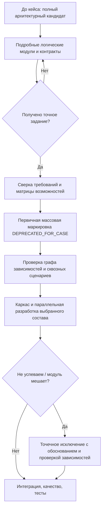
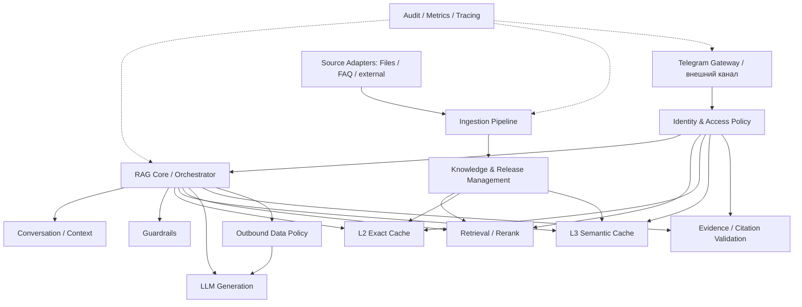
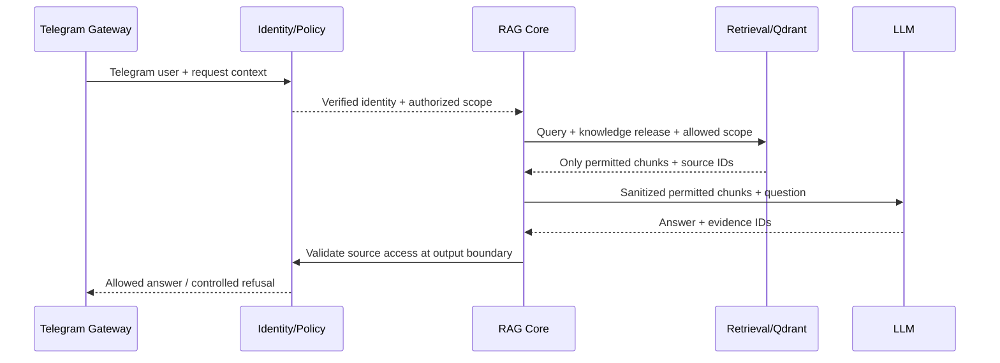
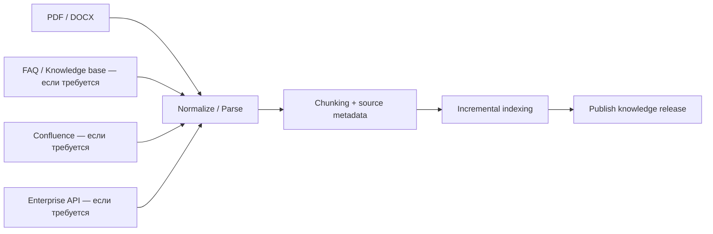
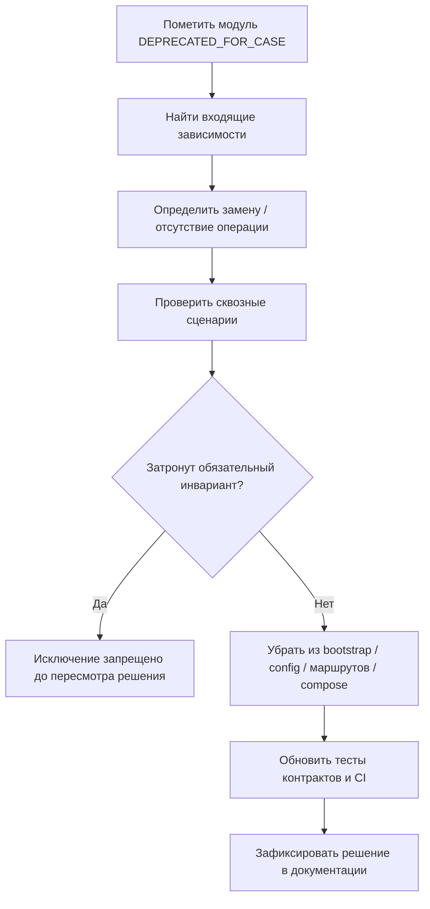

:::warning Ранние исследования
Материал сохранён для истории. При проектировании и реализации опирайтесь на актуальный раздел [«Архитектура»](../../architecture/index.md).
:::

# Архитектурное приложение A к Candidate Architecture v1

## Корпоративный контекст «БАРС Груп», расширенные границы модулей и управляемое сокращение архитектуры под фактическое задание

**Проект:** корпоративный Telegram-бот с High-Speed RAG для хакатона  
**Дата:** 2 ноября 2026 г.  
**Документ:** самостоятельное дополнение к `candidate_architecture_v1_rag_bot.md`  
**Статус:** `CANDIDATE ADDENDUM — NOT APPROVED`  
**Назначение:** зафиксировать новую информацию, её источники и влияние на *наш* архитектурный вариант; описать стратегию полной предварительной проработки и последующего сокращения состава системы. **Это не финальное решение команды и не ТЗ на реализацию.**

> **Ключевое уточнение процесса от команды.** До получения конкретного хакатонного задания мы стремимся **максимально полно и подробно** проработать исходную архитектуру, границы модулей, возможные сценарии и их контракты. **Основной отбор и исключение модулей проводится сразу после получения точного задания**: ненужные части помечаются как `DEPRECATED_FOR_CASE` в архитектурной документации и исключаются из плана сборки. **Во время реализации дополнительные исключения — не штатный способ упрощения, а вынужденная мера** при нехватке времени либо при обнаружении, что модуль мешает исполнению требований или интеграции. Мы не предлагаем с самого начала делать неполную архитектуру или откладывать описание контрактов до разработки.

---

## 1. Основание и пределы достоверности

### 1.1. Что было обнаружено

Основной новый материал — публикация из **блога самой компании «БАРС Груп»**:

**Тимур Садриев и коллеги, «Апгрейд Telegram-бота для управления внутренними процессами: наш опыт вам в копилку», Хабр, 28 января 2025 г.**  
[Полная статья](https://habr.com/ru/companies/barsgroup/articles/877322/) · [AMP-версия, обнаруженная при исследовании](https://habr.com/ru/amp/publications/877322/).

Это источник о **другом уже существовавшем корпоративном Telegram-боте** компании. По статье нельзя утверждать, что хакатонная задача требует продолжать именно этот продукт, что его архитектура сохраняется без изменений в 2026 году или что его справочник/ИИ-помощник использует тот же RAG-стек.

Дополнительные источники — документация Qdrant, Telegram Bot API, OpenAI API, типизации Python, а также материалы OWASP о безопасности LLM-приложений. Их ссылки перечислены в §14. В отличие от статьи компании, это **нормативные/технические подтверждения возможностей инструментов**, а не описание требований конкретного хакатона.

### 1.2. Обозначения статуса утверждений

| Маркер | Значение |
|---|---|
| `[ФАКТ ИЗ СТАТЬИ]` | Авторы сообщают это о своей системе на дату публикации. |
| `[ФАКТ ИНСТРУМЕНТА]` | Функция/ограничение подтверждены технической документацией. |
| `[ВЫВОД]` | Инженерное следствие из фактов, но **не** прямое требование заказчика. |
| `[РЕШЕНИЕ КАНДИДАТА]` | Принцип, принятый для нашего архитектурного варианта; ещё не утверждён командой. |
| `[УСЛОВНО]` | Применимо только при определённом тексте задания. |
| `[ОТКРЫТО]` | Нельзя обоснованно конкретизировать до получения кейса или сравнения с техлидом. |

---

## 2. Что конкретно говорит статья — с точными местами и последствиями

| № | Подтверждённое наблюдение | Где найти в статье | Что это **не** доказывает | Следствие для нашей архитектуры |
|---|---|---|---|---|
| S1 | Компания использовала **асинхронный модульный монолит на aiogram** и указывала, что функциональные части можно дорабатывать или удалять. | [«Старт работы: меняем библиотеку»](https://habr.com/ru/companies/barsgroup/articles/877322/), абзац после описания старого `telebot` | Не доказана производительность нашей RAG-реализации; это не значит, что нам нужно повторить код компании. | Сохранить модульные границы; заранее рассматривать судьбу каждого модуля при сокращении объёма. |
| S2 | Бот позволяет согласовывать внутренние процессы **в поездках, без оперативного подключения к VPN/мастер-системам**. | [«Согласование бизнес-процессов»](https://habr.com/ru/companies/barsgroup/articles/877322/) и [«Результаты»](https://habr.com/ru/companies/barsgroup/articles/877322/) | Не сказано, что все внутренние документы доступны любому Telegram-пользователю. | Зафиксировать внешнюю доверительную границу: личный Telegram-чат ≠ корпоративно подтверждённая личность. |
| S3 | В боте есть справочные материалы, корпоративные документы и FAQ по системам. | [«Предоставление справочной информации»](https://habr.com/ru/companies/barsgroup/articles/877322/) | Не установлено, что справочник построен на Qdrant, OpenAI или RAG. | Поддержать различные происхождения знаний и выдачу ссылок, а не только PDF из одного каталога. |
| S4 | В старом решении было трудно находить сведения в **Confluence**. | [«Старт работы: меняем библиотеку»](https://habr.com/ru/companies/barsgroup/articles/877322/) | Не доказано, что хакатон разрешает или требует интеграцию Confluence. | Предусмотреть входную границу `Source Connector → Ingestion`, не реализуя Confluence без задания. |
| S5 | Бот объединяет взаимодействия с внутренними бизнес-системами; авторы пишут о выделенном сервере и API для интеграций. | [«Настройка запросов и интеграция с другими системами»](https://habr.com/ru/companies/barsgroup/articles/877322/) | Не значит, что наш RAG должен делать CRM-запросы и инициировать бизнес-операции. | Отделить RAG Core от Telegram и внешних корпоративных интеграций; не привязывать доменную логику к одному транспорту. |
| S6 | Компания описывает автоматическое исключение пользователей из рабочих чатов по спискам допуска, полученным от стороннего сервиса. | [«Очищаем внутренние Telegram-группы и –каналы»](https://habr.com/ru/companies/barsgroup/articles/877322/) и [«Взаимодействие с Telegram API»](https://habr.com/ru/companies/barsgroup/articles/877322/) | Это **права доступа к чатам**, а не доказательство наличия ACL на отдельные документы, чанки или поля. | Предусмотреть внешний источник корпоративной идентичности и механизм отзыва прав; конкретную модель документов выбирать только по кейсу. |
| S7 | Авторы оставляли ручную модерацию в неопределённых случаях автоматической проверки фотографий. | [«Внедрение нейросети» / «Безопасность и обратная связь»](https://habr.com/ru/companies/barsgroup/articles/877322/) | Это не требование ручного согласования RAG-ответов. | На уровне архитектуры оставить возможность отказа, эскалации и ручной проверки спорных операций — только при соответствующем задании. |
| S8 | Авторы сообщают о снижении обращений в техподдержку на **8%** после появления справочника и ИИ-помощника. | [«Результаты»](https://habr.com/ru/companies/barsgroup/articles/877322/) | Цифра относится к их системе, а не к прогнозу эффективности нашего решения. | Предусмотреть метрики полезности, а не оценивать успех только latency/RPS. |

### 2.1. Терминологическая оговорка: «полевой доступ»

В контексте этой статьи обнаружен прежде всего **доступ из поездок/вне VPN**, то есть корпоративное взаимодействие через внешний канал связи. Это **не тождественно** «полевому доступу к атрибутам/полям документа» и не тождественно RBAC. Для архитектуры полезно различать:

1. **Канал доступа:** бот используется через Telegram вне корпоративной сети.
2. **Подтверждение личности:** кто стоит за конкретным Telegram ID.
3. **Авторизация:** к каким документам, разделам, операциям разрешён доступ.
4. **Разграничение по полям:** допустимы ли к выдаче отдельные фрагменты/атрибуты внутри разрешённого документа.

Статья прямо подтверждает первое и показывает частный механизм контроля допуска к чатам. Пункты 2–4 для **нашего RAG-кейса** остаются предметом условий задания.

### 2.2. Самый важный вывод из статьи

**[ВЫВОД]** Мы проектировали прежде всего скорость, достоверность и актуальность RAG-ответа. Статья напомнила о четвёртом измерении: **корпоративная доверительная граница** — кому разрешено узнать информацию, можно ли передать её внешнему провайдеру и как изменяются полномочия сотрудников.

**Это причина предусмотреть архитектурные точки политики доступа и классификации данных, но не причина заранее реализовывать все мыслимые роли, ведомственные интеграции и функции чужого бота.**

---

## 3. Важнейшее организационное решение: полная предварительная архитектура, затем управляемая декомпозиция

### 3.1. Почему корректируем ранее предложенный подход

Ранее обсуждалась идея заранее готовить урезанные профили («простой RAG», «обновляемый RAG», «корпоративный RAG») и начать с минимального набора модулей. В качестве иллюстрации этот подход полезен, **но как основной процесс подготовки команды он не принят**.

**[РЕШЕНИЕ КАНДИДАТА]** Действуем иначе:

- **До получения задания:** строим **максимально полную, подробную исходную архитектуру** на базе известного брифинга и выявленных сценариев; описываем модули, их возможности, границы, зависимости, предполагаемые входы/выходы, ошибки, доверительные границы и межмодульные контракты. Не обязательно писать реализацию.
- **В момент получения конкретного задания:** всей командой сопоставляем его с исходной архитектурой, выделяем требуемые возможности, основные модули и зависимости; **массово маркируем невостребованные элементы** `DEPRECATED_FOR_CASE` и исключаем их из проектного scope. Это **главная точка сокращения**.
- **После формирования проектного состава:** запускаем каркас, интеграцию и параллельную разработку оставшихся модулей; не перепроектируем всё с нуля.
- **Уже в процессе разработки:** дополнительно выводим модуль из scope **только** при объективной нехватке времени, обнаруженной несовместимости либо вредном влиянии модуля на реализацию требований. Каждое такое решение фиксируем отдельно и проверяем зависимые контракты.
- **Для сравнения с техлидом:** максимальная наша архитектура остаётся **самостоятельным кандидатом**, а не объявляется безальтернативным итогом.

Это именно **scope reduction after requirements**, а не «минимальный MVP сначала, детали потом».

### 3.2. Временная схема



### 3.3. Почему максимально подробная проработка до кейса оправданна

**Преимущества:**

- **Быстрый старт:** не нужно создавать всю архитектуру в первые часы хакатона; останется выбрать необходимую часть.
- **Устранение скрытых зависимостей:** можно заранее увидеть, что ACL затрагивает не только Retrieval, но и кэш, диалог и выдачу источников.
- **Согласованная параллельная работа:** участники получают собственные зоны с уже описанными интерфейсами и допустимыми зависимостями.
- **Трассируемость решений:** понятно, что было исключено, почему, какие предположения лежали в основе изначального решения.
- **Перестраиваемость без полной переработки:** можно сохранить оркестратор и заменить адаптер или исключить необязательный этап.
- **Удобство сравнения кандидатов:** сравниваем не разрозненные идеи, а цельные архитектуры с известными компромиссами.

**Издержки и риски:**

- **Затраты до получения точных требований:** часть тщательно продуманных модулей и контрактов может не понадобиться.
- **Ложная точность:** подробные сигнатуры, модели и потоки, придуманные без данных кейса, могут создать ощущение принятого требования, которого нет.
- **Эффект якоря:** команда может защищать уже нарисованный компонент, вместо того чтобы честно признать его ненужным.
- **Каскадное сокращение:** один модуль легко пометить deprecated, но его отсутствие может затронуть 3–5 связанных решений.
- **Переусложнение ради универсальности:** стремление сделать всё подключаемым создаёт интерфейсы, флаги и конфигурации, которые сами требуют поддержки.
- **Трудоёмкость согласования с техлидом:** более полный кандидат создаёт больше точек для обсуждения и возможных противоречий.

**Компенсация рисков:** каждый контракт подробно описываем, **но помечаем допущения, триггеры применимости и степень уверенности**; ни одна гипотетическая функциональность не должна автоматически становиться обязательством по разработке после получения кейса.

---

## 4. Принцип разделения: подробная проектная схема — не динамическая система плагинов

Мы **не** принимаем задачу разработать универсальный фреймворк, где любой модуль можно подгрузить на лету. Такая система потребовала бы дополнительной инфраструктуры и тестирования всех комбинаций.

**[РЕШЕНИЕ КАНДИДАТА]** Используем обычные Python-пакеты и статическую сборку зависимостей, где архитектура позволяет исключить модуль при формировании проекта:

- `RAG Core / Orchestrator` владеет порядком вызова стадий, но не поисковыми, ML- или инфраструктурными вычислениями.
- Модули определяются по **зонам ответственности**, а не по факту наличия отдельного контейнера.
- Контракты описывают семантику взаимодействия, ошибки, ownership данных, права и требования к версиям.
- Адаптеры внешних API и хранилищ подменяемы на границах; не каждый внутренний метод нуждается в `Protocol`.
- При исключении части проекта `bootstrap`/точка сборки **не подключает** эту реализацию, а зависимости либо исключаются, либо явно получают разрешённый базовый вариант поведения.
- Инфраструктурные процессы (RAG API-реплики, ingestion worker, Traefik, PostgreSQL, Redis, Qdrant) остаются решением физического исполнения: отключение логического модуля не обязательно означает удаление контейнера и наоборот.

**Важно:** маркировка `DEPRECATED_FOR_CASE` в документе **сама по себе не удаляет импорт, фоновую задачу, HTTP-ручку, доступ к данным или инфраструктурный сервис**. После выбора объёма нужно проверить граф сборки и фактический путь исполнения. Для этого позднее пригодятся Import Linter, тесты контрактов, CI и проверки конфигурации.

В литературе по Feature Toggles отдельно отмечается цена большого числа флагов: рост комбинаций и тестовой нагрузки. Поэтому для нашей подготовки предпочтительна **архитектурная декомпозиция и изменение сборки**, а не десятки вечных runtime-переключателей. См. [Martin Fowler — Feature Toggles](https://martinfowler.com/articles/feature-toggles.html).

---

## 5. Изменения к полной архитектурной схеме после статьи

### 5.1. Карта кандидатов (логический уровень)

Эта схема **не фиксирует окончательный состав по хакатонному заданию**. Она показывает максимально рассматриваемый перечень возможностей и их границы:



**Диаграмма концептуальная**: стрелки означают требуемое взаимодействие или ограничение, а не окончательные Python-импорты. `Identity & Access Policy`, `Outbound Data Policy`, `Audit / Metrics` могут быть как отдельными логическими модулями, так и чётко выделенными границами в соседних пакетах; физическое дробление будет согласовано после получения кейса и сравнения с техлидом.

### 5.2. Таблица влияния новых требований

| Возможность | Почему включаем в максимальную архитектуру | Условие фактического включения в MVP | Что надо обеспечить даже при исключении |
|---|---|---|---|
| **Identity Provider Adapter** | Статья показывает зависимость внутреннего бота от корпоративных систем и допусков. | Требуется идентификация сотрудника/сверка с корпоративной базой. | Не считать произвольный Telegram ID универсальным подтверждением прав на закрытые данные. |
| **Access Policy / ACL** | RAG способен раскрыть приватный документ при слишком широком поиске; права могут изменяться. | Закрытые документы, роли, отделы, группы, разная область видимости. | При отсутствии надёжной политики **не обслуживать** данные, доступ к которым не подтверждён. |
| **Policy-aware Cache** | Иначе L2/L3 могут переиспользовать ответ из разрешённого контекста в запрещённом. | Любой кэш для данных с неуниверсальной областью доступа. | Разделение версий/контекстов и базовая проверка применимости даже без сложного ACL. |
| **External Data Policy** | Чанки передаются внешнему LLM API; не все корпоративные сведения могут быть разрешены к передаче. | Есть ограничения классификации/передачи сведений. | Уточнить допустимость внешней обработки; при запрете нельзя «временно обойти» политику. |
| **Source Connectors** | В статье фигурируют FAQ, документы, Confluence, мастер-системы. | Задание требует не только локальные PDF/DOCX. | Минимальный источник документов остаётся и не раскрывает формат конкретного хранилища остальным модулям. |
| **Secure Citation Resolver** | Ссылка на источник тоже способна открыть закрытый документ. | Приватные источники или авторизованные просмотры. | Не выдавать публичную ссылку на закрытый файл. |
| **Audit / Evidence Trace** | Корпоративная эксплуатация требует разбирать спорные ответы, релизы и операции. | По заданию или по критериям защиты/надёжности. | Не логировать секреты и полный чувствительный контент без оснований. |
| **Human Review / Escalation** | Статья показывает пользу ручного контроля в исключениях. | Требуется обработка сомнительных/привилегированных ситуаций. | Базовый механизм честного отказа должен работать независимо от ручной модерации. |
| **Business Impact Metrics** | Компания измеряет снижение обращений в поддержку. | В задании есть KPI или демонстрация бизнес-эффекта. | Минимальные инженерные метрики latency, hits, retrieval quality остаются. |
| **Existing Bot Integration** | Существующий бот может стать транспортом или соседним продуктом. | Подтверждено заказчиком. | RAG Core не должен быть технически завязан на aiogram/Telegram DTO. |

### 5.3. Из чего состоит действительно обязательный минимум

Даже если весь дополнительный функционал будет исключён, остаётся базовый RAG-путь, соответствующий заданной задаче: **принять запрос → получить разрешённые сведения из актуальной базы → сформировать ответ или отказ → сослаться на допустимые источники → доставить ответ**.

«Разрешённые» здесь имеет разную семантику для разных кейсов: открытый набор общедоступных документов может иметь единую политику доступа, а закрытый корпоративный корпус требует подтверждения личности и прав. Эта политика не должна подменяться установкой `allow_all=True` по умолчанию только ради отсутствия ACL-модуля.

---

## 6. Пограничные требования: доступ вне VPN, идентичность и права

### 6.1. Почему Telegram — внешняя доверительная граница

`telegram_user_id` подтверждает, какой аккаунт Telegram отправил обновление в рамках проверенного входящего сообщения, **но не доказывает**, что этот аккаунт принадлежит действующему сотруднику с конкретными полномочиями.

**[РЕШЕНИЕ КАНДИДАТА]** Разделять:

- **Telegram authenticity:** webhook действительно зарегистрирован для нашего бота; внешний endpoint ограничен.
- **Identity binding:** доверенная связь Telegram-аккаунта и корпоративного субъекта, если она требуется кейсом.
- **Current authorization:** разрешение на конкретные источники/операции на момент обращения.
- **Output authorization:** возможность открыть процитированный исходный документ.
- **Revocation:** отзыв прав действует независимо от версии базы знаний и времени жизни кэша.

Для Telegram существует штатный механизм `secret_token` в `setWebhook` с заголовком `X-Telegram-Bot-Api-Secret-Token`; это контроль подлинности источника webhook, **не** корпоративная авторизация сотрудника. [Telegram Bot API — setWebhook](https://core.telegram.org/bots/api#setwebhook).

### 6.2. Контроль на границе Retrieval, а не только после него

Qdrant поддерживает payload-фильтры, в том числе поле группы/tenant; официальный подход к multitenancy использует фильтрацию и при необходимости sharding. [Qdrant — Filtering](https://qdrant.tech/documentation/search/filtering/), [Qdrant — Multitenancy](https://qdrant.tech/documentation/manage-data/multitenancy/).

**Предполагаемое поведение (если ACL нужен):**



Диаграмма показывает **контрольные точки**, не утверждает необходимость отдельного HTTP-сервиса идентификации или повторного обращения к корпоративной базе на каждом шаге.

**Не выбирать** стратегию «сначала найти в общекорпоративном Qdrant всё, потом удалить чужие чанки из топ-3» как единственную защиту: она не исключает передачу нежелательной информации предыдущим стадиям и может ухудшить полноту поиска.

### 6.3. Доступ к отдельным полям/фрагментам

Если задание допускает разные права внутри одного документа, простого `document_acl` может не хватить. Можно предусмотреть уровень доступа по секции/чанку или безопасное предварительное преобразование данных. **Ни статья, ни текущий брифинг не подтверждают, что именно такая гранулярность обязательна**. Это кандидатная возможность с высокой стоимостью, а не уже принятое требование.

---

## 7. Связь политики доступа с L2, L3, историей и версиями

### 7.1. Почему одной версии релиза недостаточно

Предыдущая архитектура использует `release_id` для недопущения устаревших ответов. Но **изменение прав сотрудника не означает изменение текста документа**.

Пример: R8 не изменился; пользователю А доступен документ D, пользователю Б — нет. Если кэш адресуется только хешем вопроса и `release_id`, L2 может вернуть Б ответ А без обращения к Retrieval.

**[РЕШЕНИЕ КАНДИДАТА]** Для закрытого корпуса проверять применимость кэшированного ответа к **актуальной области доступа** пользователя. Конкретный способ позже определит контракт Policy/Cache:

- контекст доступа или проверяемый его отпечаток (не сам по себе имя роли);
- версия/эпоха политики или иной механизм отзыва прав, если он нужен;
- ID источников, на которых основан ответ, чтобы повторно подтвердить их допустимость;
- `release_id`, контекст диалога и версию генерационной логики там, где они меняют смысл ответа.

**L2:** точный вопрос + область применимости.  
**L3:** поиск семантически близкого ответа **только в разрешённой области**; сходство эмбеддингов никогда не заменяет авторизацию.

### 7.2. Что делать с отзывом прав во время долгого запроса

Это новая архитектурная развилка, не требующая немедленно писать механизм:

- **Snapshot authorization:** право фиксируется при начале запроса; проще и быстрее, но отзыв может вступить в силу не мгновенно для уже работающего потока.
- **Recheck before final delivery:** повторная проверка перед отправкой результата; снижает окно, но может конфликтовать со streaming, если текст уже показан.
- **Immediate cancellation on revocation:** самая строгая семантика, требует доставки событий отзыва и управления активными запросами.

**[ОТКРЫТО]** Выбор зависит от чувствительности документов и формулировки задания. Нельзя заранее обещать мгновенный отзыв при потоковом показе текста, не реализовав соответствующую проверку и механизм отмены.

### 7.3. Контекст диалога — не источник прав и не первичное доказательство

Мы ранее выбрали хранение истории, контекстного отпечатка и ссылок на предыдущие чанки как основу Context-Aware Retrieval. После появления ACL требуется:

1. Не считать прежний ответ бота доказательством или основанием расширить текущий доступ.
2. Проверять актуальность предыдущих источников по `release_id`.
3. Не возвращать прежние приватные чанки после отзыва прав.
4. Учитывать контекст при L2/L3, не создавая ложного глобального совпадения.

**Последствие:** Context Manager, Cache и Retrieval — отдельные зоны ответственности, но у всех есть общий обязательный архитектурный инвариант **«допустимость источников для данного пользователя»**, если кейс содержит приватную документацию.

---

## 8. Корпоративная конфиденциальность и внешняя обработка данных

### 8.1. Новая граница данных

Наша исходная архитектура передаёт в OpenAI API найденные чанки. В корпоративном сценарии пользователь может задавать вопрос о внутреннем документе, который запрещено покидать пределы организации.

**[ВЫВОД]** Следовательно, **«доступно сотруднику» ≠ «разрешено передать внешней LLM»**. Это две разные проверки политики.

Официальная документация OpenAI сообщает: данные API по умолчанию не используются для обучения моделей без opt-in; однако особенности хранения данных, мониторинга злоупотреблений и application state зависят от API, настроек организации и режима использования. [OpenAI — Data controls](https://developers.openai.com/api/docs/guides/your-data). Это не означает автоматического разрешения отправлять любые корпоративные документы.

### 8.2. Политики, возможные в расширенной архитектуре

| Сценарий задания | Политика | Архитектурное поведение |
|---|---|---|
| Все документы одобрены для внешнего LLM | Пропуск разрешённого набора | Обычная генерация с допустимыми чанками. |
| Разрешены только части документов | Классификация/редакция данных | До обращения к OpenAI удаляются/маскируются запрещённые сведения; источники сохраняют трассируемость. |
| Внешняя LLM запрещена | Запрет передачи | Нужен локальный/разрешённый провайдер **или** честный отказ; подменять правило обходом нельзя. |
| Непонятная политика | Блокировка чувствительного контента | Запрос не отправляется во внешний API до подтверждения допустимости. |

**[РЕШЕНИЕ КАНДИДАТА]** Предусмотреть логическую границу `Outbound Data Policy` перед отправкой контекста во внешний LLM. Не создавать заранее отдельный сервис DLP и не приписывать заказчику конкретные ограничения до текста задания.

### 8.3. Prompt injection и корпоративные источники

Текст документа — **данные**, а не доверенная команда. Даже если пользователь прошёл авторизацию, извлечённые фрагменты могут содержать инструкции, пытающиеся изменить поведение ассистента. OWASP рекомендует отделять недоверенный контент от инструкций и проверять критические ограничения вне самой LLM. [OWASP — Prompt Injection](https://genai.owasp.org/llmrisk/llm01-prompt-injection/).

Проверка пользовательского интента `Guardrails` не заменяет фильтрацию данных, авторизацию и правила отправки информации внешним провайдерам.

---

## 9. Источники знаний: готовим расширяемый вход, но не реализуем лишние интеграции

В нашем брифинге явно обозначены PDF/DOCX и загрузка документации. Статья показывает, что в корпоративной среде знания могут происходить из справочников, Confluence и внутренних систем. **Но задача на хакатоне пока неизвестна.**

**[РЕШЕНИЕ КАНДИДАТА]** Проектировать *независимость нормализации и индексации от конкретного источника*:



Не включать заранее автоматическую синхронизацию Confluence, CRM, HR-системы или Telethon-аккаунт. Они упомянуты в статье как фактические возможности **другого** бота, но пока не относятся к подтверждённому объёму нашего кейса.

Сохранить сквозные понятия: **origin/source reference, document revision, provenance, authorized scope, publication release**. Это логические поля/свойства, **не финальные DTO или SQL-схема**.

---

## 10. Управляемая массовая маркировка `DEPRECATED_FOR_CASE`

### 10.1. Какой смысл мы вкладываем в `deprecated`

В данном проекте под `DEPRECATED_FOR_CASE` понимается **«не входит в выбранный для текущего задания объём реализации, но остаётся в историческом полном архитектурном кандидате»**. Это отличается от классического `@deprecated` в рабочем Python API, которое обычно означает постепенный вывод уже используемой функции.

Чтобы избегать путаницы, в документе желательно применять полное обозначение `DEPRECATED_FOR_CASE`, а не писать голое `deprecated` без контекста. Маркировка **не означает**, что концепция ошибочна или больше никогда не пригодится.

### 10.2. Состояния элементов документации

| Статус | Смысл | Когда ставится |
|---|---|---|
| `CANDIDATE` | Полностью проработанная или проектируемая возможность в исходном варианте. | До получения кейса. |
| `REQUIRED_FOR_CASE` | Непосредственно требуется заданием или является необходимой зависимостью обязательной функции. | Сразу после получения кейса. |
| `DEPRECATED_FOR_CASE` | Исключено из текущего scope с сохранением исторического описания. | Главным образом при первоначальной декомпозиции кейса. |
| `RESEARCH_REQUIRED` | Требуется эксперимент/уточнение, прежде чем выбирать реализацию. | При неоднозначности. |
| `BLOCKED_BY_REQUIREMENT` | Нельзя безопасно реализовать без информации/разрешения заказчика. | Если требуется критичная политика. |
| `RETIRED_DURING_BUILD` | Дополнительно снято **в ходе разработки** из-за срока или установленного вреда. | Исключительный случай, с обязательным обоснованием. |

### 10.3. Что обязательно писать возле deprecated-части

Для каждого исключённого модуля/раздела сохраняем:

- ссылку на требование кейса или отсутствие соответствующего требования;
- причину исключения;
- дату и ответственное решение команды;
- зависимости, которые необходимо исключить/заменить;
- изменение сквозных сценариев;
- последствия для тестов, CI, конфигурации и контейнеров;
- условия возврата модуля при появлении требования.

**Пример аннотации в Markdown (шаблон, не принятое исключение):**

```md
> **Статус:** `DEPRECATED_FOR_CASE`
> **Модуль:** Advanced ACL / Field-level permissions
> **Основание:** кейс разрешает единый набор публичных документов для всех пользователей.
> **Причина:** детальная матрица прав не требуется.
> **Сохраняется:** проверка источника webhook и явно установленная политика открытого корпуса.
> **Проверить зависимости:** Retrieval filters, L2/L3 scope, Citation Resolver, Context Manager.
> **Условие возврата:** появление частных документов или дифференцированного доступа.
```

### 10.4. Каскадная проверка перед исключением



**Особые ограничения:** нельзя помечать как «необязательную фичу» само соблюдение прав и ограничений на передачу данных, если они требуются кейсом. Допустимо исключить сложный механизм, **но не инвариант безопасности**. Например, отсутствие ролевого ACL возможно лишь при явно допустимом для всех корпусе; отсутствие коммерческого DLP возможно лишь при подтверждённой политике передачи данных.

### 10.5. Почему не удалять deprecated-разделы из основной проектной истории

Сохранение полного кандидата важно для последующего сравнения архитектуры техлида, объяснения отказов и возможного возврата функций. При этом **актуальный состав реализации должен иметь отдельное однозначное представление**: нельзя заставлять разработчика по всему 100-страничному документу угадывать, что реально включено. Рекомендуется держать поверх полной документации краткую **матрицу активного scope** и граф зависимостей выбранных модулей.

---

## 11. Пример полной карточки модуля до получения кейса

Вместо немедленной записи кода следует готовить единообразные полноценные архитектурные карточки. Ниже структура, **не конкретный согласованный DTO**:

```md
### Module: Identity & Access Policy
Status: CANDIDATE

Purpose:
  Определение доверенного субъекта и применимой области знаний.

Responsibilities:
  - Связать внешний Telegram-аккаунт с субъектом, если это требуется.
  - Определить допустимые документы/операции.
  - Учитывать изменение и отзыв прав.

Out of scope:
  - Telegram transport/webhook.
  - Поиск эмбеддингов и reranking.
  - Генерация текста.

Inputs (semantic):
  Telegram identity, request context, policy source, requested operation.

Outputs (semantic):
  Authorized scope / deny decision / policy provenance.

Consumers:
  Gateway, RAG Core, Retrieval, Cache, Citation Resolver.

Invariants:
  Deny on unknown identity for restricted data;
  no cache bypass of policy;
  permissions are never decided by LLM prose.

Failure semantics:
  Policy source unavailable -> controlled refusal for restricted content.

Applicability:
  REQUIRED if private or differentiated document access exists.
  Can be reduced if case explicitly uses a common public corpus.

Open assumptions:
  Actual identity provider, roles, field-level ACL, revocation SLA.

Dependencies:
  Trustworthy corporate identity / source of permissions (if specified).

Removal consequences:
  Select an explicit public-corpus policy; adjust search, cache,
  citations and context contracts; never silently allow restricted data.
```

**Почему подробная карточка полезнее раннего `public.py`:** пока нет реального кейса, она позволяет согласовать обязательные семантические свойства и направления зависимостей, не выдавая несуществующие требования за фиксированные сигнатуры. После получения задания эта карточка переводится в точные DTO, ошибки, `Protocol`, контракты тестов и код модуля.

**Уточнение:** если команда решит до хакатона оформлять и формальные Python-контракты для максимально возможного состава, это допустимо, но каждый такой контракт должен иметь явные версии и пометки о предположениях. Это вспомогательный проектный артефакт, **не обязанность реализовать все интерфейсы**.

---

## 12. Сравнение подходов к работе в условиях неизвестного кейса

| Подход | Что даёт | Главный минус | Оценка для нашей команды |
|---|---|---|---|
| **Начать с минимального RAG и расширять по факту** | Меньше первоначальной аналитики и архитектурных документов. | В начале хакатона придётся срочно проектировать межмодульные сценарии; риск переделок и конфликтов. | **Не основной подход**: команда хочет максимально подготовить архитектуру заранее. |
| **Полная архитектура, затем массовый scope-cut по заданию** | Подробные границы и готовая карта зависимостей; сокращение объёма быстрое и объяснимое. | Высокая стоимость предварительной работы и риск гипотетических контрактов. | **Выбранный процесс для Candidate v1.** |
| **Реализовать все задуманные модули заранее** | Максимальная готовность функций. | Очень дорого, вероятно лишняя работа, неизвестные политики заказчика, высокая стоимость интеграции. | **Не выбран**. Подробная архитектура ≠ полная реализация. |
| **Сделать динамическую plugin-platform с десятками feature flags** | Гибкая runtime-композиция. | Значительная стоимость инфраструктуры, тестовых комбинаций и долговременной поддержки. | **Не выбран**: достаточно статической модульной сборки. |
| **Жёсткая монолитная система без формальных границ** | Самый короткий старт написания кода. | Сложнее распределять работу пяти разработчикам и массово исключать части. | **Не выбран**, даже если инфраструктура остаётся простой. |

### 12.1. Обоснование выбора

Для короткого командного хакатона главное — **минимизировать время согласования и интеграционных переделок после раскрытия точных требований**. Полный архитектурный кандидат служит картой, которую сокращают по фактам. Цена такого подхода — значительная предварительная работа, часть которой не войдёт в финальный продукт. Команда считает эту цену приемлемой **как подготовку**, не как обязательный runtime-overhead.

### 12.2. Что будет означать неудача выбранного подхода

Подход следует пересмотреть, если до хакатона мы начнём писать большое количество абстракций без понятной ответственности; если две исходные архитектуры слишком различаются и их нельзя сопоставить; если «deprecated» разделы продолжают создавать реальные зависимости; если несогласованные предположения о ролях или внешней обработке данных маскируются как требования.

---

## 13. Реестр решений: что меняется, что нет, что остаётся открытым

### 13.1. Дополнения к Candidate Architecture v1

| ID | Решение / поправка | Основание | Состояние |
|---|---|---|---|
| ADD-01 | Считать Telegram-канал внешней доверительной границей, предусмотреть identity/policy integration point. | S2, S6; архитектурная безопасность. | `CANDIDATE / IMPORTANT` |
| ADD-02 | Если корпус закрытый, проверять допустимость источников до Retrieval и при использовании кэша/цитат. | Qdrant filtering, риск кэш-утечки. | `CANDIDATE / CONDITIONAL ON CASE` |
| ADD-03 | Разделить `knowledge_release_id` и состояние политик доступа/их отзыва. | Права могут меняться без изменения текста. | `CANDIDATE / CONDITIONAL` |
| ADD-04 | Предусмотреть границу политики отправки данных внешней LLM. | Стек OpenAI API + корпоративные данные. | `CANDIDATE / IMPORTANT` |
| ADD-05 | Проектировать ingestion с расширяемым входом источников, не привязывая всё к REST PDF/DOCX. | S3–S5; возможные интеграции. | `CANDIDATE / OPTIONAL ADAPTERS` |
| ADD-06 | Сохранять возможность трассировать ответ к источникам, релизу и решению о доступе. | Корпоративная эксплуатация и QA. | `CANDIDATE / CONDITIONAL DETAIL` |
| ADD-07 | Заранее максимально подробно документировать архитектуру и контракты, основной scope-cut выполнить при получении кейса. | Уточнённый процесс работы команды. | **`DECIDED FOR OUR WORKFLOW`** |
| ADD-08 | Дополнительный scope-cut во время разработки допускать только при нехватке времени или вредном влиянии компонента. | Уточнённый процесс работы команды. | **`DECIDED FOR OUR WORKFLOW`** |
| ADD-09 | Историческую полную схему не уничтожать; помечать элементы `DEPRECATED_FOR_CASE` и синхронно вести активный граф проекта. | Необходимость обосновывать выбор архитектуры. | **`DECIDED FOR OUR WORKFLOW`** |

### 13.2. Что это приложение **не отменяет**

Ниже сохраняются ранее принятые **в рамках нашего кандидата** решения, если сравнение с техлидом и полный кейс не выявят противоречий:

- раздельно исполняемые Online RAG и Ingestion;
- одинаковые RAG API-реплики за Traefik;
- один постоянный ingestion worker с Redis-очередью;
- отдельный RAG Core как координатор без собственных тяжёлых ML/поисковых вычислений;
- PostgreSQL для метаданных документов и публикаций, постоянное хранилище исходников, Qdrant для поиска;
- инкрементальная индексация и опубликованные версии базы знаний; интервальная видимость чанков — **кандидат**, не проверенный протокол;
- L2 Exact в Redis и L3 Semantic; без обязательного L1;
- отдельный Telegram Gateway с Draft-first streaming и fallback;
- «No Source → No Claim», контролируемый отказ, источники и проверки;
- отсутствие преждевременно согласованных финальных DTO с техлидом.

**Важное различие:** команда может подробно подготовить **свою** версию контрактов до кейса; это не означает, что они уже утверждены как общекомандный стандарт или что архитектура техлида обязана им соответствовать.

### 13.3. Открытые вопросы исключительно к фактическому заданию

1. Самостоятельный новый бот или интеграция с уже существующим корпоративным ботом?
2. Полностью общий корпус документов или личные/отделовые права доступа?
3. Нужна ли связь Telegram ↔ корпоративный сотрудник и каково её доверенное основание?
4. Что разрешено передавать внешнему OpenAI API? Есть ли закрытые классы данных?
5. Источники: только PDF/DOCX, или FAQ, Confluence, внутренние API?
6. Требуются ли ручные операции, согласования и human-in-the-loop?
7. Нужен ли аудит и какой допустим срок хранения событий/текстов?
8. Какая степень автоматического обновления документации нужна и какие объёмы ожидаются?
9. Каковы целевые показатели нагрузки, качества и экономии, **которые действительно проверяются жюри**?

Ни на один из этих вопросов статья 2025 года не даёт исчерпывающего ответа про будущий хакатон.

### 13.4. Критерий готовности приложения к использованию

Документ можно считать готовым **для сравнения архитектур**, когда другой разработчик может:

- указать, где новый факт из статьи, а где только наша гипотеза;
- объяснить, почему появились дополнительные границы доступа и политики данных;
- увидеть, какие старые решения сохраняются и какие лишь расширяются;
- восстановить процесс: **полный проект → получение кейса → массовое исключение → сборка → вынужденные точечные исключения**;
- исключить ненужный модуль на бумаге, не нарушив обязательные сценарии, безопасность и зависимости;
- сопоставить наш вариант с независимым вариантом техлида без навязывания деталей реализации.

---

## 14. Источники и проверяемость

### 14.1. Основной источник о компании

1. **«БАРС Груп», «Апгрейд Telegram-бота для управления внутренними процессами: наш опыт вам в копилку»**, 28.01.2025. [Полная публикация](https://habr.com/ru/companies/barsgroup/articles/877322/) · [AMP](https://habr.com/ru/amp/publications/877322/). В таблице §2 указаны конкретные названия разделов статьи для каждого вывода.

### 14.2. Технические подтверждения

2. **Qdrant — Filtering**: [https://qdrant.tech/documentation/search/filtering/](https://qdrant.tech/documentation/search/filtering/). Подтверждает возможность фильтровать payload при поиске; не подтверждает автоматически корректность нашей корпоративной политики.
3. **Qdrant — Multitenancy**: [https://qdrant.tech/documentation/manage-data/multitenancy/](https://qdrant.tech/documentation/manage-data/multitenancy/). Рассматривает изоляцию данных по tenant и альтернативы разделения коллекций/шардов.
4. **Telegram Bot API — setWebhook**: [https://core.telegram.org/bots/api#setwebhook](https://core.telegram.org/bots/api#setwebhook). Описывает `secret_token` и заголовок webhook.
5. **OpenAI API — Data controls**: [https://developers.openai.com/api/docs/guides/your-data](https://developers.openai.com/api/docs/guides/your-data). Правила использования API-данных и режимы хранения: не следует упрощать до утверждения «ничего нигде не сохраняется».
6. **OWASP — Prompt Injection**: [https://genai.owasp.org/llmrisk/llm01-prompt-injection/](https://genai.owasp.org/llmrisk/llm01-prompt-injection/). Почему ограничения авторизации и привилегий должны применяться вне LLM.
7. **OWASP — Sensitive Information Disclosure**: [https://genai.owasp.org/llmrisk/llm022025-sensitive-information-disclosure/](https://genai.owasp.org/llmrisk/llm022025-sensitive-information-disclosure/). Риски раскрытия внутренней информации в LLM-приложениях.
8. **Python typing — Protocols**: [https://typing.python.org/en/latest/reference/protocols.html](https://typing.python.org/en/latest/reference/protocols.html). Техническая основа будущих структурных Python-контрактов (не необходимость повсеместных интерфейсов).
9. **Martin Fowler — Feature Toggles**: [https://martinfowler.com/articles/feature-toggles.html](https://martinfowler.com/articles/feature-toggles.html). Компромиссы динамических флагов и стоимость их обслуживания.
10. **GitHub — CODEOWNERS**: [https://docs.github.com/en/repositories/managing-your-repositorys-settings-and-features/customizing-your-repository/about-code-owners](https://docs.github.com/en/repositories/managing-your-repositorys-settings-and-features/customizing-your-repository/about-code-owners). Возможность назначить ответственных за изменения модулей при будущей реализации.

### 14.3. Внутренние основания

- `брифинг_v1.0.pdf` — исходная презентация кейса (11 страниц), **не** подтверждение всех будущих требований заказчика.
- `candidate_architecture_v1_rag_bot.md` — основной архитектурный исследовательский отчёт, к которому подготовлено это приложение.
- Последовательное обсуждение Candidate Architecture v1 командой: решения по RAG Core, PostgreSQL/Qdrant, L2/L3, worker, Traefik, streaming и ожидаемому процессу согласования с техлидом.

**Источник ≠ решение:** ссылка на реализованное компанией решение свидетельствует о существующем прецеденте, но не делает его элементом нашего ТЗ. Техническая документация подтверждает наличие механизма, но не заменяет проверку его применимости к конкретному кейсу.

---

## 15. Итоговая архитектурная позиция

1. **Не меняем без необходимости базовую топологию Candidate Architecture v1.** Новый материал прежде всего расширяет понимание доверительных границ, источников знаний и корпоративной эксплуатации.
2. **Формируем максимально подробную исходную архитектуру и предварительные контракты** для всех разумно рассматриваемых модулей — не обещая реализовать все возможности.
3. **Основной выбор фактических модулей и массовая маркировка `DEPRECATED_FOR_CASE` происходят сразу после получения конкретного задания.** Это не переносится на середину разработки.
4. **В ходе разработки объём сокращается дополнительно только при вынужденной необходимости**, с проверкой последствий для общих контрактов, безопасности и интеграции.
5. **Корпоративную безопасность учитываем как сквозное свойство**, но конкретные ACL, источник идентичности и правила обработки данных не выдумываем до задания.
6. **Сравниваем целостные архитектурные варианты с техлидом** и только затем утверждаем единый вариант, обязательные контракты, состав MVP и план реализации.

> **Смысл данного приложения:** не добавить ещё десять обязательных подсистем, а заранее обнаружить и подробно описать возможные границы, которые были упущены в RAG-ориентированном проектировании. Когда появится реальное задание, мы сможем обоснованно исключить лишнее, сохранив целостность оставшегося.
