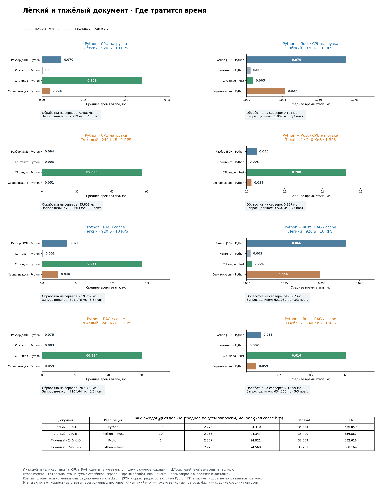
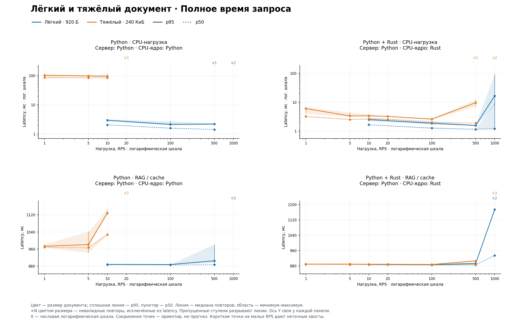
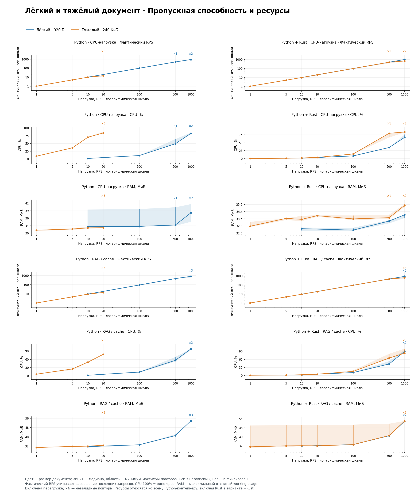
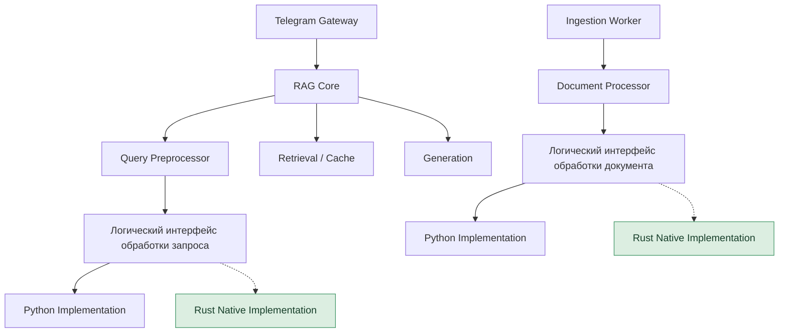

:::warning Ранние исследования
Материал сохранён для истории. При проектировании и реализации опирайтесь на актуальный раздел [«Архитектура»](../../architecture/index.md).
:::

# Архитектурная заметка: когда Python достаточно, а когда оправдан Rust

**Проект:** корпоративный High-Speed RAG / подготовка к хакатону  
**Тип документа:** исследовательское приложение для обсуждения; **не** окончательное решение о стеке  
**Эксперимент:** `20261104T080928.195954Z`  
**Режим стенда:** `rust-decision`  
**Предмет сравнения:** FastAPI/Uvicorn на Python **против того же Python-сервера**, вызывающего Rust-модуль через PyO3  
**Статус выводов:** подтверждены только для конкретного синтетического workload и конфигурации испытания

> **Главный вывод.** Rust в роли нативного CPU-ядра может радикально уменьшить стоимость конкретной вычислительной операции, сохранив Python-архитектуру приложения. Но это не означает столь же большого ускорения полного RAG-запроса и не доказывает необходимости Rust в любом модуле. Решение о переносе следует принимать по профилю **реального** кода, стоимости CPU на запрос, фактической частоте вызовов и влиянию на latency всей системы.

## 1. Почему проводился эксперимент

В Candidate Architecture v1 для хакатонного RAG основным языком выбран Python. Рассматривались и альтернативы с C# и Rust: от полностью Python-реализации до смешанных вариантов. Цель измерений — выяснить, может ли часть вычислительно дорогой работы выполняться на Rust, не вынуждая команду менять FastAPI, RAG Core, интерфейсы модулей и протоколы интеграции.

У теста есть **узкий проверяемый вопрос**: что произойдёт, если заменить конкретную синхронную CPU-функцию `analyze(data: bytes)` с двухпроходным анализом документа на нативную реализацию, сохранив всё остальное? Это не бенчмарк «скорости Python против скорости Rust вообще» и не проверка готового корпоративного RAG.

Отдельная гипотеза для архитектуры: ускорять и оптимизировать локальные CPU-участки можно, **не вводя C# и межсервисное взаимодействие между языками**. Данные данного запуска позволяют оценить Python ↔ Rust, но не позволяют численно сравнить его с ранее испытанным C# — результаты C# в этом наборе отсутствуют.

## 2. Что именно сравнивалось

| Параметр | Условие |
|---|---|
| Онлайн-сервер | Python, FastAPI, Uvicorn |
| Python-реализация | `analyze(data: bytes)` на Python |
| Гибридная реализация | Тот же сервер, `analyze` выполняется Rust через PyO3 (`rag_native`) |
| CPU-лимит приложения | 1 CPU |
| RAM-лимит приложения | 512 MiB |
| Количество Python workers | 1 |
| Лёгкий документ | 920 байт |
| Тяжёлый документ | 245 588 байт (≈240 КиБ) |
| Прогрев каждой точки | 3 секунды |
| Нагрузочная стадия | 10 секунд |
| Повторы | До 3 на точку; отдельные прогоны прекращались после нарушения SLO |
| Нагрузка | Ступени из диапазона 1–1000 RPS |
| Внешние зависимости RAG | Моки, без настоящих Redis/Qdrant/OpenAI/Telegram |
| Длительность запуска | 41 мин 27 с |

Реализации выполняют одинаковый алгоритм и выдают одинаковые выходные данные: число байтов, слов, заголовков, блоков, условных чанков и 32-битную checksum FNV-1a. Две последовательные фазы алгоритма:

1. Проход по строкам — Markdown-заголовки `# ` … `###### ` и блоки непустых строк, разделённых пустыми строками.
2. Проход по байтам — слова по фиксированным ASCII-разделителям, checksum FNV-1a, число условных фрагментов по 1024 байта.

**Что алгоритм не делает:** не строит реальные чанки, не парсит PDF, не извлекает таблицы, не вычисляет embeddings, не запускает токенизатор или ML-модель. Поэтому ускорение относится к **синтетическому сканированию байтов**, а не к качеству и скорости полного Ingestion pipeline.

Документы заранее загружены в оперативную память. Клиент отправляет идентификатор и размер, а не содержание документа. Загрузка файла, передача 240 КиБ по HTTP и извлечение текста из PDF не измерялись. Каждое обращение действительно заново вычисляет результат `analyze`.

В гибриде Python сохраняет HTTP, JSON, проверку запросов, контекст, выбор L2/L3 маршрута, RAG-оркестрацию, асинхронные ожидания и сериализацию. Меняется только внутренний вычислительный участок. **Это Python + Rust, а не отдельный Rust-сервер.**

## 3. Тестовые профили

### 3.1. `CPU-нагрузка`

```text
HTTP → JSON/валидация → контекст → analyze(document) → сериализация → HTTP
```

`analyze` вызывается **на каждом запросе**. Профиль показывает, насколько собственная CPU-функция влияет на стоимость HTTP-запроса и способность сервера обслуживать поток.

### 3.2. `RAG / cache`

```text
HTTP → контекст → mock L2 (2 мс)
                  ├─ hit → ответ
                  └─ miss → mock L3 (30 мс)
                                  ├─ hit → ответ
                                  └─ miss → mock retrieval (50 мс)
                                                   → analyze(document)
                                                   → mock LLM (800 мс)
                                                   → ответ
```

Настройка маршрутов: 20% L2-hit, 10% L3-hit, 70% full RAG. Таким образом, CPU-ядро вызывается только на **70% запросов**, а ожидание моков делает заметную часть времени независимой от языка CPU-функции. Все задержки моков — **условные параметры эксперимента**, а не показатели реальных сервисов.

### 3.3. Важная особенность асинхронности

В обоих вариантах `analyze` вызывается **синхронно из async-обработчика FastAPI**. Пока выполняется функция, поток `event loop` не обслуживает другие задачи этого процесса. В Rust-варианте PyO3 освобождает GIL во время вычисления, но **это не переводит вызов в другой поток и не освобождает event loop**: обработчик продолжает ожидать завершения синхронного вызова. Выигрыш в данном стенде достигается сокращением продолжительности блокировки.

Стенд не сравнивал этот подход с `ProcessPoolExecutor`, отдельным CPU worker, несколькими Uvicorn workers, векторизированными Python-библиотеками и другими нативными реализациями.

## 4. Основные численные результаты

Приведены **медианы по трём валидным повторам**, предоставленные в отчёте запуска. Для времени ядра и среднего времени запроса это медианы средних по отдельным прогонам, **не** статистика единой объединённой выборки.

### 4.1. Чистый CPU-профиль

| Метрика | Python | Python + Rust | Эффект |
|---|---:|---:|---:|
| Лёгкий документ, 100 RPS: `analyze`, мс | 0,349 | 0,00447 | ≈78× быстрее ядро |
| Лёгкий документ, 100 RPS: среднее время запроса, мс | 1,651 | 1,347 | ≈1,23× быстрее запрос; экономия **0,304 мс** |
| Тяжёлый документ, 10 RPS: `analyze`, мс | 83,941 | 0,792 | ≈106× быстрее ядро |
| Тяжёлый документ, 10 RPS: среднее время запроса, мс | 86,082 | 2,719 | ≈31,7× быстрее запрос; экономия **83,363 мс** |
| Тяжёлый документ, 10 RPS: клиентский p95, мс | 94,352 | 3,367 | ≈28× ниже p95 |
| Тяжёлый документ, 10 RPS: CPU контейнера, % | 70,134% | 2,092% | Снижение ≈68 п.п. |

Ключевое наблюдение: **сотни раз быстрее внутренний цикл ≠ сотни раз быстрее сервис**. В лёгком случае абсолютный выигрыш всего запроса составляет лишь около 0,3 мс — остальные стадии никуда не исчезают.

### 4.2. Mock RAG

| Условие | Python | Python + Rust | Интерпретация |
|---|---:|---:|---|
| Тяжёлый документ, 10 RPS: средняя клиентская latency | ≈751 мс | ≈625 мс | Улучшение ≈126 мс / ≈16,8%; ускорение ≈1,20× |
| Тяжёлый документ, 10 RPS: клиентский p95 | ≈1129 мс | ≈889 мс | Улучшение ≈240 мс / ≈21,3%; ускорение ≈1,27× |
| Лёгкий документ, 100 RPS: средняя RAG latency | ≈624 мс | ≈624 мс | Практически без изменения |

RAG-сценарий убедительно показывает эффект разбавления: ожидания L2/L3, Retrieval и LLM могут доминировать над CPU. На лёгком документе устранение микроскопического CPU-участка почти не отражается на полном ответе. На тяжёлом сокращение блокировки event loop полезно не только запросу, который исполнял `analyze`, но и другим одновременно находящимся в обработке запросам.

### 4.3. Почему среднее время LLM в графиках меньше 800 мс

Настроенный `mock LLM` на full-RAG-маршруте ожидает 800 мс. Но приведённые на диаграмме средние значения по **всем запросам**, включая cache hits, составляют около 557–583 мс, что согласуется с тем, что до LLM доходит лишь часть трафика. Поэтому нельзя сравнивать 800 мс настройки мока с усреднённым значением столбца как с ошибкой измерения.

## 5. График №1 — распределение времени по стадиям

<!-- ВСТАВИТЬ ГРАФИК 1: диагностика, CPU и RAG, лёгкий и тяжёлый документы -->



**Как читать:** на каждой панели собственная горизонтальная шкала; непосредственное сопоставление длины столбцов **между разными панелями** некорректно без учёта делений оси. На диаграмме приведены отдельные показательные точки (например, 1/10 RPS), а не все измеренные ступени. Разбор JSON, контекст и сериализация остались Python-операциями; существенно изменяется именно `CPU-ядро`.

Показательные детали с диаграммы:

- `CPU-нагрузка`, тяжёлый документ, 1 RPS: CPU-ядро **≈85,698 мс → ≈0,788 мс**, серверная обработка **≈85,858 мс → ≈0,937 мс**.
- `RAG / cache`, тяжёлый документ, 1 RPS: среднее время CPU-ядра **≈60,424 мс → ≈0,616 мс**, но серверная обработка **≈707,398 мс → ≈631,999 мс**.
- `RAG / cache`, лёгкий документ, 10 RPS: серверная обработка практически одинакова — **≈619,207 мс и ≈619,066 мс**.

Точечные данные с диаграммы и агрегаты в таблицах выше относятся к **разным RPS-ступеням**. Их не следует сравнивать как один экспериментальный случай.

## 6. График №2 — задержка запроса в зависимости от нагрузки

<!-- ВСТАВИТЬ ГРАФИК 2: p50/p95 latency vs RPS; невалидные повторы помечены X -->



**Как читать:** сплошная линия — p95, пунктир — p50, шкала X логарифмическая; цвет обозначает размер документа. Отмеченные `X` повторы не прошли критерии валидности и **не должны превращаться в точки достоверной latency-кривой**. Нельзя экстраполировать оборванную линию до 1000 RPS.

Наблюдения:

- В чистом CPU-профиле тяжёлый Python быстро упирается в предел одного CPU/event loop: 10 RPS валидны во всех трёх повторах, 20 RPS — ни в одном.
- Python + Rust на тяжёлом CPU-профиле успешно прошёл 100 RPS во всех повторах; на 500 RPS — два из трёх. Граница устойчивости около этих точек **ещё не установлена**.
- На лёгком документе разрыв невелик; быстрее исполняемое ядро не отменяет базовых расходов HTTP/клиента.
- На mock RAG важным ограничителем становится путь с ожиданиями. Результаты на высоких RPS нельзя автоматически трактовать как характеристики реального LLM или Telegram.

## 7. График №3 — пропускная способность и потребление ресурсов

<!-- ВСТАВИТЬ ГРАФИК 3: achieved RPS, CPU и RAM, p50/p95 по вариантам -->



**Как читать:** `фактический RPS` не равен подтверждённому *устойчивому* RPS, если генератор пропускал запланированные итерации. CPU измеряется для контейнера с лимитом 1 CPU, а RAM — для контейнера приложения; в варианте +Rust туда входит нативная библиотека. Участки, где линии CPU/RAM растут при почти той же latency, показывают ресурсную цену нагрузки, но не устанавливают универсальный предел.

Тяжёлый чисто Python CPU-профиль при 10 RPS потреблял около 70% доступного CPU; на 20 RPS точка перестала проходить критерии. На той же нагрузке Rust-вариант потреблял около 2%. По данным этого стенда это намного более весомый аргумент, чем один лишь показатель «в 106 раз быстрее функция».

## 8. Почему некоторые линии обрываются и где границы достоверности

Итог запуска:

| Статус | Количество |
|---|---:|
| Запланировано точек | 132 |
| Сохранено измеренных точек | 112 |
| Валидно среди сохранённых | 92 |
| Невалидно среди сохранённых | 20 |
| Пропущено после нарушения SLO | 20 |

Причины невалидности: `generator_dropped_iterations`, `incomplete_arrivals`. Это значит, что при данном сочетании скорости ответов, числа виртуальных клиентов и возможностей генератора не получилось создать полный заданный поток запросов. **Такие прогоны не доказывают latency на целевом RPS**. Остановки контейнеров в сохранённых состояниях были штатными (`OOM=false`, `exit code=0`); ошибок завершённых ответов не отмечено.

Дополнительные ограничения:

1. Сервер и генератор разделяют один Docker-хост; они конкурируют за его ресурсы.
2. Небольшие временные окна (10 с) и три повтора полезны для первичной оценки, но не для окончательных SLO высоконагруженного сервиса.
3. Единственный worker и один CPU — осознанно узкая конфигурация. Нельзя переносить числовые RPS-пределы на многоядерное production-развёртывание.
4. Тест показывает преимущество Rust перед **прямыми Python-циклами**, но не перед NumPy, библиотеками с C/Rust/C++-ядром, multiprocessing и оптимизированными парсерами.
5. Не измеряются реальные PDF/DOCX, сетевые передачи документов, загрузка с диска, реальное качество извлечения текста, эмбеддинги и внешние API.
6. Сложность межъязыковой сборки и сопровождения в этом запуске количественно не оценена.
7. Неизвестна будущая распределённость документных размеров и процент cache miss реального заказчика.

Следовательно, не следует заявлять «наш RAG будет в 100 раз быстрее», «наш предел — 500/1000 RPS» или «Rust всегда быстрее C#». Здесь измерен **один способ оптимизации одного локального CPU-участка**.

## 9. Когда имеет смысл переходить на Rust: практическая модель решения

#### 9.1 Общий принцип

Проведённый эксперимент подтверждает, что Rust может существенно ускорять вычислительно интенсивные операции, реализованные на Python, без замены FastAPI и без вынесения вычислений в отдельный сервис.

Однако применимость Rust определяется не названием модуля, а характером выполняемой операции.

Необходимо различать:

1. **CPU-bound операции** — собственные алгоритмы, циклы обработки текста, обход структур данных и вычисления.
2. **I/O-bound операции** — обращения к Redis, Qdrant, PostgreSQL, внешним API и файловым хранилищам.
3. **Нативные вычисления** — операции, которые уже выполняются оптимизированными библиотеками на C, C++ или Rust, несмотря на использование Python API.

Наибольший потенциальный выигрыш ожидается в первой категории.

Для второй категории замена Python на Rust обычно не устраняет основную причину задержки. Для третьей необходимо сначала оценивать накладные расходы Python-обвязки, а не предполагать, что вычисления выполняются интерпретатором.

**Архитектурное решение:** Python остаётся основным языком реализации. Rust рассматривается как опциональная реализация отдельных вычислительных операций, подключаемая через стабильные интерфейсы.

Это решение не означает обязательного внедрения Rust в проект.

#### 9.2 Ingestion Pipeline — обработка документации

Ingestion отвечает за подготовку и обновление базы знаний.

Предполагаемый процесс:

```text
Получение документа
    ↓
Извлечение текста и структуры
    ↓
Нормализация
    ↓
Структурный чанкинг
    ↓
Формирование метаданных
    ↓
Вычисление эмбеддингов
    ↓
Индексация в Qdrant
    ↓
Публикация новой версии
```

Наиболее перспективными кандидатами для Rust являются собственные алгоритмы:

- Нормализации больших текстов.
- Структурного разбора Markdown.
- Обработки границ таблиц и разделов.
- Чанкинга с учётом ограничений по токенам.
- Извлечения и преобразования метаданных.
- Массового обхода фрагментов и сопоставления структур документа.

В этих операциях возможны многократные проходы по большим массивам данных. Если они реализованы через интерпретируемые Python-циклы, Rust потенциально может уменьшить время обработки и потребление CPU.

При этом не следует автоматически переносить на Rust весь Ingestion Pipeline.

**Ограничения:**

- PDF/DOCX-парсеры могут уже использовать оптимизированный нативный код.
- Библиотеки токенизации могут иметь Rust-ядро.
- Вычисление эмбеддингов обычно выполняется ML-движком, а не Python-интерпретатором.
- Индексация ограничивается также производительностью Qdrant и скоростью передачи данных.
- Качество структурного разбиения и сохранение связей с источником важнее абсолютной скорости чанкинга.

Поскольку Ingestion Worker архитектурно отделён от Online RAG, его оптимизация прежде всего влияет на:

- Скорость подготовки и обновления базы знаний.
- Время до публикации новой редакции документации.
- Потребление вычислительных ресурсов при индексации.
- Конкуренцию за CPU с онлайн-системой при совместном размещении.

Ускорение Ingestion само по себе **не означает уменьшения latency пользовательского RAG-запроса**.

**Предварительное решение:** считать структурную обработку документов одним из первых кандидатов на профилирование и возможный перенос отдельных операций в Rust, если реальная нагрузка это оправдает.

#### 9.3 Online RAG — предварительная обработка пользовательских запросов

Второе потенциальное направление оптимизации — Query Preprocessing перед обращением к кэшу и Retrieval.

В зависимости от фактического задания этот этап может содержать:

- Нормализацию пользовательского текста.
- Токенизацию.
- Определение языка.
- Классификацию намерения пользователя.
- Обнаружение анафорических ссылок.
- Разрешение местоимений с использованием истории диалога.
- Подготовку или расширение поискового запроса.
- Вычисление дополнительных признаков для Guardrails.
- Подготовку фильтров и ограничений поиска.

В отличие от Ingestion, здесь обрабатываются преимущественно короткие тексты, но сами операции потенциально выполняются с высокой частотой.

Поэтому даже небольшая CPU-стоимость одного запроса может оказаться существенной при сотнях или тысячах RPS.

**Однако перспективность Rust различается по операциям.**

| Операция | Потенциал Rust | Обоснование |
|---|---|---|
| Простая нормализация строк | Обычно низкий | Для коротких запросов абсолютная стоимость мала |
| Токенизация | Обычно низкий | Готовые токенизаторы нередко уже используют Rust |
| Определение языка | Зависит от реализации | Возможны как дешёвые эвристики, так и нативные ML-модели |
| Разрешение анафоры | Зависит от алгоритма | LLM-вариант ограничен инференсом; собственный алгоритм может быть CPU-bound |
| Query Rewriting через LLM | Низкий | Основная задержка связана с моделью |
| Intent Guardrails на TF-IDF + Logistic Regression | Обычно низкий–средний | Математические операции могут уже выполняться нативными библиотеками |
| Собственные текстовые эвристики | Потенциально высокий | Многократные проходы и сложные правила могут создавать Python CPU bottleneck |
| Подготовка фильтров Qdrant | Обычно низкий | Формирование небольших структур обычно дёшево |
| Получение контекста из Redis | Низкий | Преобладает обращение к внешней системе |

Из этого следует, что заранее переписывать весь Query Preprocessor на Rust нецелесообразно.

Более рационально сохранить Python-оркестрацию и заменять конкретные вычислительные функции только при подтверждённом выигрыше.

#### 9.4 Частота запросов и CPU-бюджет

Для Online RAG важна не только абсолютная продолжительность одной операции, но и частота её выполнения.

Приближённая потребность в CPU-ресурсах определяется следующим соотношением:

```text
CPU cores ≈ RPS × CPU_time_ms × call_probability / 1000
```

Здесь:

- `RPS` — число поступающих запросов в секунду.
- `CPU_time_ms` — процессорное время одной операции.
- `call_probability` — доля запросов, выполняющих эту операцию.

Если операция выполняется на каждом запросе, `call_probability = 1`.

Пример теоретической потребности в CPU при выполнении операции на каждом запросе:

| CPU на операцию | 100 RPS | 500 RPS | 1000 RPS |
|---|---:|---:|---:|
| 0,1 мс | 0,01 ядра | 0,05 ядра | 0,1 ядра |
| 1 мс | 0,1 ядра | 0,5 ядра | 1 ядро |
| 5 мс | 0,5 ядра | 2,5 ядра | 5 ядер |
| 10 мс | 1 ядро | 5 ядер | 10 ядер |

Это расчётная оценка CPU-бюджета, а не результат проведённого бенчмарка. Она не учитывает дополнительные накладные расходы, неравномерность нагрузки и конкуренцию за ресурсы.

Например, собственная Python-операция стоимостью 5 мс CPU при 1000 RPS требует приблизительно пяти полностью загруженных ядер.

Если оптимизация сократит её до 0,5 мс, потребность снизится приблизительно до половины ядра.

В таком сценарии Rust может оказаться полезен даже тогда, когда уменьшение latency одного запроса составляет лишь несколько миллисекунд.

Если же операция выполняется только на 30% запросов, её ожидаемая стоимость соответственно уменьшается.

**Следовательно, решение о переносе на Rust должно учитывать одновременно:**

1. Стоимость отдельного вызова.
2. Частоту выполнения.
3. Долю CPU-времени в полном запросе.
4. Доступный CPU-бюджет одной реплики.
5. Влияние операции на конкурентную обработку запросов.

#### 9.5 Блокировка event loop и ограничения PyO3

Эксперимент показал отдельную проблему Python Online RAG: дорогостоящая синхронная CPU-операция внутри асинхронного обработчика FastAPI блокирует поток event loop.

Это может увеличивать задержки не только текущего запроса, но и других запросов, обслуживаемых тем же процессом.

В рассмотренном стенде перенос вычислительного ядра в Rust существенно сократил продолжительность блокирующего участка.

Однако необходимо различать два свойства:

- Освобождение GIL во время нативного вычисления.
- Освобождение потока event loop для выполнения других корутин.

Это разные механизмы.

**Синхронный вызов Rust через PyO3 продолжает занимать вызывающий поток до завершения функции**, даже если GIL освобождён.

Поэтому Rust сам по себе не гарантирует неблокирующую обработку длительных вычислений.

Для действительно тяжёлых операций необходимо отдельно рассматривать:

- Вынос вычислений в worker thread.
- Использование process pool.
- Несколько процессов Uvicorn.
- Пакетную обработку.
- Нативное выполнение с корректным освобождением GIL.
- Изменение расположения CPU-операции относительно асинхронного конвейера.

Rust может снизить общую вычислительную стоимость операции, но не заменяет проектирование конкурентного выполнения.

Проведённый эксперимент не сравнивал эти альтернативы, поэтому нельзя приписывать весь полученный выигрыш исключительно преимуществам языка.

#### 9.6 Почему не следует переносить Retrieval, Cache и Generation целиком

Основные операции онлайн-конвейера уже опираются на внешние или нативные системы.

**Retrieval:** поиск, фильтрация и индексирование происходят преимущественно в Qdrant. Замена Python-клиента на Rust сама по себе не ускоряет внутренние алгоритмы Qdrant.

**L2 Cache:** основная стоимость связана с Redis, сетевым обменом, сериализацией и проверками применимости кэшированного ответа.

**L3 Semantic Cache:** векторный поиск выполняется специализированной системой. Если собственная логика сопоставления кандидатов не стала CPU bottleneck, Rust не является очевидной оптимизацией.

**Generation:** при использовании внешнего OpenAI API основную задержку определяет генерация модели и сетевое взаимодействие.

**Telegram Streaming:** скорость обновлений ограничивается особенностями Telegram API, сетью и принятой политикой отправки черновиков. Переход с Python на Rust не устраняет эти ограничения.

Это не означает, что в перечисленных модулях невозможно обнаружить дорогостоящие локальные вычисления. Однако оптимизировать следует именно такие вычисления, а не переписывать весь модуль без измерений.

#### 9.7 Архитектурные последствия

Использование Rust не должно изменять логическую архитектуру Candidate Architecture v1 или её языконезависимые контракты.

Предпочтительная схема:



Пунктиром обозначены опциональные альтернативные реализации.

**Основные принципы:**

1. Контракты определяют входные данные, результат, ошибки и гарантии, а не язык реализации.
2. Python является базовой реализацией.
3. Rust подключается только для конкретного вычислительного участка.
4. PyO3 используется для локальной интеграции без отдельного сетевого сервиса, если это оправданно.
5. Результаты Python и Rust должны быть функционально эквивалентны.
6. Ввод Rust не должен требовать изменения внешнего API RAG Core.
7. Сложность сборки, кроссплатформенность и сопровождение учитываются наравне с производительностью.
8. Отсутствие Rust не должно делать невозможным запуск системы, если для выбранного профиля предусмотрена Python-реализация.

#### 9.8 Когда переход на Rust оправдан

Предлагается следующая предварительная матрица принятия решений.

| Ситуация | Рекомендуемое решение |
|---|---|
| Короткая операция, CPU остаётся свободным | Оставить Python |
| Операция уже работает через оптимизированную нативную библиотеку | Сначала измерить накладные расходы обвязки |
| Дорогие собственные Python-циклы на больших документах | Проверить Rust-прототип |
| Небольшая CPU-операция выполняется на каждом запросе при высоком RPS | Оценить совокупный CPU-бюджет |
| CPU блокирует event loop и увеличивает хвостовые задержки | Проверить Rust и варианты конкурентного исполнения |
| Основная задержка определяется внешним LLM API | Не ожидать значительного выигрыша latency от Rust |
| Ingestion не укладывается в требуемое время обработки | Профилировать стадии и оптимизировать узкое место |
| Rust ускоряет функцию, но почти не влияет на систему | Оценить экономию CPU и стоимость сопровождения |
| Rust усложняет развёртывание без существенного выигрыша | Сохранить Python |

Числовой порог перехода на Rust заранее не фиксируется.

Он должен определяться требованиями конкретного кейса, результатами профилирования и доступными ресурсами.

#### 9.9 Ограничения экспериментальных результатов

Важно отделять подтверждённые наблюдения от архитектурных гипотез.

**Подтверждено проведённым экспериментом:**

- Rust значительно ускорил конкретный синтетический алгоритм обработки байтов.
- На тяжёлом документе CPU-ядро ускорилось примерно в 106 раз.
- В CPU-профиле это заметно сократило задержку всего запроса и расход CPU.
- В Mock RAG выигрыш полного времени ответа оказался существенно меньше из-за ожидания внешних операций.
- PyO3 позволил сохранить Python-сервер и существующий HTTP-интерфейс.

**Пока не подтверждено:**

- Аналогичное ускорение реального PDF/DOCX parsing.
- Значительное ускорение полноценного структурного чанкинга.
- Преимущество Rust над готовыми библиотеками токенизации.
- Ускорение реального Query Preprocessing.
- Ускорение NLP-классификации или LLM-based Query Rewriting.
- Выигрыш при нескольких Python workers.
- Преимущество над оптимизированными Python/NumPy/ONNX-реализациями.
- Экономическая оправданность Rust при реальной нагрузке хакатонного приложения.

Поэтому результаты стенда нельзя трактовать как доказательство необходимости Rust для Ingestion или Online RAG.

Они подтверждают целесообразность **рассматривать Rust как инструмент точечной оптимизации собственных CPU-bound алгоритмов**.

#### 9.10 Итоговое решение для Candidate Architecture v1

**Базовая стратегия: Python-first, Rust-when-measured.**

До получения задания архитектура и контракты проектируются независимо от языка реализации.

После получения задания выбираются необходимые модули и определяются фактические требования к производительности.

Первоначальная реализация может выполняться на Python с использованием готовых оптимизированных библиотек.

После появления работоспособного конвейера необходимо профилировать:

1. Ingestion: собственную структурную обработку и чанкинг больших документов.
2. Online Query Preprocessing: собственные алгоритмы нормализации, анализа контекста и подготовки запроса.
3. Другие вычислительные операции, обнаруженные в ходе измерений.

При обнаружении CPU bottleneck допускается заменить отдельную функцию или вычислительное ядро реализацией на Rust.

При этом сравниваются:

- Время самой операции.
- Влияние на полную latency.
- Устойчивая пропускная способность.
- CPU и RAM.
- Поведение при конкурентной нагрузке.
- Стоимость интеграции и сопровождения.

**Главный вывод:** Rust наиболее перспективен для собственных интенсивных вычислений в Ingestion и потенциально в Online Query Preprocessing. Для остальных компонентов его необходимость должна быть подтверждена профилированием.

Архитектурные границы заранее должны позволять такую замену, но не требовать её.

Это позволяет использовать преимущества Rust там, где они действительно нужны, не усложняя весь RAG-проект преждевременно.

## 10. Что это означает для выбора Python, C# и Rust

### Рабочая гипотеза после эксперимента

**Оставить FastAPI/Python как основной online-контур** и предусмотреть возможность заменить действительно дорогие локальные вычисления на Rust. Это позволяет сохранить знакомые команде Python-инструменты для RAG и ML, модульную архитектуру, существующие контракты и один online-рантайм, не вводя C# ради точечной CPU-оптимизации.

**C# не признан бесполезным или медленным.** В настоящем запуске сравнивались только Python и Python+Rust. Из ранее проведённых отдельных тестов команды следует, что C# может быть быстрее в HTTP-части, но чисел, сопоставимых по данному прогону, в этом источнике нет. Поэтому корректный вывод уже, чем «C# не нужен»: **для измеренного CPU-узкого места C# не потребовался — большой эффект получен локальным Rust-модулем в Python-сервере**.

Вводить C# в production лишь ради предположительной производительности нерационально, пока не показаны: недостаточность оптимизированного Python-контура, выигрыш ASP.NET Core при сопоставимом реальном RAG-workload и выгода, превышающая цену дополнительного стека и интеграционных границ.

### Почему это совместимо с языконезависимыми контрактами

Внешний модульный контракт операции анализа остаётся прежним: вход, результат, ошибки, семантика и инварианты данных. Меняется **внутренняя реализация**. Условно:

```text
RAG / Ingestion → DocumentAnalysis (логический контракт)
                        ├── Python implementation
                        └── Rust implementation (PyO3)
```

Свойства корректности и набор тестовых документов одинаковы. Не надо вводить сетевой микросервис или переписывать DTO ради оптимизации, если CPU-участок может жить внутри одного процесса. При переносе Rust-логики в другой процесс потребовались бы отдельные транспортные решения; в этом эксперименте такой причины не обнаружено.

## 11. Решение для архитектурного обсуждения

**Рекомендация, а не финальная фиксация стека:**

1. Для первоначальной реализации RAG сохранить **Python-first**. Онлайн-контур, интеграции и инфраструктурная оркестрация остаются Python-модулями.
2. В языконезависимых контрактах предусмотреть возможность **замены реализации CPU-heavy операций** без изменения их семантики и публичного API.
3. Не закладывать Rust в обязательный критический путь: добавлять его после профилирования конкретного bottleneck, в особенности больших синхронных циклов, мешающих event loop.
4. Не вводить C# только ради формального статуса «самого быстрого варианта». Рассматривать его отдельно, если реальный профиль покажет выгоду целого ASP.NET online-контура или эксплуатационные причины.
5. После получения точного задания, до реализации, определить обязательные модули; ненужные части максимальной спецификации отметить `OUT_OF_SCOPE` / `DEPRECATED_FOR_CASE`. Во время разработки исключать новые части лишь при необходимости, как уже принято в стратегии команды.
6. Итоговый выбор языка и оптимизаций принимать по реальным документам, проценту попаданий кэша, распределению запросов, p95 и ресурсному бюджету — не по синтетическому коэффициенту ускорения ядра.

### Преимущества Python-first с точечным Rust

- Быстрая разработка и интеграция RAG/ML-модулей.
- Нет дополнительного C# online-сервиса, сети между языками и отдельных межсервисных контрактов.
- Измеренная возможность убрать дорогое CPU-ядро почти целиком из бюджета запроса.
- Сохранение языка и состава внешних контрактов; ограниченный радиус изменений.
- Python fallback возможен, если сохранить эквивалентную реализацию и тесты.

### Недостатки и риски

- Сборка нативной библиотеки, PyO3/Maturin, платформенные wheels, совместимость Python/Rust, CI.
- Различия в управлении памятью и обработке ошибок на границе Python/Rust.
- Rust не делает синхронный обработчик неблокирующим; для долгих вызовов нужны отдельный поток/процесс или изменение модели выполнения.
- В ряде задач собственный Rust уступит готовым зрелым библиотекам по стоимости поддержки, даже если быстрее Python-циклов.
- Выигрыш при моковом RAG не равен выигрышу с реальными Redis/Qdrant/OpenAI, особенно при другом cache-hit rate.

## 12. Что нужно проверить следующим шагом

| Приоритет | Следующая проверка | Зачем |
|---|---|---|
| 1 | Профиль реального Ingestion: PDF/DOCX → извлечение → структура → чанкинг → embeddings | Найти фактические CPU-узкие места и их частоту |
| 1 | Профиль реального Online RAG под 50/150+ RPS с настоящими локальными Redis/Qdrant (без платной LLM для первичного теста) | Не переносить синтетические ограничения на online-контур |
| 1 | Повторить тяжёлые соседние ступени 10–30 RPS Python и 100–750 RPS Rust, контролируя `dropped_iterations` | Уточнить точки деградации, не опираясь на оборванные линии |
| 2 | Проверить 2–4 Uvicorn workers / process pool при одинаковом **общем** CPU-бюджете | Отделить преимущество Rust от недостатков однопроцессной модели |
| 2 | Сравнить Python-native альтернативы для той же операции | Оценить, нужен ли собственный Rust вообще |
| 2 | Вынести генератор нагрузки на другую машину при высоком RPS | Исключить конкуренцию клиента и сервера за ресурсы |
| 3 | При необходимости повторить полный профиль на ASP.NET Core | Оценить C# по честным сопоставимым измерениям |

## 13. Итоговые тезисы для обсуждения команды

- **Доказано:** для конкретного тяжёлого byte-scanning workload Rust через PyO3 ускорил ядро примерно в **106 раз**, резко снизил CPU и p95 CPU-профиля в ограничении 1 CPU / 1 worker.
- **Доказано:** на лёгком документе выигрыш полного CPU-запроса небольшой в абсолютных величинах (**≈0,30 мс**); в mock RAG на лёгком документе разница почти исчезает.
- **Показано на моковом RAG:** при тяжёлом документе Rust уменьшает среднюю клиентскую задержку с **≈751 до ≈625 мс**, а p95 с **≈1129 до ≈889 мс**, несмотря на преобладание ожиданий внешних сервисов.
- **Не доказано:** универсальное ускорение всего RAG, скорость реальных PDF/эмбеддингов, точный предел 1000 RPS, превосходство над оптимизированными нативными библиотеками и бесполезность C#.
- **Предлагаемое архитектурное правило:** сначала Python и измерения; если собственная CPU-работа реально съедает бюджет — сравнить оптимизацию Python и Rust на том же контракте; выбирать по результату **всего запроса и ресурсоёмкости**, а не по ускорению одной функции.

---

## Источники и приложения

**Основной источник:** предоставленный командой отчёт запуска `20261104T080928.195954Z`, `rust-decision`, и три графика из того же прогона. Числовые значения и ограничения воспроизведены из этих материалов; внешние сравнительные бенчмарки не использованы.

**Изображения (пути относительно этого файла):**

- `images/diagnostics_comparison.png` — распределение времени по стадиям;
- `images/latency_comparison.png` — p50/p95 от RPS;
- `images/resources_comparison.png` — RPS, CPU, RAM.

Если приложение заметок не разрешает локальные относительные ссылки, вставить изображения вручную на отмеченные выше места `<!-- ВСТАВИТЬ ГРАФИК ... -->`.
